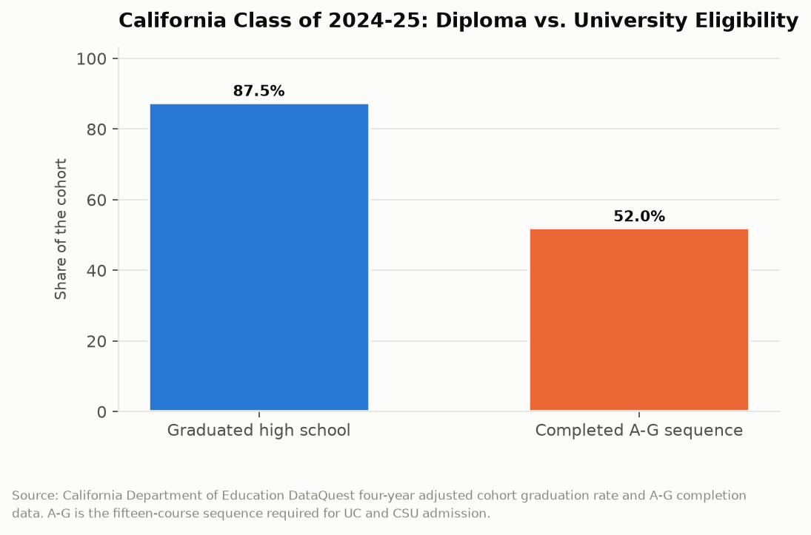
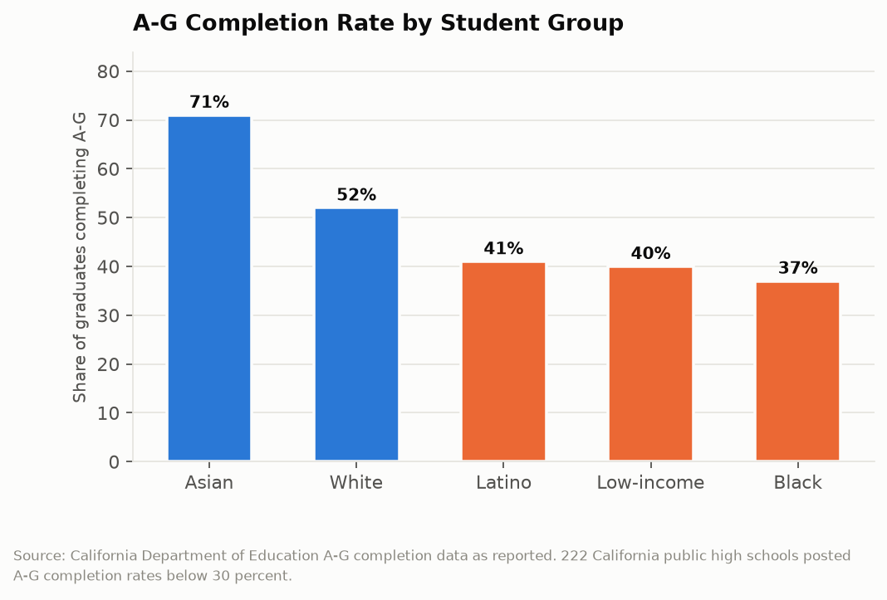

# California Counts: The Diploma That Doesn't Qualify
## California graduated 87.5 percent of its high school seniors and made about 52 percent of them eligible to apply to a state university

California's four-year high school graduation rate reached 87.5 percent for the class of 2024-25, up from 86.4 percent the year before and a record. Admission to the University of California or California State University requires a fifteen-course sequence known as A-G: four years of English, three of math, two each of science, history, and language other than English, and a year each of visual or performing arts and a college-preparatory elective. Just over half of California graduates complete it. The state runs the largest public university system in the world and structures its high school requirements so that roughly half its graduates cannot apply to it.

---

## The Topline: 87.5 Percent and 52 Percent

The two rates come from the same department, the same cohort, and the same data release.

Eighty-seven and a half percent earned a diploma. Just over half, roughly 52 percent, completed the A-G sequence. The gap is about 35 percentage points, which across a cohort of roughly 450,000 California high school seniors means on the order of 155,000 students per year who graduated and are not eligible to apply to a UC or CSU.

The gap is not a mystery of implementation. It is a direct consequence of California maintaining two different standards and requiring only one of them. The state graduation requirement is thirteen courses; A-G is fifteen, with higher course-level specifications in math and science and a minimum grade of C. A district can fully comply with state law, graduate a student in good standing, and leave that student ineligible for the state's own universities.

Some districts have closed this gap by making A-G the default graduation requirement, which converts the question from what a student elected to take into what the district scheduled. Los Angeles Unified adopted that approach. Most districts have not, and the reason is straightforward: making A-G the default raises the bar for graduation, which puts downward pressure on the graduation rate, and the graduation rate is the number that appears on the state accountability dashboard.

---

## Who Completes It

The subgroup breakdown is where the aggregate becomes a distributional finding.

Asian students complete A-G at 71 percent. White students at 52 percent. Latino students at 41 percent. Low-income students at about 40 percent. Black students at 37 percent.

The spread between the top and bottom groups is 34 percentage points, which is nearly identical to the gap between the graduation rate and the A-G rate overall. That coincidence is not meaningful arithmetically but it is useful rhetorically: the distance between graduating and qualifying is about the same size as the distance between California's best-served and worst-served student groups.

Geography reinforces it. In Marin and San Francisco counties roughly two-thirds of students complete A-G. Placer, San Mateo, Santa Clara, and Alameda counties also post relatively high rates. And 222 California public high schools posted A-G completion rates below 30 percent, which means those schools are producing graduates who are, by design of the course schedule available to them, almost entirely ineligible for the state university system.

Two hundred twenty-two schools is the number that identifies this as a supply problem rather than a demand problem. A school cannot produce A-G completers if it does not offer the courses, and offering them requires a credentialed chemistry teacher, a credentialed advanced math teacher, and a credentialed language teacher. This series has examined California's teacher shortage separately. A-G completion is what that shortage looks like measured in college eligibility.

---

## The Counseling Layer

The other constraint is informational and it is cheaper to fix than the staffing one, which is part of what makes the gap frustrating.

A-G is not intuitive. A student who takes four years of math but takes the wrong four years, or who earns a D in a required course, has not completed it and may not learn that until senior year. The sequence has to be planned starting in ninth grade, which requires a student or family to understand the requirement at age fourteen, and requires a counselor to have the time to explain it.

California's student-to-counselor ratio has historically been among the worst in the country. A counselor responsible for 500 students cannot build a four-year course plan with each of them, and the students who most need that plan built are the ones without a parent who navigated the system themselves. The 71 percent completion rate among Asian students and the 37 percent rate among Black students partly reflect differential access to that information, transmitted through families and communities rather than through schools.

The fix that districts have found effective is scheduling rather than counseling: default every student into the A-G sequence and require an opt-out rather than an opt-in. That removes the information requirement entirely. It also requires the district to staff the courses for every student rather than for the subset who ask.

| Student group | A-G completion rate |
|---|---|
| Asian | 71% |
| White | 52% |
| Latino | 41% |
| Low-income | ~40% |
| Black | 37% |
| All graduates | ~52% |
| High schools below 30% completion | 222 |

---

## What the Gap Costs

The consequence is not that 155,000 students per year are barred from higher education. California built the community college system precisely as the alternative path, with 116 colleges, open admission, and transfer agreements to UC and CSU. A student who completes an associate degree for transfer has a guaranteed pathway.

The consequence is that those students take a longer, cheaper, and substantially riskier route. Transfer completion rates from California community colleges are well below the completion rates of students who enter a four-year institution directly, and the attrition is concentrated in the first year. A student who could have been admitted to a CSU as a freshman and instead starts at a community college has a materially lower probability of finishing a bachelor's degree, not because the community college is worse at teaching but because every additional transition point in an educational pathway loses students.

So the A-G gap is best understood as a probability adjustment applied at age eighteen, on the basis of course scheduling decisions made at age fourteen, distributed unequally by race, income, and county. The diploma is real. The option it does not carry is the thing being measured.

---

## The Interpretive Tension

The critical read is that California maintains a high school graduation standard deliberately lower than the admission standard of its own public universities, knows exactly which 222 schools produce almost no eligible graduates, and has left the two standards unreconciled for decades. The state accountability system rewards the graduation rate and reports A-G completion as a secondary indicator, which gives districts a direct incentive to graduate students who cannot apply to college. The subgroup pattern, 71 percent for Asian students and 37 percent for Black students, is the kind of gap the state's equity framework exists to address, and the mechanism producing it is a course schedule, which is among the most controllable variables in public education. Districts that fixed it by defaulting students into A-G proved the fix works and most districts have not adopted it.

The generous read is that A-G completion rose meaningfully over the past decade while the graduation rate also rose, which is the hard combination to achieve, and California is one of very few states that publishes college-eligibility completion at all, let alone by school and subgroup. The state has funded A-G Completion Improvement Grants specifically to help districts expand course offerings, added A-G completion to the accountability dashboard as a College and Career Readiness component, and expanded dual enrollment so high school students can earn college credit directly. A diploma that is not A-G-complete is not a dead end in California, because the community college transfer system exists precisely to serve that student and does so at the lowest tuition in the country. And requiring A-G for graduation would, on the current evidence, reduce the graduation rate, which would harm the students who would not clear the higher bar.

---

## What the Data Doesn't Show

A-G completion is measured among graduates, which means the denominator excludes the students who did not graduate. Completion rates are therefore calculated over a population already filtered by the graduation requirement, and the true share of a ninth-grade cohort that becomes university-eligible is lower than 52 percent.

The data records whether the sequence was completed, not why it was not. A student who never enrolled in chemistry because the school offers one section, a student who enrolled and earned a D, and a student who chose a career technical education pathway instead all appear identically as non-completers. Those are three different situations and only one is a problem.

The published files also do not connect A-G completion to what happened next. California does not publish a linked file following non-completers into community college, the workforce, or neither, which means the central empirical question, whether A-G completion changes outcomes or merely predicts them, cannot be answered from public data. The correlation is strong. The counterfactual is unavailable.

---

Eighty-seven and a half percent of California's seniors got a diploma last spring and about half of them got the option to apply to the universities their parents' taxes fund. The two numbers come from the same data release, on the same day, from the same department. Nothing about the gap is hidden. It has simply never been anyone's job to close it.

---

*Data sources: [CDE A-G Completion Data](https://www.cde.ca.gov/ds/ad/agcompletiondata.asp); [CDE 2024-25 End-of-Year Data Release](https://www.cde.ca.gov/ds/cm/dqeoy25.asp); [CDE Graduation Rate Indicator, California School Dashboard](https://www.cde.ca.gov/ta/ac/cm/dashboardgrad.asp); [CalMatters, These high school classes are a must to get into UC or CSU](https://calmatters.org/education/k-12-education/2026/03/college-admission-california/); [PPIC, College Readiness in California](https://www.ppic.org/publication/college-readiness-in-california/); [CSBA, A look at A-G course completion](https://blog.csba.org/ag-completion/). Graduation and completion rates are as published by CDE; cohort size estimates are approximate.*

*This is installment #172 of California Counts, a data journalism series examining California state programs, spending, and policy through publicly available data. All data and analysis available on request.*

*Disclosure: This post was drafted with the assistance of an AI agent (Claude) and has not been independently verified by a human editor.*
