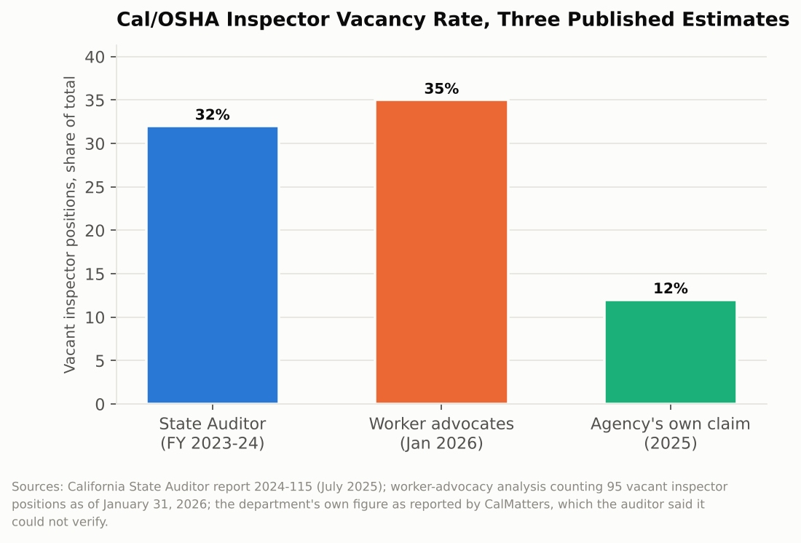
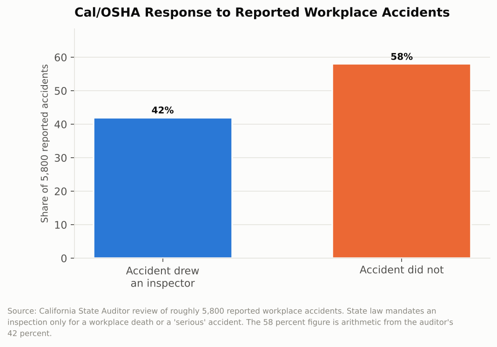
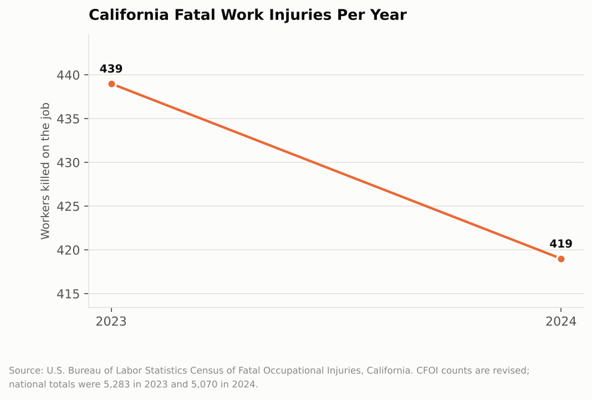

# California Counts: The Inspection That Didn't Happen
## Cal/OSHA is the agency that inspects California workplaces for hazards, and the State Auditor found roughly a third of its inspector positions empty

Four hundred nineteen Californians died on the job in 2024. The agency responsible for preventing those deaths is the Division of Occupational Safety and Health, known as Cal/OSHA, which inspects workplaces, issues citations, and sets the standards that employers are required to follow. In July 2025 the California State Auditor reported that Cal/OSHA had a 32 percent vacancy rate among its inspectors in fiscal year 2023-24. The agency says the figure is now much lower. The auditor said it had not seen data supporting that.

---

## The Topline: Three Numbers for One Vacancy Rate

The most striking feature of this data is that there is no agreed figure for how many Cal/OSHA inspectors exist.

The State Auditor found 32 percent vacant in fiscal year 2023-24, with higher rates in several district offices. The department told CalMatters the rate had since fallen to about 12 percent. A worker-advocacy analysis counting positions as of January 31, 2026 found 95 vacant inspector slots, a rate of roughly 35 percent, and a separate count put field inspector vacancies at 34 percent.

Those are not small discrepancies around a shared number. Twelve percent and 35 percent describe different agencies. The gap is partly definitional, because an agency can count every position in the division while an outside analyst counts only field inspectors, and field inspection is the function that actually visits worksites. But the auditor's position is the one that matters institutionally: it said it had not been shown data supporting the lower figure.

That is the first finding, and it is about information rather than staffing. California cannot currently say, from a source everyone accepts, how many people it employs to inspect its workplaces.

---

## What the Vacancy Produces

The consequence appears in what happens when an accident is reported.

The auditor reviewed roughly 5,800 reported workplace accidents and found that Cal/OSHA deemed 42 percent serious enough to send an inspector. The other 58 percent did not draw a site visit.

That triage is lawful. State law mandates an inspection for a workplace death or a "serious" accident, and the agency has discretion over what clears that bar. But a discretionary standard applied by an agency with a third of its inspector positions empty produces a predictable outcome, which is that the bar rises to meet the staffing. The auditor's finding was not that Cal/OSHA broke a rule. It was that workers were injured and nobody came.

Coverage ratios make the scale concrete. One analysis puts Cal/OSHA at roughly one field inspector for every 99,000 workers, against about one per 84,000 for federal OSHA. California runs its own state plan precisely so it can exceed the federal floor, and on this measure it is below it.

---

## The Deaths the Agency Exists to Prevent

The outcome measure is the count of workers who do not come home.

Four hundred thirty-nine fatal work injuries in 2023. Four hundred nineteen in 2024. The national totals over the same two years were 5,283 and 5,070, so California's decline tracked a national one of similar proportion.

Four hundred nineteen deaths is more than one per day. It is roughly a tenth of California's traffic fatality total, examined earlier in this series, and it occurs in a setting where a specific employer controls the conditions and a specific state agency is charged with checking them. Traffic deaths are distributed across millions of independent drivers. Workplace deaths are distributed across employers that hold permits, carry workers' compensation policies, and can be inspected.

The causal question the data cannot settle is whether the vacancy rate shows up in the death count. Fatalities fell slightly over the two years in which the auditor documented a 32 percent vacancy, which does not support a simple story. Enforcement effects in occupational safety operate with lags and through deterrence rather than through the individual inspection, and the number of workplaces is far larger than the number any inspectorate could visit. A 419 that would have been 380 with full staffing is not observable.

| Measure | Figure |
|---|---|
| Inspector vacancy rate, State Auditor, FY 2023-24 | 32% |
| Field inspector vacancy rate, advocacy count, Jan 2026 | ~35% |
| Vacancy rate claimed by the department, 2025 | ~12% |
| Reported accidents reviewed by the auditor | ~5,800 |
| Share that drew an inspector | 42% |
| Workers per field inspector, California | ~99,000 |
| Workers per field inspector, federal OSHA | ~84,000 |
| California fatal work injuries, 2024 | 419 |

---

## Why the Positions Stay Empty

The vacancy is not a budget authorization problem, which is what makes it harder to fix than it looks. The positions exist and are funded. They are not filled.

A Cal/OSHA safety engineer needs technical competence in construction, industrial processes, or chemical hazards, has to be willing to enter workplaces where they are unwelcome, and is paid on a state civil service scale that competes against private sector safety consulting and against the employers being inspected. This series has examined the state workforce vacancy problem before, and Cal/OSHA is a severe instance of the general pattern: the harder the technical specialty, the wider the gap between the state's pay band and the market.

The recruitment problem compounds through training time. A new inspector is not productive on arrival; the certification and field training period runs long enough that a hiring surge takes years to show up as inspections. An agency that loses a third of its inspectors cannot recover by filling the positions this year, because the people filling them will not be conducting independent complex inspections this year.

That dynamic is why the dispute over whether the rate is 12 or 35 percent matters beyond bookkeeping. If the agency has genuinely recovered, the backlog is a transitional problem. If the field inspection corps is still a third empty, the capability gap is structural and will persist through the next several fiscal years regardless of what the budget authorizes.

---

## The Interpretive Tension

The critical read is that California has a workplace safety agency that cannot staff itself, cannot agree with its own auditor about how badly, and does not send an inspector to the majority of reported workplace accidents. The state has built the most ambitious labor standards regime in the country, covering heat illness, workplace violence prevention, and silica exposure, and has placed enforcement of all of it in a division with roughly one inspector per 99,000 workers, which is thinner than the federal baseline the state plan was supposed to improve upon. A standard that is not inspected is an advisory document. The auditor's 58 percent is the number that describes what the law actually delivers to an injured worker.

The generous read is that Cal/OSHA's standards do most of their work through compliance rather than inspection, and California's standards are genuinely the strictest in the nation, which means an employer here operates under more protective rules than an employer in a federal-plan state regardless of inspection frequency. California's workplace fatality rate is low by national comparison for a state with the largest and most hazardous industrial base in the country. The vacancy problem is a statewide civil service compensation problem rather than a failure specific to this division, and the department reports it has substantially reduced the rate. The auditor's 42 percent triage figure reflects a legal mandate that reserves inspections for deaths and serious accidents, which is a legislative choice about scope, not an agency choosing not to show up.

---

## What the Data Doesn't Show

The vacancy rate depends on which positions are counted, and the published figures do not share a definition. Until the department and the auditor agree on a denominator, no outside analyst can reconcile 12 percent with 35 percent, and both will keep being quoted.

The auditor's 42 percent covers reported accidents. It says nothing about unreported ones. Workplace injuries go unreported for reasons that concentrate in the same workforces that are hardest to protect: workers without documentation, without English, or without a formal employment relationship. The denominator in that chart is itself a product of who felt safe reporting.

Fatality counts come from the federal CFOI program and are revised. They also classify by event rather than by preventability, so the data cannot distinguish a death that a standard would have prevented from one that no inspection regime would have caught.

And nothing published connects an inspection to an outcome. California does not publish an analysis of whether inspected workplaces have fewer subsequent injuries than comparable uninspected ones, which is the evaluation that would tell the Legislature what an additional inspector buys. The state knows what enforcement costs. It has not published what it returns.

---

Four hundred nineteen people went to work in California in 2024 and did not come back, and in the same period the agency charged with preventing that could not establish, to its own auditor's satisfaction, how many inspectors it had. The standards are on the books, the strictest in the country. Fifty-eight percent of reported accidents did not bring anyone out to look.

---

*Data sources: [California State Auditor, Report 2024-115 on the Division of Occupational Safety and Health](https://www.auditor.ca.gov/reports/2024-115); [CalMatters, California OSHA inspectors don't visit worksites even when workers are injured](https://calmatters.org/politics/2025/07/california-osha-inspections-state-audit/); [Cal/OSHA update to the Commission on Health and Safety and Workers' Compensation, September 2025](https://dir.ca.gov/Chswc/Meetings/2025/09-30-2025-Pres-Cal-OSHA-Update.pdf); [U.S. Bureau of Labor Statistics, Fatal occupational injuries in California, 2024](https://www.bls.gov/iif/state-data/fatal-occupational-injuries-in-california-2024.htm); [BLS National Census of Fatal Occupational Injuries, 2024](https://www.bls.gov/news.release/pdf/cfoi.pdf); [California DIR workplace fatal injuries data charts](https://www.dir.ca.gov/dosh/cfoi/data-charts/2023/all-sectors.pdf). Vacancy figures are as published by the respective sources, which do not share a common definition.*

*This is installment #177 of California Counts, a data journalism series examining California state programs, spending, and policy through publicly available data. All data and analysis available on request.*

*Disclosure: This post was drafted with the assistance of an AI agent (Claude) and has not been independently verified by a human editor.*
