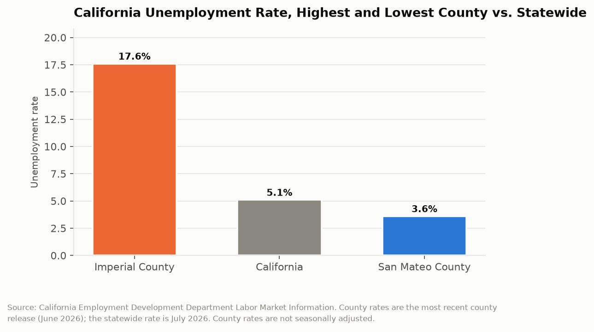

# California Counts: The Two Economies
## Imperial County's unemployment rate is nearly five times San Mateo County's, and both numbers describe the same state

Every month the Employment Development Department publishes an unemployment rate for each of California's 58 counties. The statewide figure gets the headline. The county table gets almost no attention, which is unfortunate, because the statewide number is an average of two labor markets that have almost nothing to do with each other. In the most recent county release, Imperial County's unemployment rate was 17.6 percent. San Mateo County's was 3.6 percent. Those are not two readings of the same economy. They are Spain and Switzerland, inside one state, under one set of labor laws.

---

## The Topline: 17.6, 5.1, and 3.6

The statewide rate is the number that gets reported. The spread is the number that means something.

Imperial County at 17.6 percent. California at 5.1 percent in July 2026. San Mateo County at 3.6 percent. The ratio between the highest and lowest county is 4.9 to 1.

A 17.6 percent unemployment rate is not a recession figure. It is a depression figure. The United States peaked at roughly 14.8 percent in April 2020 and roughly 10 percent during the Great Recession. Imperial County's rate in an ordinary month, in a year with no national downturn, exceeds both. It has been in that neighborhood for decades, through booms and busts, under both parties, across every state economic development program California has tried.

Meanwhile San Mateo County at 3.6 percent is operating below most definitions of full employment, in a labor market where the binding constraint is housing rather than jobs. The two counties are 550 miles apart and in different economic centuries.

---

## Why the Statewide Number Misleads

An average is a reasonable summary when the distribution is unimodal. California's county unemployment distribution is better described as two clusters with a thin middle: coastal metropolitan counties in the three-to-five percent range, and interior agricultural and border counties in the high single digits to high teens.

When the statewide rate moves, the two clusters do not move together or proportionally. A tech hiring slowdown moves San Mateo and Santa Clara and barely touches Imperial. A drought that idles farmland moves Imperial, Fresno, and Colusa and does nothing to San Mateo. The statewide rate averaging to 5.1 percent can describe a month in which one cluster deteriorated and the other improved, and the headline number would show a modest change that happened in neither place.

This has practical consequences beyond reporting accuracy. A substantial amount of California policy is triggered by statewide economic indicators. Budget forecasts, revenue projections, workforce program allocations, and the Legislature's sense of whether the economy needs attention all key off the state aggregate. A state where the aggregate says five percent and one county says 17.6 percent has a policy apparatus calibrated to a condition that a meaningful share of its residents do not experience.

The seasonal dimension compounds it. County rates are published not seasonally adjusted, while the statewide rate is typically reported seasonally adjusted, which means the two numbers are not strictly comparable and the gap in the chart above is partly a methodological artifact. In agricultural counties that artifact is large, because the underlying employment genuinely swings with the growing season. Imperial County's rate is high in every month; it is highest in the months between harvests.

---

## What Structural Means Here

Imperial County's unemployment rate is the clearest example in California of what economists mean by structural rather than cyclical unemployment, and the distinction determines whether any policy can help.

Cyclical unemployment responds to demand. When the economy recovers, the jobs come back, and the appropriate intervention is macroeconomic. Structural unemployment reflects a mismatch between where people are, what skills they have, and where employers are, and it does not resolve with recovery because recovery happens somewhere else.

Imperial County's economy is agriculture, a border crossing, and public sector employment, in a place with extreme summer heat, limited water, and a workforce whose largest employer category has been mechanizing for forty years. The county has roughly 180,000 residents. The jobs that could absorb 17.6 percent unemployment are in Los Angeles and San Diego, two and three hours away, and moving there requires affording housing in markets where the median home price exceeds what a decade of Imperial County wages would buy.

That is the mechanism that makes the gap self-sustaining. California's high-employment counties are also its high-cost counties, which means the labor market that needs workers has priced out the workers who need jobs. The migration that would equalize the rates is blocked by the housing market. This is the same constraint that appears in this series under housing, zoning, and rent control, arriving here as a labor statistic.

| County or area | Unemployment rate | Context |
|---|---|---|
| Imperial County | 17.6% | Highest in California |
| California statewide | 5.1% | July 2026, seasonally adjusted |
| San Mateo County | 3.6% | Lowest in California |
| Ratio, highest to lowest | 4.9 to 1 | |

---

## The Denominator Problem

A county unemployment rate measures people actively seeking work as a share of the labor force, which excludes people who have stopped looking. In counties where unemployment has been high for decades, a substantial share of working-age adults are not in the labor force at all, and they do not appear in the rate.

That makes the 17.6 percent figure an understatement of the gap rather than an overstatement. A county where half the working-age population has left the labor force can post a lower unemployment rate than a county where everyone is still trying, and the first county is in worse shape. The labor force participation rate, published alongside the unemployment rate in EDD's county profiles, is the necessary companion number and almost never appears in coverage.

This is also where the rate interacts with the state's disability and public assistance programs. Long-term structural unemployment migrates into SSI, SSDI, and general assistance caseloads over time, which means the county fiscal picture and the county labor market picture are the same picture viewed through different agencies. The EDD file will not show that connection.

---

## The Interpretive Tension

The critical read is that California has tolerated depression-level unemployment in specific counties for multiple decades while reporting a healthy statewide average, and the state's economic development apparatus has produced no measurable convergence. Imperial County's rate was the highest in the state twenty years ago and it is the highest now. The state has run enterprise zones, workforce investment boards, community college career technical education expansions, and targeted tax credits across that period. The rate did not move. Meanwhile the housing policy that would let workers move to where the jobs are has been blocked county by county in exactly the high-employment jurisdictions that would have to build, which means the two halves of the gap are being maintained by two different sets of policy failures that reinforce each other.

The generous read is that a 4.9 to 1 spread between the extreme counties of a state with 39 million people and enormous geographic diversity is not obviously a policy failure at all. Imperial County is a desert agricultural economy on an international border with 180,000 people; San Mateo County contains the headquarters of several of the largest companies on earth. No policy available to a state government can make those two places have similar labor markets, and the ones that tried, like enterprise zones, were eliminated because evaluations found they mostly relocated jobs rather than creating them. California publishes county-level labor data monthly, for all 58 counties, with labor force participation and industry detail, which is more granular economic reporting than most states produce and is precisely what allows the gap to be identified at all. The state also runs the transfer programs that make a 17.6 percent unemployment rate survivable rather than catastrophic.

---

## What the Data Doesn't Show

County unemployment rates are modeled estimates, not counts. EDD produces them through the federal Local Area Unemployment Statistics program, which combines survey data, unemployment insurance claims, and statistical models. In small counties the confidence intervals are wide, and month-to-month movements of less than a point should not be read as real.

The rates exclude people who have left the labor force, exclude the underemployed working part-time involuntarily, and exclude undocumented workers in ways that are difficult to characterize. In agricultural counties with large undocumented workforces, the measured labor force is not the actual workforce, and the direction of the resulting bias is not obvious.

County rates are not seasonally adjusted while the statewide rate typically is, so any direct comparison of the two, including the chart in this post, mixes methodologies. And the file records the rate, not the cause. Nothing in the EDD data distinguishes a county with 17.6 percent unemployment because a plant closed from one with 17.6 percent unemployment because the structure of its economy has not changed since 1960.

---

Imperial County has had the worst labor market in California for as long as California has been measuring county labor markets, and the statewide average has never once reflected it. The data to see this has been published every month for decades, county by county, free to download. The gap is not a discovery. It is a standing condition that the headline number is structurally unable to report.

---

*Data sources: [EDD Labor Market Information, Unemployment Rate and Labor Force](https://labormarketinfo.edd.ca.gov/data/unemployment-and-labor-force.html); [EDD Industry Employment and Unemployment Rates for Counties](https://labormarketinfo.edd.ca.gov/data/industry-employment-and-unemployment-rates-for-counties.html); [EDD Monthly Data Release](https://labormarketinfo.edd.ca.gov/data/monthly-data-release.html); [EDD Imperial County Profile](https://labormarketinfo.edd.ca.gov/geography/lmi-by-county.html); [Federal Reserve Bank of St. Louis, Unemployment Rate in Imperial County](https://fred.stlouisfed.org/series/CAIMPE5URN); [USAFacts California unemployment](https://usafacts.org/answers/what-is-the-unemployment-rate/state/california/). County rates are not seasonally adjusted; the statewide rate is as published by EDD.*

*This is installment #164 of California Counts, a data journalism series examining California state programs, spending, and policy through publicly available data. All data and analysis available on request.*

*Disclosure: This post was drafted with the assistance of an AI agent (Claude) and has not been independently verified by a human editor.*
