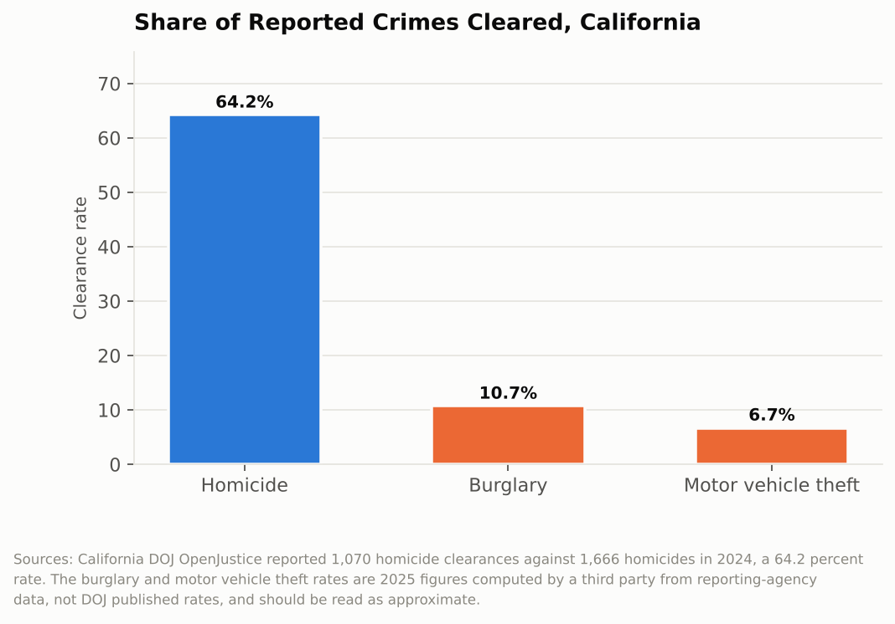
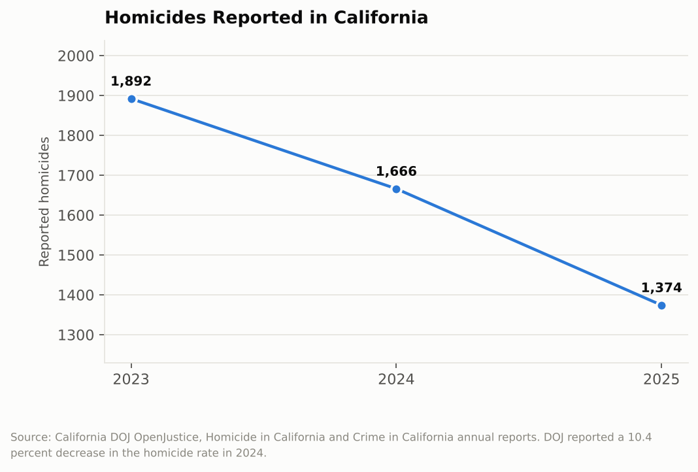

# California Counts: The Cases That Close
## California cleared 64 percent of its homicides and roughly 11 percent of its burglaries, and the gap describes what the system is actually built to do

A crime is cleared when an arrest is made or when the case is closed by exceptional means, such as the death of the suspect. The clearance rate is the share of reported crimes that reach that point, and it is the closest thing the criminal justice system has to a completion statistic. California's Department of Justice publishes it through OpenJustice, its public criminal justice data portal. In 2024 the state cleared 1,070 of 1,666 reported homicides, a rate of 64.2 percent. The clearance rate for burglary runs around a tenth of that.

---

## The Topline: 64 Percent, 11 Percent, 7 Percent

The spread across offense types is the finding, and it is enormous.

Homicide at 64.2 percent, from the DOJ's own 2024 counts. Burglary at roughly 10.7 percent and motor vehicle theft at roughly 6.7 percent, computed from reporting-agency data for 2025 by an outside analyst rather than published as DOJ rates, and therefore approximate.

A homicide in California is about six times more likely to be cleared than a burglary and roughly ten times more likely than a stolen car. That ratio is not a California anomaly; it holds across American jurisdictions and has for decades. But the magnitude is worth stating plainly, because the public conversation about crime rarely distinguishes between the crime being reported and the crime being solved, and these numbers say those are nearly separate systems.

For the overwhelming majority of property crimes in California, the police report is the end of the process rather than the beginning. The report exists because an insurer requires one, because a landlord requires one, or because the victim wanted the event recorded. It very rarely precedes an arrest.

---

## Why Homicide Is Different

The clearance gap is not a measure of effort distributed unfairly. It is a measure of what the investigative method can do.

A homicide produces a body, a scene that is held and processed, a medical examiner's report, and in most cases a victim with a known relationship history. Detectives are assigned individually, work the case for weeks, and have access to phone records, surveillance footage, and witnesses who can be compelled. Most homicides are committed by someone known to the victim, which means the suspect pool is often small from the first day.

A burglary produces a broken window and an absent homeowner. There is frequently no witness, no recoverable forensic evidence worth the cost of processing, no relationship between offender and victim to narrow the field, and a property loss that does not justify weeks of detective time against a caseload of hundreds. The case is not unsolvable in principle. It is unsolvable within the resources any department allocates to it.

That allocation is itself a choice, and it is the choice the clearance data makes visible. California police departments concentrate investigative capacity on violent crime because the public, the courts, and the political system all demand it. The property crime clearance rate is the residual.

---

## Against a Falling Crime Rate

The clearance figures sit inside a period of substantial decline in the underlying crime counts, which complicates every simple reading.

One thousand eight hundred ninety-two homicides in 2023. One thousand six hundred sixty-six in 2024, which DOJ reported as a 10.4 percent decrease in the homicide rate. One thousand three hundred seventy-four in 2025.

That is a 27 percent decline in reported homicides across two years. California's property crime rate reached its lowest level since at least 1985, and motor vehicle theft fell 16.8 percent in 2024, the first annual decrease since 2019.

A falling crime count should, mechanically, make clearance easier: the same investigative capacity spread over fewer cases. Whether it has is not answerable from the published data, because DOJ's clearance tables and its crime tables are produced on different schedules and the clearance rate for 2025 was not in the reports examined here. The hypothesis is testable and the state has the data to test it. It has not published the test.

| Measure | Figure |
|---|---|
| Homicides reported, 2023 | 1,892 |
| Homicides reported, 2024 | 1,666 |
| Homicides reported, 2025 | 1,374 |
| Homicide clearances, 2024 | 1,070 |
| Homicide clearance rate, 2024 | 64.2% |
| Burglary clearance rate (third-party estimate) | ~10.7% |
| Motor vehicle theft clearance rate (third-party estimate) | ~6.7% |

---

## What Cleared Does Not Mean

The word doing the most work in this analysis is "cleared," and it does not mean what most readers assume.

A clearance by arrest requires that a suspect be arrested and turned over for prosecution. It does not require a charge, a conviction, or a correct identification. A case cleared by arrest in which the district attorney declines to file remains cleared. A case cleared by arrest that ends in acquittal remains cleared. The statistic measures the end of police investigative activity, not the delivery of justice.

Clearance by exceptional means covers cases where the offender is identified but cannot be arrested: the suspect died, is in custody elsewhere, or the victim declines to cooperate. Jurisdictions vary in how aggressively they use the category, and the variation is not auditable from published data.

That matters for the 64.2 percent. It is the share of homicides where police investigative work concluded with an identified suspect, which is a meaningful and hard-won number. It is not the share of homicides where someone was convicted of the killing, which is lower and which California does not publish in a form connected to the clearance data.

---

## The Interpretive Tension

The critical read is that California operates a criminal justice system in which roughly nine out of ten burglaries and more than nine out of ten car thefts end with no one identified, which means the practical consequence of committing a property crime in California is close to nothing. The state spends heavily on policing and on corrections, examined repeatedly in this series, and the clearance data shows where that spending does and does not produce resolution. Meanwhile the quality of the public data is uneven: homicide clearance is published clearly, property crime clearance has to be computed by outsiders from agency submissions, and the state does not publish a conviction rate connected to either. A system that cannot say what share of reported crimes result in a conviction cannot evaluate itself.

The generous read is that a 64.2 percent homicide clearance rate is at or above the national average and was achieved while homicides fell 27 percent in two years, which is the combination that is hardest to produce and the one that matters most to public safety. Property crime clearance is low everywhere in the developed world because the investigative economics are the same everywhere, and California's property crime rate is nonetheless at its lowest level since at least 1985, which suggests that prevention, deterrence, and changing opportunity structures are doing work that clearance rates do not capture. California publishes OpenJustice, a public criminal justice data portal with agency-level detail that most states do not approach, and the fact that an outside analyst could compute burglary clearance at all is a function of that transparency.

---

## What the Data Doesn't Show

Clearance rates are computed from crimes reported during a period and clearances recorded during the same period, including clearances of crimes from prior years. The ratio is therefore not a cohort measure, and a department that closes a backlog can post a clearance rate that overstates its performance on current cases.

The property crime figures in this post are not DOJ published rates. They are computed by a third party from reporting-agency submissions for 2025 and should be treated as approximate. California DOJ publishes crimes and clearances tables, but the state does not produce a clean annual summary of clearance by offense type in the way it produces one for crime volume, which is why the authoritative version of the central comparison in this post does not exist in a single public document.

Reporting itself is the unexamined denominator. Clearance measures resolution of reported crimes, and crimes go unreported at rates that vary enormously by offense and by community. A neighborhood that has concluded reporting a burglary accomplishes nothing produces fewer reports and, mechanically, can produce a better-looking clearance rate.

And nothing in the clearance data connects to what happened afterward. California does not publish a linked series following cleared cases into charging, conviction, and sentence. The state knows how many cases its police closed. It does not publish how many of those closures were right.

---

Sixty-four percent of California's killings end with someone identified, and roughly ninety percent of its burglaries end with a case number and nothing else. Both figures have been roughly stable for decades, in good years and bad, under every crime policy the state has tried. The clearance rate is the one statistic that describes what the system does rather than what it is asked to do, and it is the one least often quoted.

---

*Data sources: [California DOJ OpenJustice, Crime in California 2024](https://data-openjustice.doj.ca.gov/sites/default/files/2025-07/Crime%20In%20CA%202024%20final.pdf); [Homicide in California 2025](https://data-openjustice.doj.ca.gov/sites/default/files/2026-07/Homicide%20In%20CA%202025f.pdf); [Homicide in California 2024](https://data-openjustice.doj.ca.gov/sites/default/files/2025-07/Homicide%20In%20CA%202024%20final.pdf); [DOJ Crimes and Clearances context document](https://data-openjustice.doj.ca.gov/sites/default/files/stats/2025-07/Crimes-Clear-Arson%20Context_06162025.pdf); [Public Policy Institute of California, Overall Crime in California Fell Last Year](https://www.ppic.org/blog/overall-crime-in-california-fell-last-year-but-shoplifting-continued-to-rise/); [Bureau of Justice Statistics, Crime Known to Law Enforcement 2024](https://bjs.ojp.gov/document/ckle24.pdf). Homicide figures are DOJ published counts; property crime clearance rates are third-party computations from agency data and are approximate.*

*This is installment #178 of California Counts, a data journalism series examining California state programs, spending, and policy through publicly available data. All data and analysis available on request.*

*Disclosure: This post was drafted with the assistance of an AI agent (Claude) and has not been independently verified by a human editor.*
