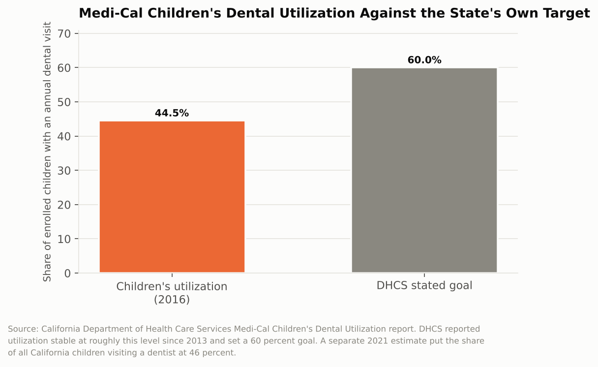
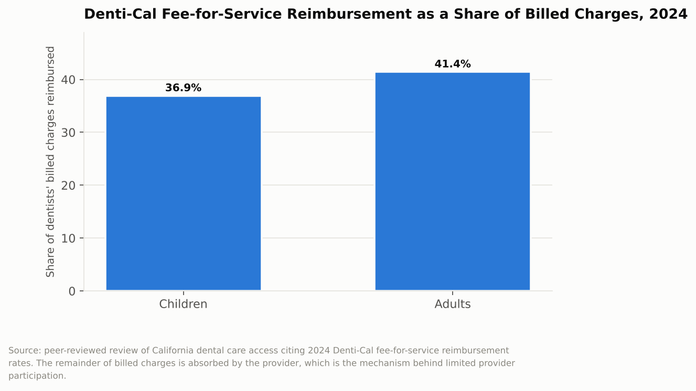

# California Counts: The Dental Benefit
## Medi-Cal covers dental care for roughly 15 million Californians, and fewer than half the children enrolled see a dentist in a year

Medi-Cal's dental program, universally called Denti-Cal, is a covered benefit. Enrollment confers entitlement to cleanings, fillings, extractions, and for children a schedule of preventive care that the program's own guidance treats as the standard of care. The Department of Health Care Services reported children's dental utilization at 44.5 percent and set itself a target of 60 percent. The gap between a benefit and a visit is the entire subject of this installment.

---

## The Topline: 44.5 Percent Against a 60 Percent Goal

The state publishes both the performance and the target, which makes this one of the rare cases where a program's own standard is available for comparison.

Children's dental utilization at 44.5 percent, which DHCS reported as essentially stable since 2013. The department's stated goal is 60 percent annual utilization among Medi-Cal enrolled children. The shortfall is 15.5 percentage points, and it has not been closing.

A separate estimate put the share of all California children who visited a dentist in 2021 at 46 percent, which is in the same range and suggests the Medi-Cal population is not dramatically behind the state as a whole on this measure. That is a genuinely important qualification: the dental access problem in California is not confined to Medi-Cal, and a comparison that only looks at the Medi-Cal number will misattribute a general failure to a specific program.

Stability is the detail worth sitting with. A rate that held near 44 percent from 2013 through the most recently reported years spans a period that included the Affordable Care Act expansion, the addition and removal and re-addition of the adult dental benefit, substantial rate increases funded by Proposition 56 tobacco tax revenue, and a pandemic. The number did not move.

---

## The Rate Mechanism

The most direct explanation is what the program pays, and California publishes it in a form that makes the problem legible.

Denti-Cal fee-for-service reimbursement in 2024 ran at 36.9 percent of dentists' billed charges for children and 41.4 percent for adults.

A dentist who treats a Denti-Cal patient under fee-for-service collects something on the order of forty cents on the dollar of what that dentist bills. The remainder is absorbed by the practice. Dentistry in California is overwhelmingly delivered by small private practices with high fixed costs: a leased suite, chairs, imaging equipment, a hygienist, and a front office. A practice can absorb some share of below-cost patients. It cannot build a business on them.

The consequence is a participation problem rather than a coverage problem. The child is enrolled. The benefit exists. The appointment does not, because within a reasonable distance there are few practices accepting new Denti-Cal patients, and the ones that do operate with wait times that defeat the purpose of preventive care.

This is the same mechanism this series documented in Medi-Cal's medical benefit, where low physician reimbursement produces specialist access problems for enrollees who are nominally covered. Dental is the sharper version because dentistry has no equivalent of the emergency department obligation. A hospital must stabilize anyone who arrives. A dental practice may simply decline.

---

## Where the Untreated Cavity Goes

Dental disease does not resolve by being ignored, and the costs of not treating it reappear in more expensive parts of the same state budget.

Untreated dental caries in children produce pain, which produces school absence, which this series examined under the chronic absenteeism data. They produce infection, which in a minority of cases becomes serious. And they produce emergency department visits for dental pain, which are among the clearest examples of a system paying more to do less: an emergency department can prescribe antibiotics and analgesics for a dental abscess and cannot treat the tooth, so the patient returns.

California has the data to quantify that pathway. HCAI collects emergency department encounter data with diagnosis codes, DHCS holds the dental claims, and the state could in principle report how many Medi-Cal emergency department visits are for conditions a dentist should have handled, and what they cost. That analysis is not published in a form that would let the Legislature compare the cost of the visits against the cost of raising the reimbursement rate.

| Measure | Figure |
|---|---|
| Children's dental utilization | 44.5% |
| DHCS stated utilization goal | 60% |
| Share of all California children visiting a dentist, 2021 | 46% |
| Denti-Cal FFS reimbursement, children, 2024 | 36.9% of billed charges |
| Denti-Cal FFS reimbursement, adults, 2024 | 41.4% of billed charges |

---

## Two Delivery Systems, One Benefit

Denti-Cal is administered in two ways, and the split is a natural experiment the state has not fully exploited.

Most of the state runs fee-for-service, where the provider bills DHCS directly at the published rate. Sacramento and Los Angeles counties have operated dental managed care, where plans receive capitation and contract with provider networks. The two arrangements produce different incentives: fee-for-service pays per procedure and rewards volume, while capitation pays per enrollee and rewards keeping people out of the chair, which can mean prevention or can mean non-treatment depending on the plan.

DHCS publishes fact sheets tracking utilization under both arrangements, and a Los Angeles County-specific fact sheet exists for the managed care population. The state also maintains a Dental Utilization by Provider dataset on the open data portal, with beneficiary and service counts by rendering provider for recent calendar years, which is the file that would let an analyst determine how concentrated participation actually is.

The question that dataset could answer, and that the published fact sheets do not, is what share of Denti-Cal's volume is delivered by what share of its providers. If a small number of high-volume clinics are carrying most of the program, the access problem is a geographic one and the fix is clinic siting. If participation is broad but shallow, the fix is the rate. Those call for different legislation and the public data has the material to distinguish them.

---

## The Interpretive Tension

The critical read is that California guarantees dental coverage to roughly 15 million people, pays providers about forty cents on the dollar, and then reports as a performance metric that fewer than half of enrolled children get a visit. The state set its own 60 percent goal and has missed it for more than a decade without the number moving, which suggests the interventions tried, including the Proposition 56 rate supplements, were too small to change provider economics. The result is a benefit that exists on the enrollment card and not in the community, and the burden falls on exactly the children for whom a preventable cavity is most likely to become an emergency department visit, a missed school day, and eventually an extraction.

The generous read is that California restored and has maintained a comprehensive adult dental benefit that many state Medicaid programs do not offer at all, covering a population larger than most states' entire Medicaid enrollment. The children's utilization gap is substantially a national and even universal dental access problem rather than a Medi-Cal failure: 46 percent of all California children saw a dentist in 2021, which is close to the Medi-Cal figure and indicates that insurance status is not the binding constraint. California directed Proposition 56 tobacco tax revenue specifically into dental provider payments, publishes utilization fact sheets and a provider-level dataset that let outsiders audit the program, and set a public numerical target, which is more accountability than most benefit programs accept.

---

## What the Data Doesn't Show

The headline utilization figure in this post is from a DHCS report describing a rate stable since 2013, and more recent fact sheets present the measure in ways that are difficult to reconcile against it. One February 2026 DHCS fact sheet appears to show a fee-for-service annual dental visit rate for ages 0 through 20 of about 18 percent for calendar year 2024, which is far below the other published figures and almost certainly reflects a different denominator, a different delivery system, or a different measure definition. The series does not publish a single reconciled utilization number, and that is a real obstacle to oversight.

Utilization counts a visit. It does not count whether the visit delivered what the child needed. A sealant placed, a cavity filled, and an extraction performed are all one visit.

The reimbursement percentages compare payment to billed charges, and billed charges are set by dentists rather than tied to cost. A program paying 40 percent of billed charges may be paying more or less than 40 percent of actual cost, and California does not publish a cost-based comparison that would settle it.

And the provider dataset reports who delivered services, not who declined to. There is no published count of dentists licensed in California who do not accept Denti-Cal, which is the number that would describe the access problem most directly.

---

Fifteen million people hold a dental benefit, the state pays about forty cents on the dollar for it, and fewer than half the children enrolled see a dentist in a year. The gap between those facts has been stable for more than a decade, through a coverage expansion, a rate supplement, and a pandemic. California set itself a target of 60 percent and has published its distance from it, annually, without closing it.

---

*Data sources: [DHCS Medi-Cal Children's Dental Utilization Report](https://www.dhcs.ca.gov/wp-content/uploads/2026/05/Medi-Cal_Children27s_Dental_Utilization_Rept.pdf); [DHCS Dental Fee-for-Service and Dental Managed Care fact sheet](https://www.dhcs.ca.gov/uk/wp-content/uploads/2026/05/FFS-DMC-Fact-Sheet-February-2026.pdf); [DHCS Medi-Cal Dental Services Los Angeles County fact sheet](https://www.dhcs.ca.gov/wp-content/uploads/2025/10/LASH-Fact-Sheet-May-2024.pdf); [DHCS Proposition 56 Dental Directed Payment Program evaluation](https://www.dhcs.ca.gov/services/Documents/DirectedPymts/CY2023-Prop-56-Dental-Evaluation.pdf); [Dental Utilization by Provider dataset (CHHS Open Data Portal)](https://data.chhs.ca.gov/dataset/dental-utilization-per-provider); [Opportunities to Address Healthy People 2030 Dental Care Access Challenges in California, Journal of the California Dental Association](https://www.tandfonline.com/doi/full/10.1080/19424396.2025.2483732). Utilization and reimbursement figures are as published by the respective sources, which use differing measure definitions.*

*This is installment #180 of California Counts, a data journalism series examining California state programs, spending, and policy through publicly available data. All data and analysis available on request.*

*Disclosure: This post was drafted with the assistance of an AI agent (Claude) and has not been independently verified by a human editor.*
