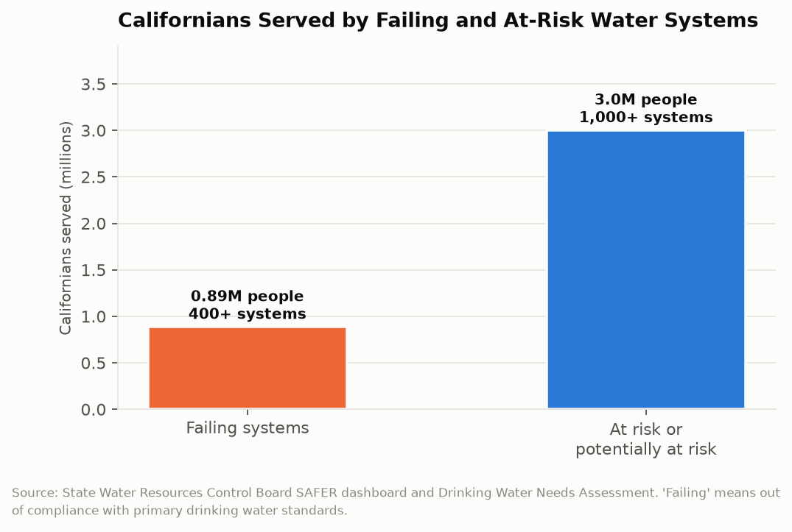

# California Counts: The Tap That Fails
## More than 400 water systems serving 885,000 Californians cannot meet drinking water standards, and the state publishes a map of every one of them

In 2012 California became the first state in the nation to declare a human right to water, establishing in statute that every resident has a right to safe, clean, affordable, and accessible water for consumption, cooking, and sanitation. In 2017 the State Water Resources Control Board began publishing a list of the water systems that fail to deliver it. The list currently has more than 400 systems on it, serving 885,000 people. Another 1,000-plus systems, serving more than 3 million Californians, are classified as at risk or potentially at risk. The state knows the name and location of every one.

---

## The Topline: 885,000 Now, 3 Million Next

The SAFER dashboard, the Water Board's public tracking system for drinking water compliance, produces two numbers that should be read together.

More than 400 failing systems serving 885,000 people. More than 1,000 additional systems serving more than 3 million people classified as at risk or potentially at risk of failure. Nearly four million Californians, roughly one in ten residents, are served by a water system that either cannot currently meet primary drinking water standards or is on a trajectory toward not being able to.

Failing has a specific regulatory meaning here. It means the system is out of compliance or consistently fails to meet primary drinking water standards, which are the enforceable health-based limits on contaminants like arsenic, nitrate, hexavalent chromium, and 1,2,3-trichloropropane. It does not mean the water tastes bad. It means the water exceeds a concentration that the state has determined presents a health risk over sustained consumption.

More than half of the failing systems are in disadvantaged communities. Two-thirds serve populations that are majority people of color. That distribution is the finding that turned this from a water quality issue into an environmental justice issue and is the reason the Water Board publishes the demographic overlay alongside the compliance data.

---

## Why the Systems Are Small

The structural fact that explains most of this list is that California has a lot of water systems, and most of the failing ones are tiny.

California has roughly 7,400 public water systems. A few hundred serve most of the population; the Metropolitan Water District wholesales to 19 million people. The long tail consists of systems serving a few hundred or a few thousand customers each: a mobile home park, an unincorporated farmworker community, a school with its own well, a small rural district formed in the 1950s when a few dozen families pooled money for a pump.

Those systems fail for reasons that have nothing to do with negligence and everything to do with arithmetic. Removing arsenic or nitrate requires a treatment plant. A treatment plant has a minimum viable cost that does not scale down below a certain size. Spreading that cost across 300 connections produces a monthly bill that the community cannot pay, and spreading it across 30,000 connections produces a bill nobody notices. A system with 300 connections also cannot afford a full-time certified operator, cannot afford an engineer, and often cannot afford a grant writer to apply for the money the state has appropriated to help it.

That last point is the quiet one. California has committed substantial funding to drinking water improvements, including a dedicated Safe and Affordable Drinking Water Fund. The systems that need it most are the least equipped to obtain it, because the application process assumes administrative capacity that a 300-connection district does not have. The state has responded by funding technical assistance providers to help small systems apply, which is a program to help communities apply for a program.

---

## Consolidation as the Actual Policy

The Water Board's operative theory of the case is that most failing systems should stop existing as independent entities and be absorbed into larger neighboring systems. California has given the board authority to mandate consolidation in specified circumstances, which is a significant expansion of state power over local water governance.

The logic is sound. A failing 300-connection system adjacent to a functioning 30,000-connection system can be fixed by a pipe and a merger, at a fraction of the cost of building it a treatment plant. The board has facilitated dozens of these consolidations.

The obstacles are political and they are not trivial. The receiving system's existing ratepayers inherit a liability: aging pipes, a customer base with lower ability to pay, and capital needs the prior system deferred for decades. Their board has a fiduciary duty to those existing ratepayers. The failing system's residents, meanwhile, lose local control over a resource that in many California communities is the most important thing their local government does. Consolidation is the correct technical answer and a genuine loss of self-governance for the community being consolidated, and the state's mandatory authority means that loss can be imposed.

| Category | Systems | People served |
|---|---|---|
| Failing | 400+ | 885,000 |
| At risk or potentially at risk | 1,000+ | 3,000,000+ |
| Total California public water systems | ~7,400 | ~39,000,000 |

---

## What the Human Right Obligates

The 2012 human right to water statute is a declaration of state policy, not an individually enforceable entitlement, and the difference is where the interesting legal and civic question lives.

A resident of a community with arsenic in the water cannot sue the state and win an order compelling delivery of clean water tomorrow. What the statute does is require state agencies to consider the human right to water in their decisions, which has moved the Water Board's priorities, generated the Needs Assessment and the SAFER dashboard, and justified the funding programs. The declaration produced measurement, and the measurement produced a list, and the list produced accountability of the reputational rather than the legal variety.

That is not nothing. Before 2017 the state could not have told you how many Californians drank noncompliant water. Now it publishes the count, the systems, the contaminants, and the demographics, updated continuously, on a public dashboard. The gap between the declared right and the delivered service is quantified by the state itself, which is an unusual thing for a government to do about its own failure.

It is also fourteen years into a declared right, with 885,000 people still on the wrong side of it.

---

## The Interpretive Tension

The critical read is that California declared a human right to water in 2012 and, fourteen years later, 885,000 residents still receive water that fails health standards, with another three million in systems the state's own analysis says are heading the same way. The burden falls overwhelmingly on poor communities and communities of color, which means the practical content of the right depends on which community a person lives in. The state's chosen remedy, consolidation, imposes governance losses on the affected communities rather than on the systems and regulatory structures that let 7,400 separate water utilities proliferate in the first place. And the funding architecture requires the least capable systems to compete for grants, a design that predictably delivers money to the applicants with the best staff rather than the residents with the worst water.

The generous read is that California is the only state in the country that can produce these numbers, because it is the only state that built the measurement system that generates them. The 400 failing systems are not new failures; they are longstanding failures that were invisible until the state decided to count them and publish the count with names attached. Consolidation is genuinely the cheapest path to clean water for most of these communities, and the state took the politically costly step of giving itself mandatory authority to force it. Hundreds of millions of dollars have moved through the Safe and Affordable Drinking Water Fund, the failing list is actively worked rather than static, and systems come off it. A state that publishes a live dashboard of its own noncompliance, with the demographic breakdown that makes the inequity undeniable, is behaving like a government that intends to fix the problem.

---

## What the Data Doesn't Show

The SAFER dashboard covers public water systems. It does not cover private domestic wells, which serve an estimated one to two million Californians and are not regulated for water quality at all. A household on a private well with nitrate contamination from adjacent agriculture appears nowhere in these numbers. The failing-systems count is therefore an undercount of Californians drinking unsafe water, and the size of the undercount is unknown.

Compliance is measured against enforceable maximum contaminant levels, which are set for a limited list of regulated contaminants. Substances without an established standard, including most PFAS compounds until recently, do not cause a system to fail no matter the concentration. The list measures compliance with the standards that exist.

The at-risk classification is a model output, combining water quality, financial capacity, and operational indicators to predict future failure. It is a prediction, and the dashboard does not publish the model's historical accuracy, so there is no public basis for knowing how many of the three million at-risk residents will actually end up on the failing list.

---

Fourteen years after California declared that water is a human right, the state maintains a searchable public map of the places where it isn't one. The map is good. It is updated. It names the systems and counts the people and shows who they are. What it has not yet done, for 885,000 Californians, is change what comes out of the tap.

---

*Data sources: [State Water Resources Control Board SAFER Dashboard](https://www.waterboards.ca.gov/drinking_water/certlic/drinkingwater/saferdashboard.html); [SWRCB Drinking Water Needs Assessment](https://www.waterboards.ca.gov/drinking_water/certlic/drinkingwater/needs.html); [SWRCB 2024-25 Performance Report](https://www.waterboards.ca.gov/about_us/performance_report_2425/enforce/); [SWRCB Board Priorities Workplan 2025](https://www.waterboards.ca.gov/board_info/priorities/docs/workplan-2025.pdf); [California Open Data Portal water datasets](https://data.ca.gov/). System counts and population served are as published by the State Water Board.*

*This is installment #165 of California Counts, a data journalism series examining California state programs, spending, and policy through publicly available data. All data and analysis available on request.*

*Disclosure: This post was drafted with the assistance of an AI agent (Claude) and has not been independently verified by a human editor.*
