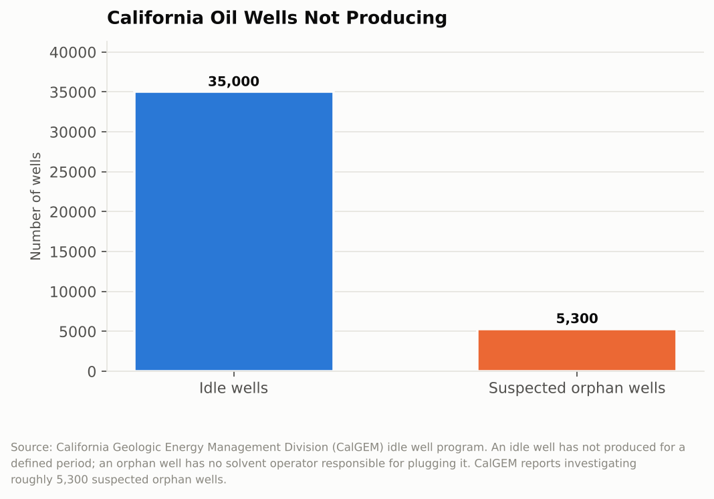
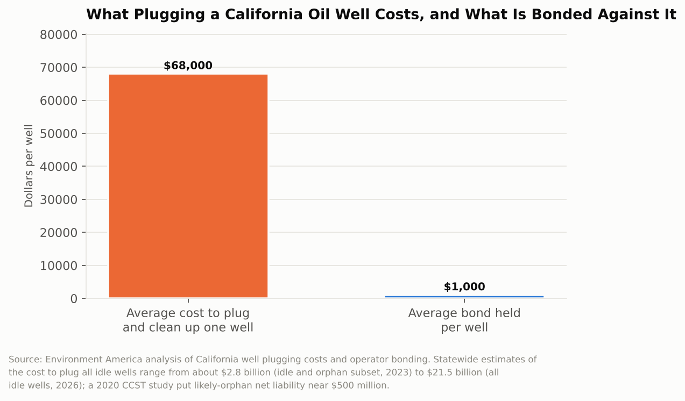

# California Counts: The Wells Nobody Owns
## California holds about $1,000 in bond against a well that costs $68,000 to plug, and there are roughly 35,000 idle wells

An oil well that stops producing does not stop existing. It is a hole, often more than a mile deep, lined with steel casing that corrodes, passing through groundwater on its way to a hydrocarbon formation. Plugging it properly means filling it with cement in the right places, cutting the casing below grade, and restoring the surface. California has roughly 35,000 wells categorized as idle and is investigating about 5,300 it suspects are orphans, meaning no solvent operator remains to pay for any of that.

---

## The Topline: 35,000 Idle, 5,300 Suspected Orphans

The inventory is the starting point, and the two categories carry very different legal consequences.

Approximately 35,000 idle wells, per the Geologic Energy Management Division, the state agency known as CalGEM that regulates oil and gas. Approximately 5,300 wells under investigation as suspected orphans.

An idle well still has an operator. That operator owes CalGEM an annual fee, must file an idle well management plan, and remains legally responsible for eventually plugging it. The well is a liability on a private balance sheet.

An orphan well has no such operator, because the company dissolved, went bankrupt, or sold the asset down a chain of successively smaller entities until the last one had no capacity to pay. At that point the liability transfers to the state, which is to say to the public. The 5,300 figure is the state's estimate of how many wells are in or near that condition.

The transfer mechanism is worth naming precisely because it is legal and routine. A major producer sells aging, low-production wells to a mid-tier operator, which sells them to a small one, which eventually cannot fund plugging. Each transaction is lawful. The cumulative effect is that the profitable decades of a well belong to companies with the means to pay for cleanup and the unprofitable end belongs to one that does not.

---

## The Bond Gap

The instrument that is supposed to prevent exactly that outcome is the operator bond, and this is where the arithmetic breaks.

The average cost to properly plug and clean up a California well is roughly $68,000. The average bond available per well is roughly $1,000.

That is a coverage ratio of about 1.5 percent. A bonding system is supposed to hold security sufficient to complete the obligation if the obligor fails. California's holds about a sixtieth of it.

The reason is structural rather than negligent. California's bonding has historically operated through blanket bonds, where an operator posts a single capped amount covering its entire inventory regardless of well count. An operator with a handful of wells is reasonably covered. An operator with two thousand wells under the same cap is covered at a few hundred dollars each. The cap was set when the inventory looked different and the cost of plugging was lower, and it was not indexed.

California has moved on this. Assembly Bill 1866 changed idle well management plan requirements so operators must address all idle wells rather than only long-term idle ones, and idle well fees and elimination requirements rose effective January 1, 2025. Those are real changes to the incentive to let a well sit. They do not retroactively bond the 35,000 wells already idle.

---

## What the Total Costs

The estimates of statewide liability vary by more than an order of magnitude, and the variation is almost entirely about scope.

A 2020 California Council on Science and Technology study estimated net liability for wells it identified as likely orphan or at high risk of becoming orphan, 5,540 of them, at roughly $500 million. An Environment America analysis in 2023 put idle and orphan well costs above $2.8 billion. Current estimates reported in 2026 put the cost of plugging all idle wells statewide at $21.5 billion. A Sierra Club figure of $21 billion in 2023 was disputed by industry groups as overstated.

Those numbers are not in conflict so much as they answer different questions. Five hundred million dollars is the likely-orphan subset at the time of study. Twenty-one and a half billion is every idle well in the state. The policy question, which is how much the public will end up paying, sits somewhere between them and depends on how many of the 35,000 idle wells end up orphaned, which depends on oil prices, on operator solvency, and on how aggressively CalGEM enforces the new idle well requirements.

| Measure | Figure |
|---|---|
| Idle wells in California | ~35,000 |
| Suspected orphan wells under investigation | ~5,300 |
| Average cost to plug and clean up one well | ~$68,000 |
| Average bond held per well | ~$1,000 |
| Bond coverage ratio | ~1.5% |
| Estimated cost, likely-orphan subset (CCST, 2020) | ~$500 million |
| Estimated cost, idle and orphan subset (2023) | $2.8+ billion |
| Estimated cost, all idle wells (2026) | $21.5 billion |

---

## Why an Unplugged Well Matters

The liability is not only fiscal, and the health case is the part of the record that is thinnest.

An unplugged or poorly plugged well can leak methane, a potent greenhouse gas, and can provide a pathway for hydrocarbons and brine to migrate into groundwater. California's idle wells are concentrated in the San Joaquin Valley and in the Los Angeles Basin, and the Los Angeles wells are the ones that sit in neighborhoods: in alleys, behind fences, next to apartment buildings and schools. The city of Los Angeles has been working through its own inventory and its own authority to require abandonment.

The health effects of proximity to idle wells remain, in the honest formulation used in recent coverage, unclear. There is research associating proximity to active oil and gas operations with respiratory and birth outcomes. The idle well literature is thinner, which means the state is making decisions about a 35,000-well inventory without a settled estimate of what leaving them unplugged costs in health terms.

The federal government has supplied money for this, through orphan well plugging grants that California has drawn on. That funding is meaningful and is also small relative to the upper-bound estimates, and it has the effect of socializing a cost that the bonding system was designed to keep private.

---

## The Interpretive Tension

The critical read is that California permitted roughly 35,000 wells to go idle while holding security covering about 1.5 percent of their plugging cost, which is not a bonding system but the appearance of one. The structure allowed operators to extract the profitable decades of a well and transfer the cleanup obligation down a chain of ever-smaller companies until it reached the public, and every step was legal because the state wrote the rules that way. The 2025 fee and management plan changes are an improvement that applies going forward to an inventory that has already accumulated. Meanwhile the state cannot say what the total liability is within a factor of forty, and has not established what leaving the wells unplugged costs in groundwater or in health.

The generous read is that California maintains a public well inventory with location and status data that most producing states do not match, has identified and is investigating its suspected orphan wells rather than waiting to discover them, and has raised idle well fees and tightened management plan requirements over industry objection. The wide range in cost estimates reflects genuine uncertainty about how many idle wells become orphans, which depends on future oil prices and operator solvency rather than on anything the state is concealing. Plugging is also not costless to get wrong: a rushed program that plugs wells badly creates the same pathway it was meant to close, and California's requirements are more rigorous than the federal minimum. The state has drawn federal orphan well funding and has a declining-production trajectory that bounds the problem rather than growing it.

---

## What the Data Doesn't Show

CalGEM's inventory records well status as reported and as inspected, and status changes with production. An idle well is defined by a period without production, which means the count moves when prices move and does not by itself indicate which wells are at risk of orphaning. The 5,300 suspected orphans are a state estimate under investigation, not an adjudicated count.

The $68,000 average plugging cost is an average across wells of very different depths, locations, and conditions. An urban Los Angeles well requiring traffic control and a rig in a residential alley costs a large multiple of a rural Kern County well. An average applied to 35,000 heterogeneous wells is the least reliable element of every total-liability estimate.

The bonding figure describes bonds available per well under the arrangements in force when the analysis was done. It does not reflect operator-specific financial assurance, indemnities, or parent guarantees that may exist outside the posted bond, and the state does not publish an operator-by-operator comparison of inventory against financial assurance, which is the analysis that would identify which companies are most likely to orphan their wells next.

And nothing published connects an idle well to a measured outcome. California does not publish a monitoring series of methane emissions or groundwater contamination by well status, which means the health and climate case for plugging rests on inference rather than on the state's own measurements.

---

Thirty-five thousand holes in the ground, about $1,000 secured against each one, and a plugging bill somewhere between half a billion and twenty-one and a half billion dollars depending on which question you ask. California knows where the wells are and publishes the inventory. What it has not established is who is going to pay, and the history of this asset class is that the answer arrives only after the last operator has dissolved.

---

*Data sources: [CalGEM Idle Well Program](https://www.conservation.ca.gov/calgem/idle_well); [CalGEM Idle Well Program Legislative Report](https://www.conservation.ca.gov/calgem/Documents/Idle%20Well%20Program%20Report%20for%202022.pdf); [CalGEM Operator Financial Responsibility](https://conservation.ca.gov/calgem/Pages/Operator-Financial-Responsibility.aspx); [State Oil and Gas Supervisor Annual Report 2023](https://www.conservation.ca.gov/calgem/Documents/State%20Oil%20and%20Gas%20Supervisor%20Annual%20Report%202023.pdf); [Environment America, Mapping the risks of California's idle and orphan oil wells](https://environmentamerica.org/california/resources/mapping-the-risks-of-californias-idle-and-orphan-oil-wells/); [Times of San Diego, California has thousands of abandoned oil wells](https://timesofsandiego.com/environment/2026/05/08/california-abandoned-oil-wells-health-billions/); [Los Angeles Board of Public Works idle well documents](https://cityclerk.lacity.org/onlinedocs/2024/24-0585_misc_04-16-25.pdf). Well counts are as published by CalGEM; cost estimates are as published by the cited analyses and differ in scope.*

*This is installment #182 of California Counts, a data journalism series examining California state programs, spending, and policy through publicly available data. All data and analysis available on request.*

*Disclosure: This post was drafted with the assistance of an AI agent (Claude) and has not been independently verified by a human editor.*
