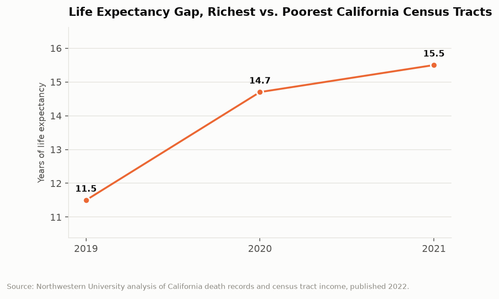

# California Counts: The Fifteen Year Gap
## The distance in life expectancy between California's richest and poorest census tracts grew from 11.5 years to 15.5 years in two years

A census tract is a small thing, a few thousand people, usually walkable end to end. California has about 9,000 of them. Researchers matched California death records to census tract income and found that in 2019, a person born in the state's highest-income tracts could expect to live 11.5 years longer than a person born in its lowest-income tracts. By 2021 the gap was 15.5 years. The state did not become more unequal in income over those two years by anything like that magnitude. What changed was who died.

---

## The Topline: 11.5 Years to 15.5 Years

The income-based life expectancy gap is the single most compressed summary of California's health inequality, and it moved more in two years than in the preceding decade.

Eleven and a half years in 2019. Fourteen point seven years in 2020. Fifteen and a half years in 2021. A four-year widening in twenty-four months.

Fifteen and a half years is not a subtle difference. It is roughly the gap between the national life expectancy of a wealthy country and that of a country in the middle of the global development distribution. Two Californians born the same day, forty minutes apart by car, with the same state government, the same public health department, the same Medi-Cal program, and the same air quality regulations, have expected lifespans that differ by more than the average length of a career.

For a point of reference at the county level, San Mateo County has one of the longest life expectancies of any county in the United States at roughly 83.1 years. County averages compress the variation, though. The tract-level analysis is where the range actually lives, because a single county contains tracts at both ends of the distribution.

---

## Why the Gap Widened

The mechanism is not mysterious and it is worth being precise about, because the timing points directly at it. The gap grew in 2020 and 2021, which are the two years of the COVID-19 pandemic.

COVID-19 mortality in California was heavily concentrated by occupation, household density, and access to care. Workers who could not work remotely, households where multiple generations shared limited space, and communities with fewer primary care providers per capita absorbed a disproportionate share of the 102,400 deaths this series examined in its discussion of the state's archived pandemic datasets. Those characteristics correlate strongly with census tract income.

A pandemic that kills disproportionately in low-income tracts widens a life expectancy gap mechanically. It does not require any change in the underlying chronic disease pattern, the health care system, or income distribution. It requires only that the deaths land unevenly, which they did.

That makes the 15.5 year figure partly a pandemic artifact and partly not, and disentangling the two is the substantive question. The 11.5 year 2019 baseline is the durable finding: before COVID-19, before any pandemic effect, California already had an 11.5 year income-based life expectancy gap. That gap was built by decades of differential exposure to air pollution, differential access to primary care, differential rates of diabetes and hypertension, differential neighborhood violence, and differential traffic fatality exposure on the wide arterial streets that run through poor neighborhoods. Every one of those is a topic this series has examined separately. The life expectancy gap is what they sum to.

---

## What Eleven and a Half Years Was Made Of

The pre-pandemic gap is the more useful number for policy because it reflects standing conditions rather than an acute shock, and its components are individually measurable in California data.

Cardiovascular disease and diabetes mortality are the largest contributors in most decompositions of income-based life expectancy gaps, and both are sharply patterned by income in California. Both are also highly responsive to primary care access, which means the gap is partly a measure of who has a doctor. Medi-Cal covers roughly a third of Californians, and coverage is not the same as access when provider reimbursement rates make it difficult to find a physician accepting new Medi-Cal patients.

Environmental exposure contributes directly. CalEnviroScreen, the state's own pollution burden index, maps cumulative environmental burden to census tract and finds the highest burdens in the San Joaquin Valley and in specific industrial-adjacent urban tracts, which are also among the lowest-income tracts. Particulate exposure has well-established cardiovascular and respiratory mortality effects.

Injury and violence contribute more than their share of deaths because they kill young. A death at 25 removes roughly 55 years from a life expectancy calculation; a death at 80 removes very few. That arithmetic means traffic fatalities, homicides, and overdose deaths have outsized effects on the measure, and all three are concentrated in lower-income tracts.

| Year | Gap, highest to lowest income tracts |
|---|---|
| 2019 | 11.5 years |
| 2020 | 14.7 years |
| 2021 | 15.5 years |

---

## The Measurement Is the Achievement

It is worth pausing on how this number exists at all, because it is not a routine statistical product.

California death certificates record the decedent's residential address. Geocoding those addresses to census tracts, joining tract-level income from the American Community Survey, constructing period life tables for income groups, and doing it across multiple years requires access to individual death records under a research agreement, substantial methodological care, and the state's willingness to permit the analysis. The 11.5 to 15.5 finding came out of a Northwestern University research team working with California data.

It is not published by the state as a routine indicator. CDPH publishes county health status profiles and statewide mortality trend visualizations, which are useful and which do not produce this number. There is no California dashboard that shows the income-based life expectancy gap updated annually, which means the state's most striking measure of health inequity exists because outside researchers went looking for it rather than because the state tracks it.

That gap between what the state's data can show and what the state actually reports is a recurring theme in this series. The records are there. The tract geography is there. The methodology is published. What is missing is anyone inside the state whose job is to produce the number every year and put it in front of the Legislature.

---

## The Interpretive Tension

The critical read is that California, the wealthiest large jurisdiction in the country and the one most rhetorically committed to equity, has a fifteen and a half year income-based life expectancy gap and does not routinely publish it. The 11.5 year pre-pandemic baseline was the accumulated result of policy choices, about where to site industry, how to fund primary care, what speed limits to set on residential arterials, and which communities get clean drinking water, that the state made with full knowledge of their distributional consequences. The pandemic widening was foreseeable within weeks of March 2020 from occupational exposure data, and the state's protective measures did not prevent a four-year widening. A government that tracked this number quarterly would have to answer for it.

The generous read is that a life expectancy gap between the richest and poorest tracts is a feature of every large and diverse society, that California's overall life expectancy is among the highest of any American state and higher than the national average, and that San Mateo County ranks among the longest-lived counties in the United States. California expanded Medi-Cal to the largest eligible population in the country, including undocumented residents, which is the single largest health coverage expansion any state has undertaken. The state built CalEnviroScreen specifically to direct resources to high-burden communities and routes cap-and-trade proceeds by that index. The pandemic widening reflects a global shock that hit frontline workers everywhere, and California's overall COVID mortality rate was lower than most large states. The gap is real, the trend is bad, and the counterfactual state without those interventions would be worse.

---

## What the Data Doesn't Show

Life expectancy at the census tract level is a period measure, which means it describes the mortality conditions of a given year applied hypothetically across a lifetime. It is not a prediction about any actual person. A tract's 2021 life expectancy reflects 2021 deaths, including pandemic deaths, projected as though those conditions persisted forever. They did not.

The measure is assigned by residence at death, which creates a selection problem in both directions. People who become seriously ill sometimes move, to be near family or into institutional care, which relocates their death to a different tract than the one where the exposure occurred. In a state with California's housing costs, and with substantial residential mobility among low-income households, the tract where someone died may have little to do with the tract where their health was determined.

Income is measured at the tract level, not the individual level, so this is an area-based rather than person-based analysis. A low-income person in a wealthy tract is counted in the wealthy group. That attenuates the measured gap, which means 15.5 years is likely an understatement of the individual-level difference.

And the analysis ends in 2021. Whether the gap has narrowed as pandemic mortality receded is the obvious next question and there is no published answer, because nobody in the state is assigned to produce it.

---

Two babies born in California this week, one in a tract near the top of the income distribution and one near the bottom, have expected lifespans differing by more than fifteen years. The records that prove it are in the state's own files. The join that reveals it takes a research agreement and a few weeks of work. Nobody in Sacramento runs it annually, which means the number is discovered rather than monitored, and discovered numbers are easy to not have discovered yet.

---

*Data sources: [Northwestern University, Income-based life expectancy gap in California grew by 4 years from 2019 to 2021](https://news.northwestern.edu/stories/2022/07/income-based-life-expectancy-gap-in-california-grew-by-4-years-from-2019-2021/); [CDPH County Health Status Profiles and Statewide Mortality Trends](https://www.cdph.ca.gov/Programs/CHSI/Pages/County-Health-Status-Profiles---Statewide-Mortality-Trends-Visualizations.aspx); [County Health Rankings and Roadmaps, Life Expectancy](https://www.countyhealthrankings.org/health-data/population-health-and-well-being/length-of-life/life-expectancy); [List of U.S. counties by life expectancy](https://en.wikipedia.org/wiki/List_of_U.S._counties_with_longest_life_expectancy); [CalEnviroScreen (OEHHA)](https://oehha.ca.gov/calenviroscreen). Gap figures are as published by the cited research; county life expectancy figures are as published by County Health Rankings.*

*This is installment #170 of California Counts, a data journalism series examining California state programs, spending, and policy through publicly available data. All data and analysis available on request.*

*Disclosure: This post was drafted with the assistance of an AI agent (Claude) and has not been independently verified by a human editor.*
