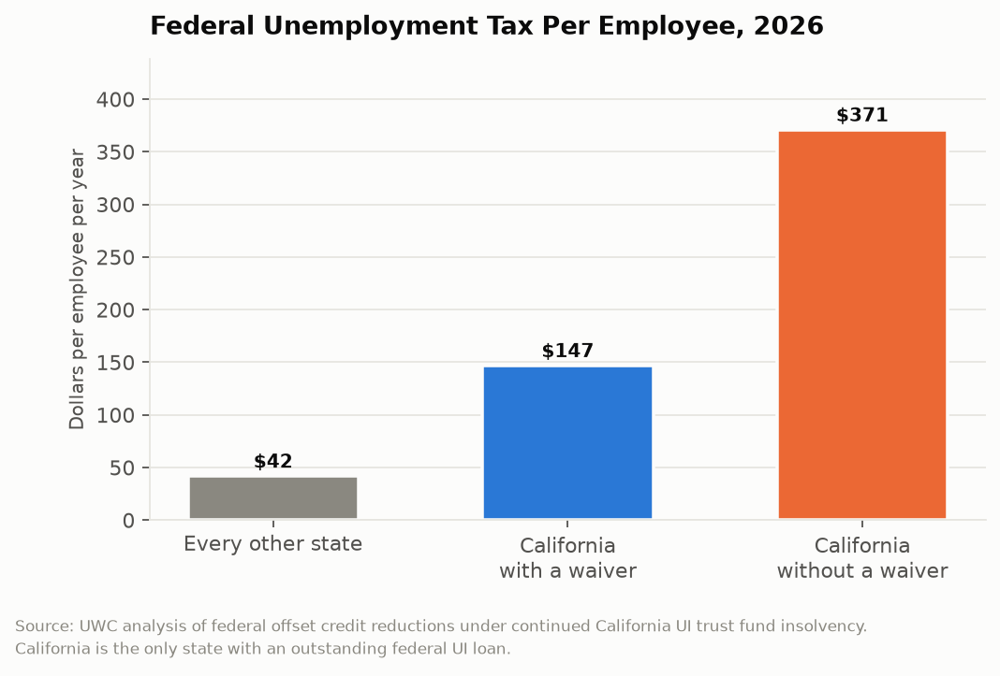
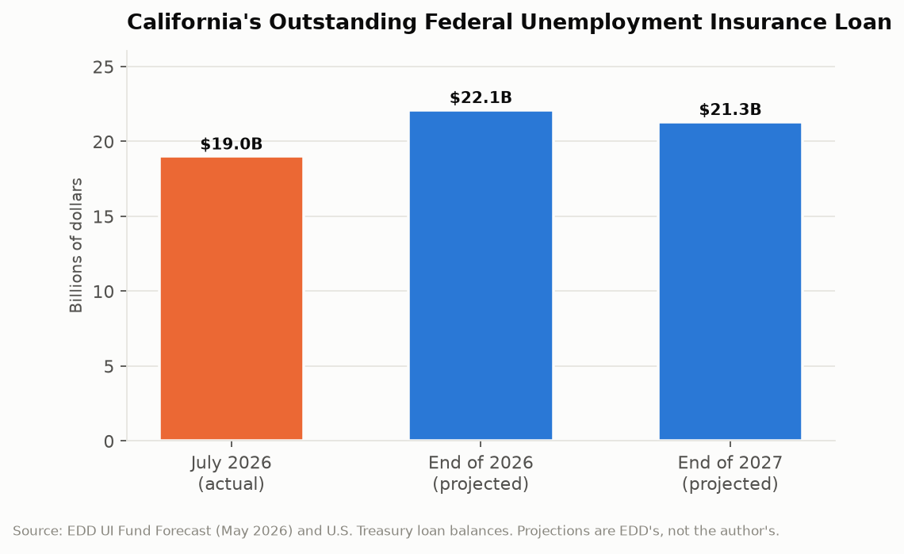

# California Counts: The Loan That Won't Close
## California owes the federal government $19 billion for unemployment benefits, is the only state still carrying such a loan, and its employers now pay nine times the federal unemployment tax rate paid everywhere else

Unemployment insurance in California is funded by a payroll tax on employers, deposited into a trust fund held at the U.S. Treasury. When the fund runs dry, the state borrows from the federal government to keep paying benefits, and the loan carries interest. California borrowed heavily in 2020, has not repaid, and as of July 2026 owes more than $19 billion. It is the only state in the country still carrying an outstanding federal unemployment insurance loan. The mechanism the federal government uses to collect is a tax increase on California employers that escalates every year the debt remains.

---

## The Topline: $371 Per Employee

The federal collection mechanism is an escalating reduction in the credit employers receive against the Federal Unemployment Tax Act levy, and the resulting per-employee figures are stark.

An employer in every other state pays roughly $42 per employee per year in net federal unemployment tax. A California employer, if the state obtains a waiver of the credit reduction, would pay approximately $147. Without a waiver, approximately $371.

Three hundred seventy-one dollars against forty-two is a ratio of nearly nine to one. For a California business with 100 employees, the difference between the no-waiver scenario and the rate paid in Nevada or Arizona is roughly $33,000 per year, on a tax line that has nothing to do with the employer's own layoff history.

That last point is what makes this unusual as a tax. The state-level unemployment insurance rate is experience-rated: an employer who lays off workers pays more. The federal credit reduction is not. It applies to every covered employer in the state regardless of conduct, which means a California business that has never laid off a single worker pays the penalty for a trust fund shortfall it had no part in creating.

---

## The Balance Is Not Falling

The loan balance trajectory is the part that distinguishes this from an ordinary recession borrowing that resolves with recovery.

More than $19 billion outstanding as of July 22, 2026. EDD's own forecast projects $22.1 billion by the end of 2026 and $21.3 billion by the end of 2027.

Those are the state's projections, not an outside critic's. California's labor market agency expects the debt to grow through 2026 and then decline by less than a billion dollars over the following year. At that pace the loan does not close in this decade.

Interest is due each September 30 and must be paid from state funds rather than from the trust fund itself, which means the general fund makes an annual interest payment on a debt incurred to pay benefits. That payment competes directly with every other general fund priority and produces nothing: it is the cost of not having repaid.

The structural reason the balance does not fall is that California's UI contribution schedule does not collect enough to fund its benefit levels. Employers have been on the highest statutory contribution schedule, the F schedule, plus a 15 percent surcharge, since 2004. The surcharge is automatic when the fund reserve ratio falls below a specified level, and the fund has been below that level for more than two decades. EDD's forecast expects employers to remain on that schedule throughout the forecast period and beyond. The maximum rate the statute permits is not sufficient to both pay current benefits and retire the debt.

That is the finding: California's unemployment insurance system is structurally underfunded at its own statutory maximum. The 2020 borrowing did not create the problem. It revealed one that the state had been carrying since before the Great Recession.

---

## The Fraud That Sits Underneath

Any accounting of the $19 billion has to address the fraud, and the honest version is that the two are related but not identical.

Estimates of fraudulent pandemic unemployment claims paid by California range from $20 billion to $32.6 billion, the highest of any state. EDD has recovered more than $5.9 billion. The State Auditor designated EDD a high-risk agency, citing inadequate fraud prevention, and found that the department's missteps and inaction led to billions in payments it later determined may have been fraudulent. The auditor also identified the root cause as a longstanding failure to modernize claims processing and call center operations, which left EDD unable to handle legitimate claims and simultaneously unable to screen illegitimate ones.

The accounting relationship requires care. Most of the fraudulent payments were made under federal pandemic programs, principally Pandemic Unemployment Assistance, which were federally funded and did not draw on the state trust fund. So the $19 billion state loan is not primarily a fraud balance. The fraud was a separate and larger failure, absorbed largely by federal taxpayers.

But the two share a cause. A department that could not distinguish a real claim from a fabricated one in 2020 was a department without modern systems, and the same absence of modern systems is part of why California cannot efficiently administer, forecast, or collect its way out of the trust fund shortfall. The fraud and the debt are two outputs of one underinvestment.

| Measure | Figure |
|---|---|
| Outstanding federal UI loan, July 2026 | $19+ billion |
| Projected balance, end of 2026 | $22.1 billion |
| Projected balance, end of 2027 | $21.3 billion |
| Net FUTA per employee, other states | ~$42 |
| Net FUTA per employee, California with waiver | ~$147 |
| Net FUTA per employee, California without waiver | ~$371 |
| Employer contribution schedule since 2004 | F schedule plus 15% surcharge |
| Estimated pandemic UI fraud | $20 to $32.6 billion |
| Fraud recovered | $5.9+ billion |

---

## Why Nobody Fixes It

The arithmetic of a fix is simple and each version is politically unavailable, which is why the debt has survived six budget cycles.

Raising employer contributions requires increasing the taxable wage base, which in California has been $7,000 per employee since 1983 and is among the lowest in the country. A worker earning $80,000 and a worker earning $7,000 generate identical UI contributions. Indexing that base would raise substantial revenue and would be a direct tax increase on employers, including small employers, in a state where business groups are organized and effective.

Reducing benefits is the other lever, and California's benefit levels are not generous by comparison: the maximum weekly benefit has been $450 since 2005, which twenty years of inflation has eroded to roughly half its original value. Cutting further is not a serious proposal, and labor advocates have pressed instead for increases, which would enlarge the shortfall.

Paying the debt from the general fund was done once, in a limited amount, and general fund deficits have foreclosed it since. Each year of deferral adds an interest payment and moves the credit reduction one step higher.

So the system runs on autopilot: employers at the statutory maximum rate, benefits frozen at 2005 levels, a growing federal loan, an annual interest payment from the general fund, and an escalating federal penalty on every covered employer in the state.

---

## The Interpretive Tension

The critical read is that California has run its unemployment insurance fund below the required reserve level since 2004, has kept a taxable wage base frozen since 1983, borrowed $20 billion when the pandemic arrived, lost an additional $20 billion or more to fraud through a department its own auditor calls high-risk, and now taxes every employer in the state nine times the normal federal rate to service a debt its own forecast says will still exceed $21 billion at the end of 2027. The burden falls on employers without regard to layoff history and on a benefit level frozen for two decades, which means both sides of the system are being penalized for a financing structure the Legislature has declined to fix across six governors' budgets.

The generous read is that California paid unemployment benefits to millions of people during the sharpest employment collapse in modern history, at a moment when the alternative was mass destitution, and it did so by borrowing exactly as the federal system was designed to permit. The trust fund borrowing mechanism exists for that purpose. Most of the fraud occurred in federal programs Congress designed for speed over verification and pushed to states in days, and every state was defrauded; California's absolute losses are largest because California is largest. EDD has recovered $5.9 billion, more than most states recovered in total. The state has sought waivers of the credit reduction to protect employers, and the underlying wage base problem requires a tax increase that the Legislature's supermajority requirements make genuinely difficult. A frozen $450 benefit is evidence that the state has not been profligate with benefits.

---

## What the Data Doesn't Show

EDD's UI Fund Forecast publishes projected balances, contribution revenue, and benefit outlays. It does not publish a scenario in which the loan is repaid, because no combination of current-law parameters produces one. The absence of a repayment scenario in the state's own forecast document is the clearest statement available about the structural nature of the problem.

Fraud estimates range from $20 billion to $32.6 billion, a spread of more than $12 billion, and EDD has not published a reconciled figure. That range reflects genuine methodological difficulty in retrospectively classifying claims, and it also means the single largest financial loss in recent California state history is known only to within a factor of about one and a half.

The per-employee FUTA figures depend on whether California obtains a waiver, which is an annual federal determination. Employers cannot know their own liability with certainty until that determination is made, which is a planning problem the published data cannot solve.

And nothing in the fund data addresses adequacy. The forecast reports whether the fund can pay claims at current benefit levels. It does not report whether $450 per week is enough to keep a laid-off Californian housed, which is the question the program exists to answer.

---

Nineteen billion dollars owed, a projection that it will be larger next year, benefits frozen since 2005, a taxable wage base unchanged since 1983, and every employer in California paying nine times the federal rate paid in every other state. The forecast documents are public, published twice a year, and contain no path back to solvency. California is the last state still carrying this loan, and the last state is not a position that resolves itself.

---

*Data sources: [EDD May 2026 Unemployment Insurance Fund Forecast](https://edd.ca.gov/siteassets/files/unemployment/pdf/2026-may-ui-fund-forecast.pdf); [EDD January 2026 UI Fund Forecast](https://edd.ca.gov/siteassets/files/unemployment/pdf/january-2026-ui-fund-forecast.pdf); [EDD Federal Unemployment Tax Act information](https://edd.ca.gov/en/payroll_taxes/federal-unemployment-tax-act/); [California State Auditor, 2025-601 State High-Risk Audit Program](https://www.auditor.ca.gov/reports/2025-601/); [Legislative Analyst's Office, Unemployment Insurance Fraud](https://lao.ca.gov/reports/2022/4542/Unemployment-Insurance-Fraud-021522.pdf); [UWC, California UI Trust Fund Insolvency](https://uwcstrategy.org/california-ui-trust-fund-insolvency-likely-to-result-in-federal-unemployment-tax-rate-increases-and-interest-payments-for-2026/); [California Chamber of Commerce, Unemployment Insurance Fund](https://advocacy.calchamber.com/policy/issues/unemployment-insurance-fund/); [EDD Fraud Response](https://edd.ca.gov/en/about_edd/fraud-response/). Loan balances and projections are as published by EDD and the U.S. Treasury; per-employee FUTA figures are as calculated by UWC.*

*This is installment #175 of California Counts, a data journalism series examining California state programs, spending, and policy through publicly available data. All data and analysis available on request.*

*Disclosure: This post was drafted with the assistance of an AI agent (Claude) and has not been independently verified by a human editor.*
