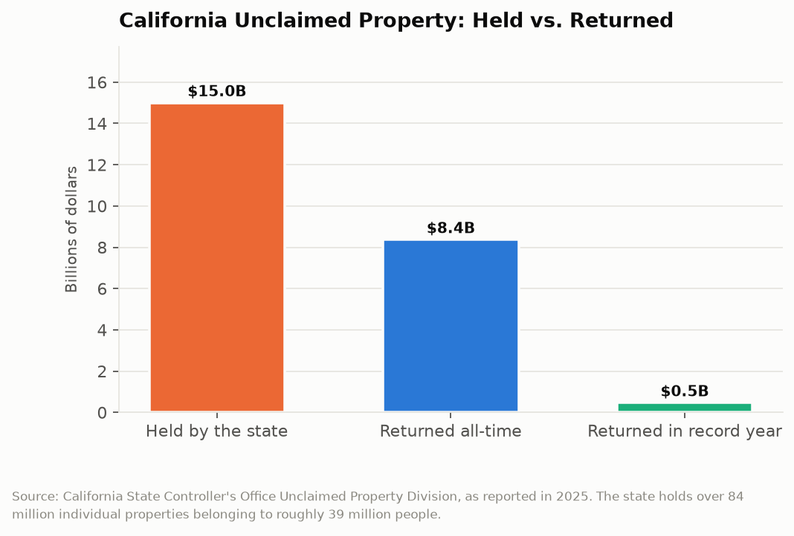

# California Counts: The Fifteen Billion Dollar Lost and Found
## The state holds 84 million pieces of property belonging to 39 million people, earns interest on all of it, and returned 3 percent last year

California's State Controller is holding more than $15 billion that belongs to other people. It arrived through a legal process called escheatment: when a bank account goes dormant, a paycheck goes uncashed, an insurance benefit goes unclaimed, or a utility deposit goes unrefunded for a statutory period, the holder is required to turn the money over to the state. The state holds it indefinitely, in trust, and waits for the owner to ask. There are more than 84 million individual properties in the file, belonging to close to 39 million Californians, which is a number very nearly identical to the state's entire population.

---

## The Topline: $15 Billion Held, $465 Million Returned

The scale of what is held and the pace at which it is returned are the two numbers that define the program.

More than $15 billion currently held. Roughly $8.37 billion returned to owners across the life of the program. And $465 million returned in the most recent record year, which the Controller's office publicized as an achievement, correctly, because it was the highest annual total the program has posted.

Four hundred sixty-five million dollars against a $15 billion balance is a return rate of roughly 3.1 percent per year. At that pace, and setting aside the new property arriving every year, clearing the current balance would take about three decades. New property arrives faster than that, which is why the balance grows rather than shrinks. The program is not a queue being worked down. It is a reservoir being filled slightly faster than it drains.

The 84 million properties figure is the one that reframes the program. The average property is worth roughly $180. That is not a forgotten trust fund. It is a final paycheck from a job somebody left in 2009, a security deposit on an apartment in Sacramento, a refund check that went to an old address, a dividend on eleven shares of stock. The money is not concentrated in a few large estates. It is diffuse, small, and spread across nearly every household in California.

---

## Where the Interest Goes

Here is the mechanism that makes this more than a customer service story. California does not hold unclaimed property in a segregated non-interest-bearing account. The money is deposited into the General Fund and the state uses it, with a reserve maintained to pay claims as they come in.

That means unclaimed property functions as an interest-free loan from 39 million Californians to the state government, of indefinite duration, in an amount exceeding $15 billion. The state earns the return on that balance. The owner, upon claiming, receives the principal. California pays no interest on most unclaimed property claims, which is a policy choice the Legislature made and could unmake.

The budget consequence is that the program's revenue contribution depends on money not being claimed. That is not a hypothetical tension; it is an accounting reality that appears in the annual budget as an unclaimed property revenue line. A dramatically more effective return program would reduce General Fund revenue. Nobody has designed the program to fail, and the Controller's office has invested real effort in outreach and in simplifying the claims process. But the incentive structure runs the wrong direction, and it runs the wrong direction by statute rather than by anyone's intent.

This is also where the program differs sharply from other states. Several states pay interest on claimed property. Some run automatic return programs that mail checks to owners the state can identify from tax records without requiring a claim at all. California has moved toward proactive notification but has not adopted automatic return at scale, which would be the single largest available improvement to the return rate.

| Measure | Figure |
|---|---|
| Total value held | $15+ billion |
| Individual properties held | 84+ million |
| Californians with unclaimed property | ~39 million |
| Average property value | ~$180 |
| Returned in record year | $465 million |
| Returned program-to-date | $8.37 billion |
| Annual return rate against balance | ~3.1% |

---

## The Claims Process as the Bottleneck

The database is public and searchable at the Controller's site, free, by name. Anyone can look up their own property in under a minute. That part works.

What follows is the part that determines the return rate. A claim requires the claimant to prove they are the person named, which means documentation of identity and of the address associated with the property at the time it was reported. For a property escheated in 2011 from an address the claimant left in 2012, producing that documentation ranges from inconvenient to impossible. Claims involving deceased owners require estate documentation. Claims on business property require corporate records. Each requirement is individually reasonable as fraud prevention and collectively functions as a filter, and the filter screens out hardest the people whose lives have involved the most moving, which correlates with low income.

A private industry exists in that gap. Heir-finder firms search the public database, locate owners, and offer to handle the claim for a percentage. California caps the fee these firms may charge, which is appropriate consumer protection and is also an admission that the state's own process is difficult enough that a paid intermediary market clears.

The strongest evidence that the process is the bottleneck rather than owner indifference is the average property value. At $180, the expected value of a successful claim is often less than the cost in time and document-gathering of pursuing it. A rational person with a $90 property and a missing 2014 utility bill will not file. Multiply that decision by 84 million properties and the result is a $15 billion balance.

---

## The Interpretive Tension

The critical read is that California has constructed a system in which it takes custody of its residents' money by operation of law, deposits it in the General Fund, earns the return on it, pays no interest, imposes a documentation burden that correlates inversely with the claimant's likely income, and books the unclaimed balance as revenue. The program returns about three percent of its holdings per year and the balance grows. Other states have solved the largest part of this by matching unclaimed property against tax filing records and mailing checks without requiring a claim, a capability California has the data to build and has not built at scale. A state genuinely trying to return $15 billion would not be making residents prove a 2011 address.

The generous read is that unclaimed property law exists to protect owners, not to enrich the state. Before escheatment, dormant accounts were simply absorbed by the banks and insurers holding them, and the owner got nothing. California's program takes that money away from private holders, preserves the owner's claim in perpetuity with no statute of limitations, and publishes a free searchable database. The documentation requirements prevent fraud in a system where the state is handing money to people based on name matches, and a program that paid out on weak evidence would be robbed at scale. The Controller's office set a return record last year, has run proactive outreach campaigns, and has returned $8.37 billion to date, which is real money to real households. The $15 billion balance largely reflects the arithmetic of 84 million small properties, not obstruction.

---

## What the Data Doesn't Show

The public database shows property names, holder names, and in many cases a value range rather than an exact amount. It does not show the age distribution of the holdings, which would answer the most important question about the program: whether the balance consists of recently escheated property still likely to be claimed or decades-old property that will never move.

The Controller publishes annual totals received and returned. It does not publish a claims funnel: how many claims were initiated, how many abandoned mid-process, how many denied and for what reason. Without that, there is no public basis for distinguishing a documentation barrier from owner disinterest, which is exactly the distinction that would determine whether a process fix or an outreach fix is the right investment.

There is also no published analysis of the demographics of successful claimants. Given that the average property is $180 and the documentation burden falls on the mobile, the distributional question of who actually gets their money back is both obvious and unanswered in the public data.

---

Fifteen billion dollars, eighty-four million properties, and very nearly one per resident of California. The state maintains a free public database that will tell you in one minute whether some of it is yours, which is a genuinely good piece of civic infrastructure. It will then ask you to prove where you lived in 2011. Most people do not have that, which is precisely how the money became unclaimed in the first place.

---

*Data sources: [California Unclaimed Property search (claimit.ca.gov)](https://claimit.ca.gov/); [State Controller's Office Unclaimed Property Division](https://www.sco.ca.gov/upd_contact.html); [State Controller press releases on unclaimed property returns](https://www.sco.ca.gov/eo_pressrel_26836.html); [California Open Data Portal](https://data.ca.gov/). Holdings, property counts, and return totals are as reported by the State Controller's Office in 2025. The average property value and annual return rate are arithmetic derived from those figures.*

*This is installment #166 of California Counts, a data journalism series examining California state programs, spending, and policy through publicly available data. All data and analysis available on request.*

*Disclosure: This post was drafted with the assistance of an AI agent (Claude) and has not been independently verified by a human editor.*
