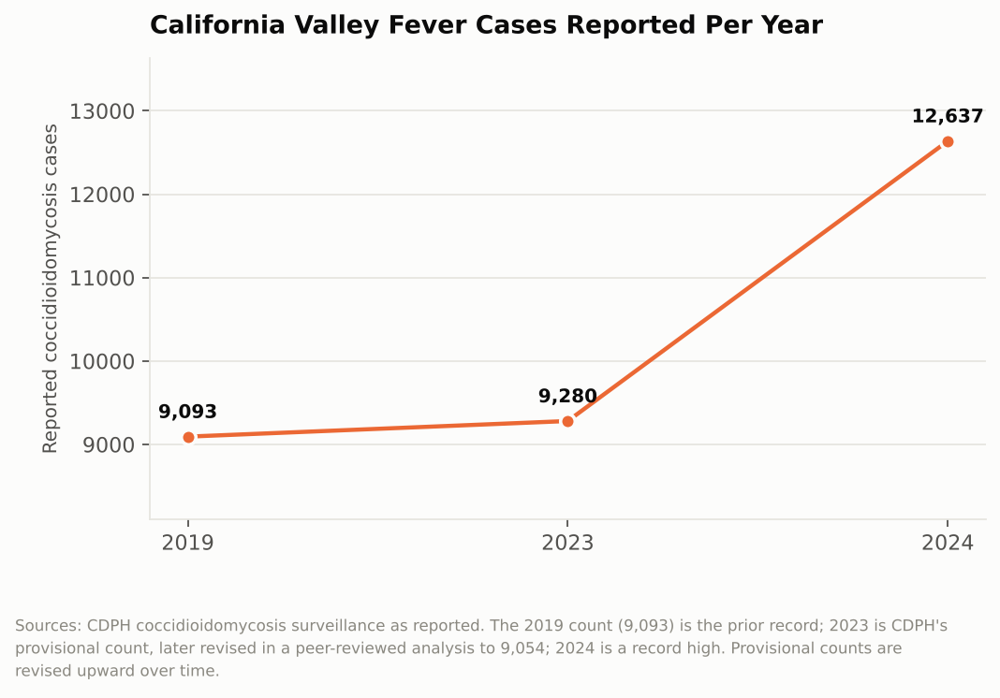
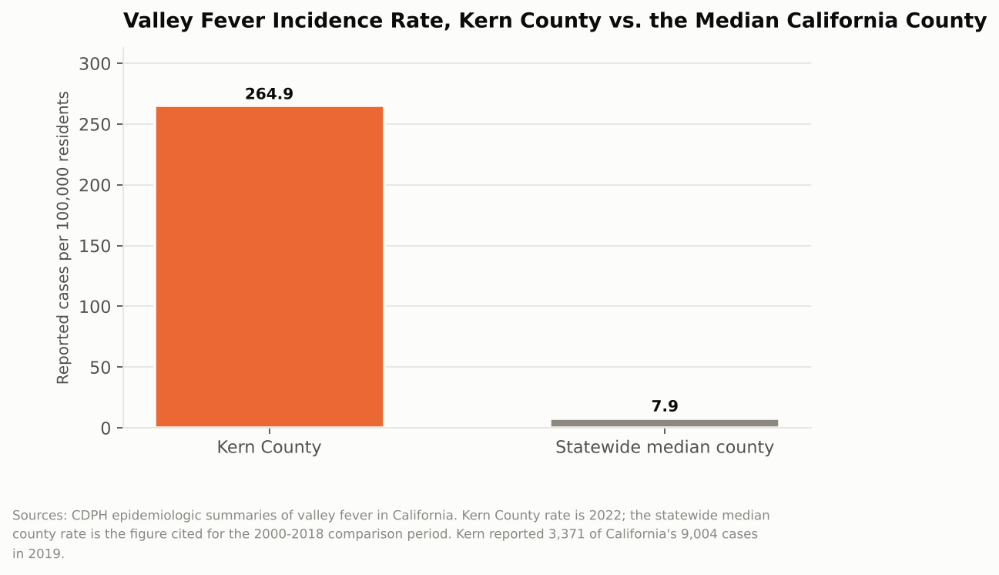

# California Counts: The Dust Disease
## Valley fever cases hit a record 12,637 in 2024, and the disease is concentrated in the counties that grow the state's food

Coccidioides is a fungus that lives in the top few inches of soil in California's drier interior. When that soil is disturbed, by wind, by a tractor, by a backhoe digging a foundation, the spores go airborne, and anyone who breathes them in can develop valley fever. Most people clear it without knowing they had it. A minority develop pneumonia that lasts months, and a small number develop a disseminated infection that reaches the bones, the joints, or the lining of the brain and requires antifungal treatment for life. California reported a record 12,637 cases in 2024.

---

## The Topline: A Record, Then Another

The reported case counts from CDPH surveillance describe a disease that is not holding steady.

Nine thousand ninety-three cases in 2019, which stood as the record. Roughly 9,280 provisional cases in 2023, which CDPH flagged at the time as the highest on record and which a later peer-reviewed analysis revised down slightly to 9,054. Then 12,637 in 2024, which is not a marginal record but a 39 percent increase over the prior peak.

The 2025 data continued the trajectory. CDPH identified more than 5,500 provisional cases in the first six months of 2025, and the first quarter alone produced 3,123 cases, close to double the ten-year average for that quarter.

The longer arc is steeper than any of those single-year comparisons. California's reported case rate rose from 4.3 per 100,000 residents in 2001 to 11.6 per 100,000 in 2010, and state summaries describe a nearly fivefold increase between 2001 and 2021. In the counties studied most closely, the case rate increased twelvefold between 2000 and 2018.

---

## Where It Lands

Valley fever is a statewide reportable disease and an intensely local one.

Kern County's incidence rate was 264.9 cases per 100,000 residents in 2022, against a statewide median county rate of 7.9 per 100,000 over the comparison period. That is a ratio of better than 33 to 1. In 2019, Kern County alone reported 3,371 of California's 9,004 cases, roughly 37 percent of the state total from a county holding about 2 percent of the state's population.

The concentration follows the soil and the work. The highest rates are in Kern, Kings, Tulare, Fresno, and the surrounding San Joaquin Valley counties, with a secondary zone along the Central Coast. These are the counties where this series has repeatedly found California's worst outcomes: the highest unemployment, the most failing drinking water systems, the greatest cumulative pollution burden, and the shortest life expectancies. Valley fever is another entry on that list, and it arrives through a mechanism the others do not share, which is that the exposure is the dirt itself.

Occupational exposure is the part that makes this a labor story as much as a health story. The people most exposed are the ones who disturb soil for a living: farmworkers, construction crews, solar installation workers, and state prison staff and incarcerated people at the Central Valley facilities, where valley fever outbreaks have produced litigation and court-ordered transfers. California's Division of Occupational Safety and Health maintains valley fever guidance for employers precisely because the disease is an occupational hazard in a defined geography.

---

## The Climate Mechanism

The reason the curve is rising rather than oscillating is now reasonably well established, and it is specific enough to forecast against.

The fungus needs moisture to grow and dryness to go airborne. Research published in Emerging Infectious Diseases links California's rising incidence to hydroclimatic swings: a wet winter builds fungal mass in the soil, and the dry summer and the drought that follows release it. The worst years come after a wet period gives way to a dry one, which is precisely the whiplash pattern that California's climate is producing more of.

That gives public health something it rarely gets, which is a leading indicator. Reservoir levels and precipitation records are published continuously and well in advance of the exposure season. A state that wanted to warn construction firms, farm labor contractors, and prison administrators ahead of a high-risk year has the inputs to do it a year out.

What the state does with that lead time is a separate question. There is no mandatory workplace dust-control standard specific to valley fever, no routine pre-season advisory tied to the hydroclimatic forecast, and no vaccine, though a canine vaccine has been licensed and human candidates remain in development.

| Measure | Figure |
|---|---|
| Reported cases, 2019 | 9,093 |
| Reported cases, 2023 (provisional) | ~9,280 |
| Reported cases, 2024 | 12,637 |
| Cases, first half of 2025 (provisional) | 5,500+ |
| Kern County rate, 2022 | 264.9 per 100,000 |
| Statewide median county rate | 7.9 per 100,000 |
| Kern share of 2019 cases | 3,371 of 9,004 |

---

## The Diagnostic Gap

A reported case requires a clinician to suspect valley fever and order the test, and the gap between infection and reporting is the least examined part of this data.

Valley fever presents as community-acquired pneumonia. A patient with a persistent cough, fatigue, and a fever looks like a hundred other patients, and the default response is a course of antibiotics, which does nothing to a fungus. Published work on care in the Central Valley argues the real gap is not diagnosis at the point of first contact but longitudinal care afterward: a patient who is diagnosed often does not receive sustained follow-up for a condition that can take a year to resolve.

Both failures distort the surveillance data in the same direction. A patient treated for the wrong illness never enters the count. A patient who is diagnosed and then lost to follow-up enters it once and disappears, which means the state can report how many people were diagnosed and cannot report how many are still sick.

So the record 12,637 is a floor, and it is a floor whose height depends partly on how many clinicians in the endemic counties thought to order a coccidioides serology that week.

---

## The Interpretive Tension

The critical read is that California has a rising, geographically concentrated, occupationally driven fungal disease that set a record by 39 percent in a single year, and the state's response is surveillance and guidance rather than regulation. The exposure is overwhelmingly borne by outdoor workers in the counties with the least political weight, and the mechanism is now predictable enough to forecast, which means a high-risk year could be met with mandatory dust suppression, respiratory protection requirements, and pre-season warnings. None of that is in force. The state publishes an excellent epidemiologic summary every year documenting a problem it is not acting on at the scale of the trend.

The generous read is that California runs the most sophisticated valley fever surveillance program in the country, publishes annual epidemiologic summaries with county-level detail, funds the research that established the hydroclimatic mechanism, and maintains occupational guidance through Cal/OSHA that no other state matches. The disease is caused by a soil fungus in a climate the state does not control, and the principal driver of the increase is a precipitation pattern no public health department can regulate. Case counts are rising partly because awareness and testing are rising, which is what a working surveillance system does. California has also funded a university research program and supported vaccine development, which is the only intervention that would actually change the trajectory rather than manage it.

---

## What the Data Doesn't Show

Surveillance counts diagnosed and reported cases. The infection-to-diagnosis ratio for valley fever is believed to be large and is not measured, so the true number of Californians infected each year is unknown and the reported record is a lower bound on a quantity nobody has estimated precisely.

Provisional counts are revised, sometimes substantially. The 2023 figure appears in the public record as 9,280, 9,210, and 9,054 depending on the source and the vintage, which is normal for communicable disease surveillance and makes year-over-year comparisons across sources unreliable.

The data records residence, not exposure. A case is attributed to the county where the patient lives, which for a disease contracted through soil disturbance at a worksite may be the wrong county entirely. A Bakersfield resident infected at a solar construction site in Kings County counts as a Kern County case. That means the geographic pattern in the surveillance data is a residence map, not an exposure map, and nothing published lets an outside analyst convert one into the other.

Occupation is not recorded in the case file. The claim that outdoor workers bear most of the exposure rests on outbreak investigations and research studies, not on the surveillance system, which means the central policy question, who is getting sick at work, cannot be answered from the state's own routine data.

---

Twelve thousand six hundred thirty-seven people, most of them in a handful of counties, most of them infected by breathing. California can forecast the bad years from rainfall records a season ahead, publishes the county rates every year, and has no standard requiring anyone to do anything differently when the forecast is bad. The dust does not need a policy. The people working in it do.

---

*Data sources: [CDPH Epidemiologic Summary of Valley Fever in California, 2022](https://www.cdph.ca.gov/Programs/CID/DCDC/CDPH%20Document%20Library/CocciEpiSummary2022.pdf); [CDPH Epidemiologic Summary, 2019](https://www.cdph.ca.gov/programs/cid/dcdc/cdph%20document%20library/cocciepisummary2019.pdf); [CDPH valley fever provider alert (California Medical Association)](https://www.cmadocs.org/newsroom/news/view/ArticleId/50427/CDPH-warns-of-rising-cases-of-Valley-fever-in-California); [Recent and Forecasted Increases in Coccidioidomycosis Incidence Linked to Hydroclimatic Swings, Emerging Infectious Diseases](https://wwwnc.cdc.gov/eid/article/31/5/24-1338_article); [Cal/OSHA Protection from Valley Fever](https://www.dir.ca.gov/dosh/valley-fever-home.html); [UC Davis Health valley fever epidemiology](https://health.ucdavis.edu/valley-fever/about-valley-fever/epidemiology/index.html). Case counts are as reported by CDPH; provisional figures are revised over time.*

*This is installment #176 of California Counts, a data journalism series examining California state programs, spending, and policy through publicly available data. All data and analysis available on request.*

*Disclosure: This post was drafted with the assistance of an AI agent (Claude) and has not been independently verified by a human editor.*
