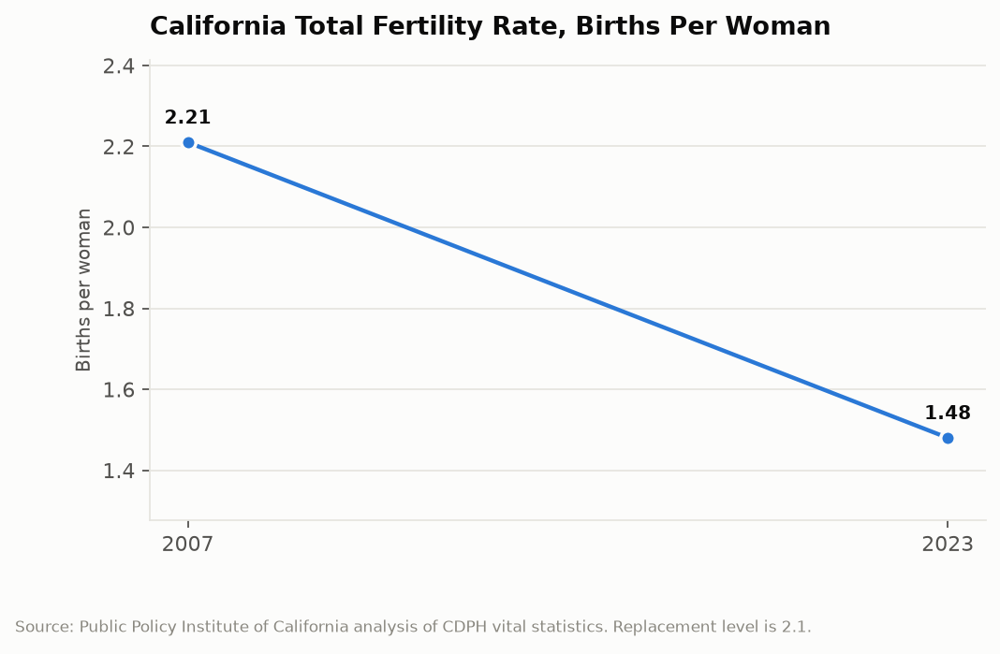
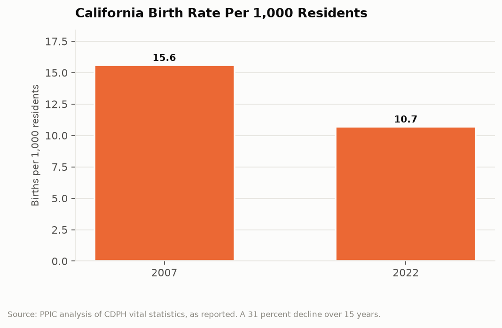

# California Counts: The Missing Generation
## The state's fertility rate fell from 2.21 to 1.48 in sixteen years, and almost every long-range plan California has written assumes otherwise

California's total fertility rate, the number of children an average woman would have over her lifetime at current rates, was 2.21 in 2007. In 2023 it was 1.48. Replacement level, the rate at which a population holds steady without migration, is 2.1. California crossed below replacement around 2010 and has not been back, and the state has been writing school facility plans, pension projections, and water demand forecasts on the other side of that line ever since.

---

## The Topline: 2.21 to 1.48

The fertility series from CDPH vital statistics, as analyzed by the Public Policy Institute of California, is the single most consequential number in California demography and among the least discussed.

A drop from 2.21 to 1.48 is a decline of roughly a third in sixteen years. It puts California below the national rate, below replacement by a wide margin, and in the general neighborhood of countries whose low fertility is treated as a national emergency requiring cabinet-level attention.

The crude birth rate tells the same story in a different unit and confirms it is not an artifact of how fertility is modeled.

Roughly 15.6 births per 1,000 residents in 2007, and 10.7 in 2022. A 31 percent decline. Two independent measures, the same direction, the same magnitude.

The downstream effect is already in the population data rather than in a forecast. California had more than 9.5 million children in 2004. It has fewer than 8.4 million in 2025. That is a loss of more than 1.1 million children, which is not a projection about the 2040s but a fact about now, and it has already begun arriving in the enrollment numbers of school districts across the state.

---

## Why This Is Not the Exodus Story

California's population conversation for the last five years has been about people leaving, and this series has examined that claim before. Domestic out-migration is real and has been measured. It is also not what is driving this.

The fertility decline and the migration story are separable, and the arithmetic separates them cleanly. Net domestic out-migration moves adults, mostly working-age adults with the means to relocate, and it changes the state's population level. A fertility rate of 1.48 changes the state's population structure, permanently, in a way migration cannot reverse without a volume of in-migration that no one is currently proposing. A child not born in 2018 is not in kindergarten in 2023, not in high school in 2032, not in the labor force in 2040, and not paying into CalPERS in 2045. The effect compounds through every institution keyed to age cohorts.

The decline is also not California-specific, which matters for how it should be understood. National birth rates hit a historic low in 2023. The pattern shows up across high-income countries with very different housing markets, family policies, and political arrangements, which makes single-cause explanations suspect. California's housing costs are a plausible contributor and a favorite explanation locally, but the fertility rate also fell sharply in states with abundant cheap housing over the same period.

What is California-specific is the scale of the institutional exposure. A state with 5.8 million public school students, the largest public pension systems in the country, and a revenue base concentrated in a labor market that needs workers is more sensitive to a permanent change in cohort size than a smaller or less institutionally dense state would be.

---

## The Institutions Built for 2.21

The most immediate consequence is school enrollment, and it is already producing closures. California school funding runs through average daily attendance, which means a district with fewer children has proportionally less revenue but does not have proportionally fewer buildings, boilers, or pension obligations. Districts across the state have been consolidating schools, and the politics of closing a neighborhood elementary school are difficult enough that many districts have deferred the decision past the point where deferral is affordable.

The pension exposure is slower and larger. CalPERS and CalSTRS are funded by contributions from active workers and employers alongside investment returns. A permanently smaller cohort entering the workforce means a smaller contribution base supporting a retiree population that is not smaller. The actuarial assumptions in those systems include population and payroll growth projections, and the fertility data is the leading indicator for payroll growth two decades out.

Then there is the demand-forecasting layer, which is where the assumption is most deeply buried. California's water planning documents, transportation models, housing element targets, and electricity load forecasts all rest on population projections. Those projections have been revised downward repeatedly over the past decade, and each revision quietly changes the justification for infrastructure that was authorized on the prior number. A conveyance project sized for a population California is no longer going to have is a different project than the one that was approved.

| Measure | 2007 | Recent | Change |
|---|---|---|---|
| Total fertility rate | 2.21 | 1.48 (2023) | -33% |
| Births per 1,000 residents | 15.6 | 10.7 (2022) | -31% |
| Children in California | 9.5M (2004) | 8.4M (2025) | -1.1M |

---

## The Interpretive Tension

The critical read is that California has quietly become a low-fertility society and has no policy that acknowledges it. The state's housing costs, childcare costs, and the structure of its labor market make having children expensive in ways that are the direct result of state and local policy choices, and the fertility rate is the aggregated result of several million households responding rationally to those prices. Meanwhile the institutions built for a growing young population continue to operate on growth assumptions, which means the adjustment will happen through crisis rather than planning: school closures fought district by district, pension contribution increases absorbed by general funds, and infrastructure projects justified by population forecasts that stopped being true before construction started.

The generous read is that a falling fertility rate in a wealthy society is substantially a story about expanded options, particularly for women, and that treating it as a problem to be solved requires an uncomfortable position on whose choices should change. Teen births have fallen dramatically over the same period, which is an unambiguous public health achievement and accounts for part of the decline. A smaller population reduces pressure on housing, water, and emissions, which are California's three hardest constraints, and a state that spent thirty years failing to build enough housing for a growing population may find a shrinking one easier to serve. The trend is also not uniquely Californian, which suggests the levers a state government controls are not the ones that matter most.

Both readings share an uncomfortable implication: the adjustment is not optional. The cohorts are already born or already not born.

---

## What the Data Doesn't Show

Vital statistics count births to California residents. They do not distinguish between a woman who will have no children and a woman who will have children later, which means a falling fertility rate can reflect postponement rather than forgone births. The distinction matters enormously for forecasting and cannot be resolved until the cohorts in question finish their childbearing years.

The birth files do not record why. There is no field for housing cost, childcare availability, partner status, or intention. Every causal claim about California's fertility decline, including the ones in this post, comes from research that joins the birth data to other sources, and those joins involve assumptions.

County-level and ZIP-level birth profiles exist on the open data portal, which allows geographic analysis, but small-area counts are suppressed for privacy below a threshold. That suppression falls hardest on rural counties, which are precisely the places where a 30 percent decline in births has the largest effect on whether a hospital keeps a labor and delivery unit open.

---

A state that plans in thirty-year increments has had sixteen years of data telling it that the next thirty years will have substantially fewer children in them, and the plans have mostly not changed. The fertility rate is the rare indicator that is both perfectly measured and almost entirely unactionable after the fact. California will find out what 1.48 means, one kindergarten cohort at a time.

---

*Data sources: [Statewide Live Birth Profiles (California Open Data Portal)](https://data.ca.gov/dataset/statewide-live-birth-profiles); [Live Birth Profiles by County (CHHS Open Data Portal)](https://data.chhs.ca.gov/dataset/live-birth-profiles-by-county); [CDPH Births surveillance](https://www.cdph.ca.gov/Programs/CFH/DMCAH/surveillance/Pages/Births.aspx); [Public Policy Institute of California, Examining Trends in California's Birth Rates](https://www.ppic.org/publication/examining-trends-in-californias-birth-rates/); [Kidsdata.org birth tables](https://www.kidsdata.org/topic/610/births/table). Fertility and birth rate figures are as published by PPIC from CDPH vital statistics.*

*This is installment #161 of California Counts, a data journalism series examining California state programs, spending, and policy through publicly available data. All data and analysis available on request.*

*Disclosure: This post was drafted with the assistance of an AI agent (Claude) and has not been independently verified by a human editor.*
