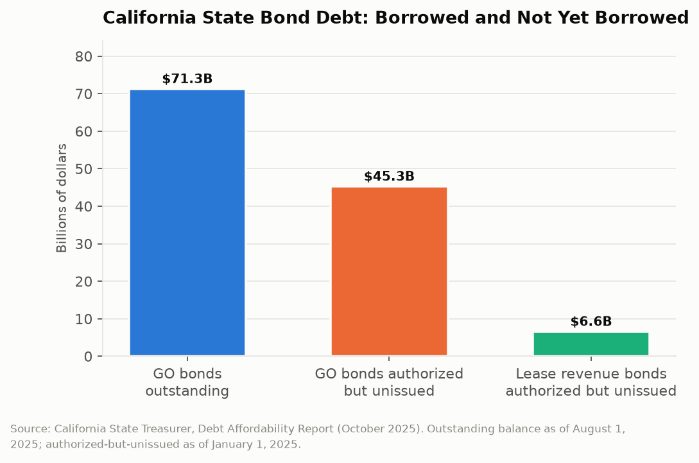

# California Counts: The Debt Not Yet Borrowed
## California owes $71.3 billion on general obligation bonds and has voter permission to borrow $45.3 billion more that it has not yet touched

When California voters approve a bond measure, they authorize borrowing rather than perform it. The state sells the bonds later, in tranches, as projects need cash, which can take a decade or more. That produces a distinctive feature of California's balance sheet: a large stock of authorized but unissued debt, approved by voters in past elections, sitting on the books as a commitment the state has not yet incurred but cannot easily decline. As of January 2025 that stock was $45.3 billion in general obligation bonds, against $71.3 billion actually outstanding.

---

## The Topline: $71.3 Billion Borrowed, $45.3 Billion Approved

The Treasurer's annual Debt Affordability Report is the only place these figures appear together, and the comparison is the report's most useful single output.

Outstanding general obligation bond debt was $71.3 billion as of August 1, 2025. Authorized but unissued general obligation bonds stood at approximately $45.3 billion as of January 1, 2025. A further $6.6 billion in lease revenue bonds was authorized and unissued as of the same date.

Add the authorized-but-unissued general obligation total to the outstanding balance and California's general obligation commitment is roughly $116.6 billion, of which about 61 percent has been borrowed. The remaining 39 percent is a queue.

Total debt service on the state's bonded debt accounted for about 3.3 percent of total governmental funds as of fiscal year 2023, which is a modest ratio by the standards of both state government and any household comparison. The state sold over $9.45 billion of general obligation and lease revenue bonds primarily payable from the general fund in the most recent fiscal year, and recent refunding transactions are projected to save $134 million in debt service over twenty years, $91 million on a present value basis.

---

## Why the Queue Exists

Authorized-but-unissued debt is a consequence of the ballot measure mechanism, and it is a feature rather than a defect.

A voter-approved bond is a legal authorization with no expiration in most cases. The state issues against it when the funded projects reach the point of needing money, which for a school construction program means as districts complete applications and break ground, and for a water infrastructure program means after permitting, design, and environmental review. That sequence takes years. Issuing the full authorization on approval day would leave the state paying interest on cash sitting in an account.

So the queue is prudent cash management. It is also a fiscal commitment that a future Legislature inherits and cannot readily modify. The voters authorized the borrowing; the projects have sponsors; the appropriations follow. A Legislature facing a deficit can defer issuance, which defers the debt service, but deferral is not cancellation and the deferred projects accumulate.

The stock has grown recently because voters keep adding to it. The November 2024 ballot carried two ten-billion-dollar bonds, one for school facilities and one for climate and water resilience, both of which passed. Those authorizations entered the queue and will be issued over the following decade. The Treasurer's own analysis notes that California's debt ratio is likely to increase over the next several years specifically because of the authorized-but-unissued stock working its way into the outstanding balance.

---

## What 3.3 Percent Means

The debt service ratio is the figure that determines whether any of this is a problem, and it is the figure that is most often either ignored or misused.

At roughly 3.3 percent of total governmental funds, California's debt service is well within the range that rating agencies and public finance analysts consider manageable. It is not close to any threshold that would constrain the state's market access. California carries investment-grade ratings, sells bonds at spreads that reflect a large diversified economy, and has never defaulted on a general obligation bond.

The ratio also understates the state's total obligation picture in a way worth naming. Bonded debt is one of several long-term liabilities. Unfunded pension obligations at CalPERS and CalSTRS, retiree health care liabilities, and the outstanding federal unemployment insurance loan this series examines separately are all commitments that do not appear in the bond debt figure. Bonded debt is the most visible, most transparently reported, and among the smaller of California's long-term liabilities, which is a combination that tends to concentrate public attention on the wrong number.

The general obligation pledge is what makes bonded debt different in kind. General obligation debt service is paid from the general fund with a constitutional priority that sits above nearly every other claim, including education funding. That priority is why the bonds price well and why the ratio matters: a rising debt service obligation crowds out discretionary spending automatically, without any legislative decision.

| Category | Amount | As of |
|---|---|---|
| GO bonds outstanding | $71.3 billion | August 1, 2025 |
| GO bonds authorized but unissued | $45.3 billion | January 1, 2025 |
| Lease revenue bonds authorized but unissued | $6.6 billion | January 1, 2025 |
| Bonds sold in the prior fiscal year | $9.45 billion | FY 2024-25 |
| Debt service as share of governmental funds | ~3.3% | FY 2023 |

---

## The Ballot Box as a Capital Committee

The more interesting structural observation is about who decides.

California's capital plan is assembled by ballot measure. A school construction bond appears because the school facilities coalition qualified it. A water bond appears because water agencies and environmental groups negotiated a package. Each measure is presented to voters individually, in a specific election, against a specific set of competing measures, with no mechanism for voters to compare it against the other capital needs the state has or against the debt service it will require.

The consequence is a capital program that reflects which coalitions were organized in which election years rather than a ranked assessment of state infrastructure needs. The projects in the queue were prioritized by the interest groups that drafted the measures. There is no state capital improvement plan in the sense that a city or a corporation would recognize one, ranking projects by return and sequencing them against a borrowing capacity constraint.

The Treasurer's Debt Affordability Report is the closest thing California has to that document, and it is analytic rather than decisional. It reports the capacity. It does not allocate it.

---

## The Interpretive Tension

The critical read is that California has assembled a $116.6 billion general obligation commitment through a sequence of individually-voted ballot measures with no mechanism for comparing them against each other or against the state's actual infrastructure priorities. The $45.3 billion authorized-but-unissued stock is a decade of future debt service that a future Legislature cannot decline and did not choose, and the Treasurer's own analysis says the debt ratio will rise as it issues. The general obligation pledge gives that debt service constitutional priority over education and health spending, which means the crowding-out is automatic. And the state's most consequential capital decisions are made by whichever coalition can raise signature-gathering money in a favorable election year.

The generous read is that a 3.3 percent debt service ratio is a genuinely conservative number for a state with California's infrastructure needs, and that borrowing to build long-lived assets is exactly what bond financing is for. Voter approval of general obligation debt is a more democratic mechanism than legislative borrowing and has functioned as a real constraint: California voters have rejected bond measures, which is not true of every borrowing authority. The authorized-but-unissued stock reflects disciplined cash management rather than deferred obligation, since issuing early would waste interest. The Treasurer publishes an annual Debt Affordability Report with the outstanding balance, the authorized-but-unissued stock, the ratio, and the projections, which is transparency that lets anyone run this analysis. And the state actively refunds debt when rates permit, saving $134 million on the most recent transaction.

---

## What the Data Doesn't Show

The Debt Affordability Report covers state bonded debt. It does not cover the debt of school districts, cities, counties, or special districts, which collectively borrow far more than the state does and whose obligations fall on the same taxpayers. California's aggregate public debt is not published in any single document.

Authorized-but-unissued totals do not carry an issuance schedule. There is no published timeline for when the $45.3 billion enters the outstanding balance, which means the debt service projections in any given year depend on assumptions about issuance pace that are not themselves published.

The report also reports debt service against total governmental funds rather than consistently against general fund revenues, and different analysts use different denominators, which makes cross-year and cross-state comparison of the ratio treacherous. A figure quoted as three percent under one denominator can be five percent under another.

And nothing in the debt data connects a bond to an asset. California reports what it borrowed and what it owes. It does not report, in the same document or any other, whether the schools, water projects, and hospitals the borrowing paid for were built, what they cost against estimate, or whether they work.

---

Seventy-one billion dollars borrowed, forty-five billion approved and waiting, and a debt service line with constitutional priority over almost everything else in the budget. California's voters have been assembling a capital program one measure at a time for sixty years, and the only document that adds it up is a report from the Treasurer that has no authority to change any of it.

---

*Data sources: [California State Treasurer, Debt Affordability Report, October 2025](https://www.treasurer.ca.gov/publications/dar/2025.pdf); [State Treasurer Debt Highlights](https://www.treasurer.ca.gov/inside/divisions/PFD/debt-highlights); [State Treasurer Public Finance Division](https://www.treasurer.ca.gov/bonds/); [California Debt and Investment Advisory Commission, Debt Line](https://www.treasurer.ca.gov/cdiac/debtpubs/2025/202508.pdf); [California Debt Financing Guide, State General Obligation Bonds](https://debtguide-api.treasurer.ca.gov/guide-pages/chapter-3-types-of-debt-obligations-issued-by-public-agencies/3-9-state-financings/3-9-1-state-general-obligation-bonds). Figures are as reported by the State Treasurer at the dates noted; the combined commitment total is arithmetic.*

*This is installment #173 of California Counts, a data journalism series examining California state programs, spending, and policy through publicly available data. All data and analysis available on request.*

*Disclosure: This post was drafted with the assistance of an AI agent (Claude) and has not been independently verified by a human editor.*
