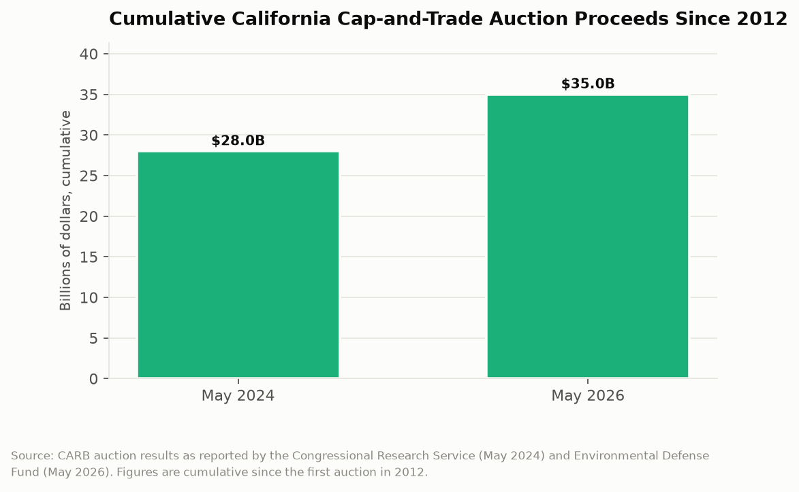

# California Counts: The Carbon Auction
## Thirty-five billion dollars raised by selling permission to emit, and a revenue stream that succeeds by shrinking

Four times a year, California holds an auction. The item for sale is a permit to emit one metric ton of carbon dioxide, and the buyers are refineries, cement plants, electricity importers, and fuel distributors that are legally required to hold one permit for every ton they release. The auctions began in 2012. As of May 2026 they have collected roughly $35 billion. That money now funds high-speed rail, electric vehicle rebates, wildfire prevention, affordable housing near transit, and about forty other programs, which creates a structural oddity worth examining: California has built a substantial part of its climate budget on a revenue source that is designed to dry up.

---

## The Topline: $35 Billion and Counting

The cumulative figure is the cleanest way to see the program's scale.

Roughly $28 billion in cumulative proceeds as of May 2024, and roughly $35 billion as of May 2026. Seven billion dollars in two years. Auction proceeds peaked at a reported $8.1 billion in the 2023-24 fiscal year and have been declining since.

For scale, $35 billion is more than California has spent on homelessness across all programs in the past five years, and it was raised without a vote of the people, without a tax increase in the conventional sense, and without appearing on anyone's tax return. It arrives through a market mechanism that most Californians have never thought about and that shows up in their lives primarily as a line on a utility bill labeled the climate credit.

That last detail is worth noting because it is unusual. A portion of allowance value is returned directly to ratepayers as a credit, which means the program both collects money from emitters and refunds some of it to households, on the theory that the price signal should hit the emitter's decision without hitting the household's budget. Whether that works as designed is one of the more interesting empirical questions in California climate policy and is not answerable from the auction data.

---

## How a Falling Revenue Line Is the Goal

The mechanism is a declining cap. Each year California issues fewer allowances than the year before, which is the entire point: the quantity of legal emissions shrinks on a schedule. In a well-functioning market, scarcity raises the price per allowance even as the number of allowances falls, and total revenue depends on which effect dominates.

That makes cap-and-trade revenue structurally unlike a tax. Sales tax revenue rises when the economy grows. Income tax revenue rises when high earners do well. Cap-and-trade revenue rises when emitters need more permits than are available and falls when they need fewer, and the program's success condition is that they eventually need almost none. A climate program that works puts itself out of business as a revenue source.

California has spent the money as though this were not true. The Greenhouse Gas Reduction Fund, created by the Legislature in 2012 to receive auction proceeds, now carries continuous appropriations: a fixed percentage of proceeds is statutorily committed to high-speed rail, another share to affordable housing and sustainable communities, another to transit. Those are multi-year capital commitments funded by a revenue stream with quarterly volatility and a long-term downward design.

The result is a recurring budget problem that appears whenever auction prices soften. Allowance prices have dropped to the floor in past quarters, and when they do, the Legislative Analyst's Office produces revised projections showing hundreds of millions or billions less than the expenditure plan assumed. The programs that get cut are the discretionary ones, because the continuous appropriations are protected by statute. A program's priority under this structure is determined less by current policy judgment than by which year its funding formula was written into law.

---

## The Reauthorization Question

The program's legal authorization runs out, which turns a market design question into a legislative one on a deadline. Extensions have been contested each time, and the 2026 round of amendments carries revenue implications that analysts have modeled explicitly: the same emissions budget can produce materially different program revenues depending on how allowance banking, price containment reserves, and offset limits are structured.

That is the part of the program that deserves more public attention than it gets. Two designs can deliver identical tonnage of emissions reduction while differing by billions in state revenue, because the revenue is a function of market rules rather than of environmental outcomes. Deciding those rules is deciding how much money California has for climate spending, and it is a decision made in technical amendments rather than in a budget debate.

| Measure | Figure |
|---|---|
| Cumulative proceeds, May 2024 | ~$28 billion |
| Cumulative proceeds, May 2026 | ~$35 billion |
| Reported peak fiscal year | 2023-24, $8.1 billion |
| First auction | 2012 |
| Auctions per year | 4 |

---

## What the Money Bought

The expenditure side is where accountability gets difficult, and not because the spending is hidden. California publishes annual reports on GGRF expenditures with program-level detail and estimated emissions reductions per dollar.

The difficulty is that the estimated reductions are modeled rather than measured. A rebate that helped someone buy an electric vehicle is credited with the emissions of the gasoline vehicle they would otherwise have driven, which requires assuming what they would otherwise have done. A weatherization grant is credited with the heating energy the home no longer uses, estimated from engineering models rather than meter readings. Neither assumption is unreasonable and neither is verifiable at the program level.

This produces the awkward situation in which California can state its auction revenue to the dollar and can state its emissions reductions only within a range that depends on counterfactual assumptions. The revenue side of the ledger is audited. The benefit side is estimated.

---

## The Interpretive Tension

The critical read is that California has built a $35 billion climate finance apparatus whose spending priorities were locked in by statute in the 2010s and are now defended by the programs receiving the money rather than by their emissions performance. High-speed rail's continuous appropriation has survived every revenue shortfall while more direct emissions interventions were cut, which is a political outcome rather than an analytic one. The state has also made itself fiscally dependent on carbon emissions continuing, creating the perverse position in which a faster-than-expected decarbonization produces a budget crisis in the climate programs. And the entire mechanism rests on a market whose rules the state sets, which means the revenue is ultimately a policy choice being presented as a market outcome.

The generous read is that cap-and-trade has done what almost no other American climate policy has done, which is raise tens of billions of dollars for decarbonization while covering roughly 80 percent of the state's emissions under a binding declining cap, and do it through a mechanism that lets emitters find the cheapest reductions rather than having the state guess. California's emissions have fallen while its economy grew, which is the outcome the program was built to produce. The revenue volatility is real and is the honest consequence of a design that prices scarcity rather than levying a fixed rate, and the alternative, a carbon tax, was and remains politically unavailable in a state where tax increases require a legislative supermajority. A program that has moved $35 billion into climate investment over fourteen years is not a failure because its out-year projections are uncertain.

---

## What the Data Doesn't Show

Auction results report the settlement price, the quantity sold, and the proceeds. They do not report which entities bought, in what volume, or at what cost basis, because bidder identity is confidential. That means the public cannot see whether allowance holdings are concentrated, whether specific refiners are banking allowances for later compliance, or how much of the market is financial rather than compliance-driven.

The proceeds figures also blur an important distinction. Some allowance value is consigned by utilities and returned to ratepayers rather than deposited in the GGRF, so cumulative auction proceeds and cumulative state climate spending are not the same number, and headline totals do not always make clear which is being reported. The $28 billion and $35 billion figures cited here come from different analysts using different reporting dates.

Finally, nothing in the auction data connects a ton of emissions to a place. Cap-and-trade is deliberately geography-blind, which is efficient and which is also the basis of the longstanding environmental justice objection that emissions reductions have not occurred in the communities nearest the emitters. Answering that requires the facility-level emissions data and the CalEnviroScreen pollution burden data, not the auction file.

---

Thirty-five billion dollars, collected four times a year, from companies bidding for permission to do something the state intends to make impossible. California built a revenue machine out of the thing it is trying to eliminate and then wrote multi-decade spending commitments against it. The auctions will keep clearing until the allowances run out. The budget plans mostly assume they will not.

---

*Data sources: [California Air Resources Board Cap-and-Trade Program Data](https://ww2.arb.ca.gov/our-work/programs/cap-and-trade-program/cap-and-trade-program-data); [CARB Auction Information](https://ww2.arb.ca.gov/our-work/programs/cap-and-trade-program/auction-information); [Congressional Research Service, The California Cap-and-Trade Program](https://www.congress.gov/crs-product/R48314); [Legislative Analyst's Office Cap-and-Trade Auction Updates and GGRF Projections](https://lao.ca.gov/Publications/Report/4480); [Resources for the Future, Revenue Implications from California Cap-and-Trade Amendments](https://www.rff.org/publications/issue-briefs/california-cap-and-trade-emissions-budget-climate-policy/); [International Carbon Action Partnership, California Cap-and-Invest](https://icapcarbonaction.com/en/ets/usa-california-cap-and-invest-program). Cumulative proceeds figures are as reported by the cited analysts at the dates noted.*

*This is installment #163 of California Counts, a data journalism series examining California state programs, spending, and policy through publicly available data. All data and analysis available on request.*

*Disclosure: This post was drafted with the assistance of an AI agent (Claude) and has not been independently verified by a human editor.*
