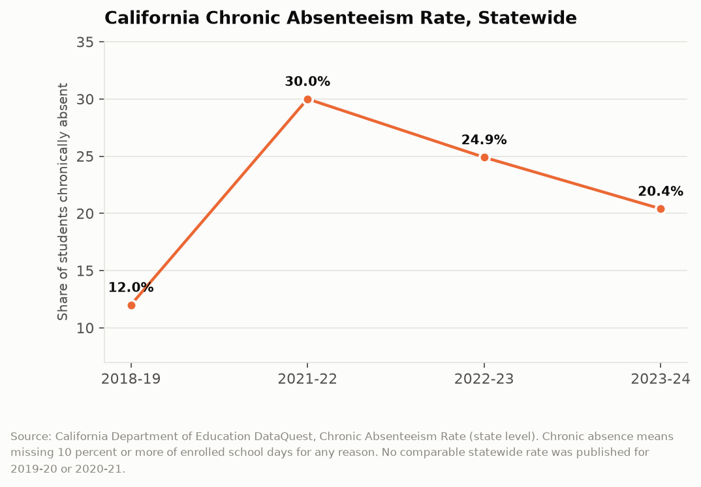

# California Counts: The Empty Desk
## Chronic absence nearly tripled in two years, has fallen for three straight years, and is still nowhere near where it started

California defines chronic absence as missing ten percent or more of the school days a student is enrolled for, which in a standard year means eighteen days for any reason at all: flu, a family trip, a missed bus, a suspension, a parent working a shift that makes the morning impossible. In 2018-19, 12.0 percent of California students hit that threshold. In 2021-22, 30.0 percent did. The state has spent three years climbing back down a hill it took two years to climb up, and it is not down yet.

---

## The Topline: 12 Percent to 30 Percent to 20 Percent

The statewide chronic absence rate from the Department of Education's DataQuest system shows the clearest shape of any education indicator California publishes.

Twelve percent in 2018-19. Thirty percent in 2021-22, the first year after the return to full in-person instruction. Then 24.9 percent in 2022-23, and 20.4 percent in 2023-24. Three consecutive years of improvement, each one smaller than the last: a 5.1 point drop, then a 4.5 point drop. At that rate of deceleration California reaches its pre-pandemic baseline sometime in the 2030s.

The middle of that series is missing for a reason. The state did not publish a comparable statewide rate for 2019-20 or 2020-21, because during distance learning the denominator stopped meaning anything. A student logged into a Zoom class from a phone in a car was present by one definition and absent by another, and the state declined to pretend otherwise. The gap in the chart is the state's own acknowledgment that it could not measure the thing during the period when the thing changed most.

What that leaves is a before and an after with no observable transition. Twelve percent, then thirty. Whatever happened, happened in the dark.

---

## Why the Threshold Is the Story

Ten percent sounds forgiving until you do the arithmetic. A 180-day school year makes the line eighteen days. Eighteen days is one bad case of strep, one family funeral out of state, and one week of a parent's hospitalization. It is not a measure of truancy, which California tracks separately and which requires unexcused absences. Chronic absence counts every absence, excused and unexcused alike, because the research finding behind the metric is that seat time predicts outcomes regardless of why the seat was empty.

That design choice is what makes the 2021-22 figure interpretable. Thirty percent of California students missing eighteen or more days is not thirty percent of California students skipping school. It is a state in which respiratory illness guidance told families to keep symptomatic children home, in which COVID exposure protocols generated multi-day exclusions, and in which the social contract that says a child with a cough goes to school anyway had been deliberately and correctly dismantled. Some large share of the 2021-22 spike is families following public health instructions.

The part that does not resolve so neatly is the decline curve. Illness-driven absence should fall quickly as protocols relax, and it did: the first year of recovery took 5.1 points off. But the second year took only 4.5, and the state is still 8.4 points above where it started six years earlier. Something in the 2023-24 number is not about illness.

---

## The Habit Hypothesis

The explanation that the research community has converged on is that attendance is a habit, that the habit is maintained by a dense web of small expectations, and that California broke the web for eighteen months and has not fully rebuilt it.

The mechanics are mundane. A family that arranged childcare around a school schedule for years stopped needing to, and the arrangement lapsed. A parent who took a job with a shift that conflicts with the school run took it during a period when the school run did not exist. A student who learned in 2020 that the consequences of missing a day were negligible retained the lesson. A school office that spent two years unable to enforce attendance stopped having the staff position that made the calls.

None of that shows up in the absence data, which records only whether the desk was empty. It shows up in the shape of the curve: a rate that falls fast when the mechanical cause is removed and then slows down when what remains is a changed set of household routines across roughly eight hundred thousand families.

There is also a funding dimension that the attendance rate makes visible and that the state's school finance system makes consequential. California funds districts through average daily attendance, which means a chronically absent student generates less revenue than an enrolled one. A district facing a ten-point increase in chronic absence faces a revenue problem at the same moment it faces an intervention cost, and the intervention that works is labor-intensive: home visits, attendance clerks, transportation fixes, and health services. The metric that identifies the need also reduces the money available to meet it.

| School year | Chronic absence rate | Change |
|---|---|---|
| 2018-19 | 12.0% | baseline |
| 2021-22 | 30.0% | +18.0 points |
| 2022-23 | 24.9% | -5.1 points |
| 2023-24 | 20.4% | -4.5 points |

---

## What It Sits Next To

Chronic absence is not the only California education indicator that moved during this period, and the comparison sharpens it. The statewide four-year graduation rate rose from 86.4 percent in 2023-24 to 87.5 percent in 2024-25, a record. Test scores recovered partially. The state's accountability dashboard shows improvement in most academic indicators.

That combination is genuinely difficult to read. A state where one student in five is chronically absent and the graduation rate is setting records is a state where either the absences are not costing what the research says they cost, or the diploma is measuring something other than what it used to measure. Both possibilities have serious implications, and the two datasets cannot distinguish between them because they are not linked in any published form.

---

## The Interpretive Tension

The critical read is that California has normalized a level of school absence that it would have treated as a crisis in 2019. Twenty percent chronic absence means roughly 1.2 million students missing eighteen or more days, and the state's response has been a set of grant programs and guidance documents rather than a structural change to how schools are staffed for attendance work. The improvement is decelerating, which is what a problem looks like when the easy part of the fix is exhausted and the hard part has not been funded. Meanwhile the funding formula actively penalizes districts with the worst absence for having it, which is close to the opposite of how a system designed to solve the problem would allocate money.

The generous read is that a state which nearly tripled its chronic absence rate under the most disruptive event in the history of American public schooling has cut the excess by more than half in three years without any single dramatic intervention, which is a real achievement by ordinary bureaucratic means. Much of the residual elevation reflects a permanent and desirable change in norms about sending sick children to school, and a state that had returned exactly to 12.0 percent would be a state that had relearned a bad habit. California publishes this number annually, at the school level, disaggregated by subgroup, which is more transparency than most states offer about their least flattering indicator, and the improvement trend is only legible because the state kept publishing it.

---

## What the Data Doesn't Show

DataQuest reports whether a student crossed the ten percent threshold. It does not report why. Excused and unexcused absences are combined by design, which means the rate cannot distinguish a family following medical advice from a family that has disengaged, and those two situations call for opposite responses.

The rate is calculated on days enrolled, so a student who moves districts mid-year is measured against a shorter denominator and can be flagged chronically absent on fewer total days. Student mobility and chronic absence are correlated, which makes the two hardest-to-serve populations partly the same population and partly an artifact of how the measure works.

Nothing in the attendance file connects to outcomes. The state publishes absence rates and it publishes test scores and graduation rates, but not a linked student-level file that would let anyone outside the department test whether the 2021-22 cohort's absences predicted its results. That analysis is possible inside CDE. It is not possible from the public data.

---

One in five California students missed at least eighteen days of school last year, the state knows exactly which students and which schools, and the funding formula responds by sending those schools less money. The absence data is good enough to find every empty desk in the state. What it cannot show is whether anyone went looking.

---

*Data sources: [California Department of Education DataQuest, Chronic Absenteeism Rate](https://dq.cde.ca.gov/dataquest/DQCensus/AttChrAbsRate.aspx?agglevel=State&cds=00&year=2023-24); [CDE Chronic Absenteeism Data files](https://www.cde.ca.gov/ds/ad/filesabd.asp); [CDE 2024-25 End-of-Year Data Release](https://www.cde.ca.gov/ds/cm/dqeoy25.asp); [Policy Analysis for California Education, Unpacking California's Chronic Absence Crisis](https://edpolicyinca.org/publications/unpacking-californias-chronic-absence-crisis-through-2023-24); [California School Boards Association attendance brief](https://www.csba.org/). Rates are as published by CDE.*

*This is installment #160 of California Counts, a data journalism series examining California state programs, spending, and policy through publicly available data. All data and analysis available on request.*

*Disclosure: This post was drafted with the assistance of an AI agent (Claude) and has not been independently verified by a human editor.*
