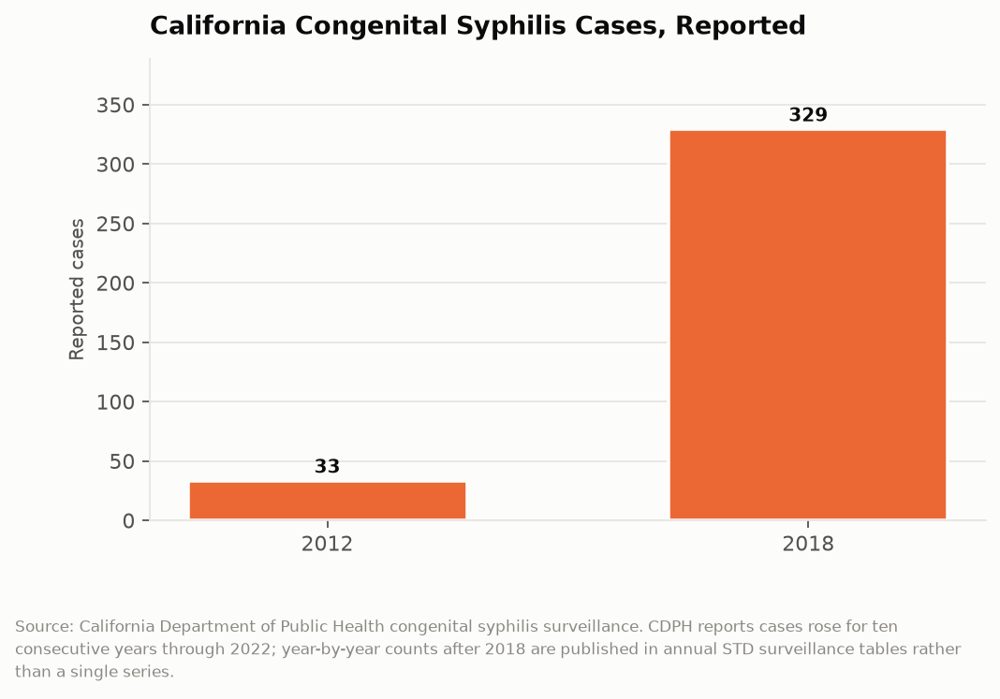

# California Counts: The Preventable Return
## Congenital syphilis cases rose nearly 900 percent in six years in a state where the cure costs less than a tank of gas

Congenital syphilis happens when an untreated infection passes from a pregnant woman to her fetus. It causes stillbirth, bone deformity, blindness, deafness, and death. It is detected by a blood test that costs a few dollars and prevented by a single intramuscular injection of penicillin, a drug that has been available since 1943. California recorded 33 cases in 2012. By 2018 it recorded 329. The disease that American medicine considered solved came back in a state that spends more than $300 billion a year.

---

## The Topline: 33 to 329

The CDPH congenital syphilis surveillance series is short, simple, and hard to look at.

Thirty-three cases in 2012. Three hundred twenty-nine in 2018. An increase of nearly 900 percent over six years. CDPH reported that cases rose for ten consecutive years through 2022, which means the 2018 figure was not a peak but a waypoint. By 2023, 37 of California's 61 local health jurisdictions, 60.7 percent of them, reported at least one case. The yearly count is at its highest point since 1950.

Nineteen fifty is the comparison that matters. In 1950, penicillin had been in civilian use for roughly seven years, the federal venereal disease control program was young, and prenatal syphilis screening was not yet standard. California has since built a universal prenatal screening recommendation, a Medi-Cal program covering roughly half of all births in the state, and a public health infrastructure of 61 local jurisdictions. With all of that in place, it is producing congenital syphilis at mid-century rates.

This is not a hard disease. That is the entire point of the number.

---

## Where the Chain Breaks

Congenital syphilis requires a specific sequence of failures, and CDPH's own case reviews identify where the sequence breaks in California. Most pregnant women who gave birth to infants with congenital syphilis received prenatal care late in pregnancy or not at all.

That single finding reframes the problem. Congenital syphilis is not primarily a syphilis problem. It is a prenatal care access problem that happens to be measured in syphilis cases, because syphilis is the condition where the absence of prenatal care produces an immediate, visible, countable harm to a newborn.

The chain has four links and each one fails for different reasons. A woman has to know she is pregnant early enough for treatment to work, which requires a pregnancy test and a reason to take one. She has to enter prenatal care, which requires insurance, transportation, a provider accepting new patients, and a schedule that permits appointments. She has to be screened, which requires the provider to order the test, and California has progressively strengthened the screening requirement precisely because providers were not always ordering it. And she has to receive penicillin at the right stage, which requires the result to come back, someone to act on it, and the patient to be reachable.

Each link fails most often for the same population: women without stable housing, women using drugs, women without insurance, and women in rural counties with no obstetric provider within an hour's drive. Those are the same populations that show up in this series under homelessness, fentanyl, maternal health, and rural hospital closures. Congenital syphilis is what those four datasets look like when they intersect in one body.

---

## The Geography

That 37 of 61 local health jurisdictions reported a case in 2023 is the detail that distinguishes the current outbreak from a localized one. Congenital syphilis in California is not a Los Angeles phenomenon or a Central Valley phenomenon. It is present in the substantial majority of the state's public health jurisdictions, which include large counties, small rural counties, and the three city health departments.

Geographic spread changes what an effective response looks like. A concentrated outbreak can be addressed by surging resources into one jurisdiction. A dispersed one requires every jurisdiction to maintain a capability, which is a much more expensive proposition in a state where local health department funding varies by orders of magnitude between counties. A rural county health department with four communicable disease staff cannot run the kind of field investigation and partner notification program that stops transmission, and the state's structure leaves that capability at the local level.

CDPH has issued health alerts for specific regions, including Northern California and the Central Coast, which indicates the agency is tracking regional acceleration rather than a statewide uniform rise. Those alerts are addressed to providers and ask for screening at first prenatal visit, at 28 weeks, and at delivery.

| Indicator | Figure |
|---|---|
| Reported cases, 2012 | 33 |
| Reported cases, 2018 | 329 |
| Increase, 2012 to 2018 | ~900% |
| Consecutive years of increase through 2022 | 10 |
| Local health jurisdictions reporting a case, 2023 | 37 of 61 |
| Cost of the curative treatment | one penicillin injection |

---

## What It Costs to Not Prevent

The economics here are unusually lopsided, which is what makes the case count function as an indictment of the delivery system rather than a description of a disease.

A prenatal syphilis screen is a blood test. Treatment for a pregnant woman with syphilis is benzathine penicillin G, a generic drug. The intervention that prevents a case of congenital syphilis costs, in materials, something on the order of a restaurant meal.

A case of congenital syphilis costs a neonatal intensive care admission, a ten-day course of intravenous penicillin for the infant, lifetime management of any resulting neurological or skeletal damage, and in some cases a stillbirth. Medi-Cal pays for most of this, because the population affected is disproportionately Medi-Cal eligible. The state is on both sides of the ledger: it pays for the screening it did not deliver and it pays for the NICU stay that followed.

Published scenario projections for California through 2030 model the case trajectory under different intervention assumptions, which is a reasonable exercise and also an admission that the baseline is a rising line. Modeling the future of a preventable disease implies that prevention is being treated as a variable rather than a given.

---

## The Interpretive Tension

The critical read is that a nearly 900 percent increase in a disease curable by a 1943 drug is a direct measurement of California's failure to deliver basic care to its poorest pregnant residents. The state has universal Medi-Cal pregnancy coverage on paper, a screening mandate on paper, and 61 local health jurisdictions on paper, and the outcome is mid-century case rates. The rise continued for at least ten consecutive years, which is long enough for every level of the system to have noticed and responded. That it kept rising through a decade of awareness suggests the constraint is not information but capacity: local health departments without field staff, obstetric deserts in rural counties, and a population whose lives are too unstable for a care model built around scheduled appointments.

The generous read is that California detects and reports congenital syphilis better than most states, and part of a rising case count in any surveillance system is improved surveillance. CDPH strengthened screening requirements during this period, which mechanically finds more cases. The state has issued regional health alerts, published case management protocols, and funded provider education, which is the recognized playbook. The underlying driver is a national surge in syphilis among women of childbearing age that is affecting every state, tied to methamphetamine and fentanyl use and to the collapse of the sexually transmitted infection clinic system after decades of federal disinvestment, none of which a state health department can reverse alone. California's rate remains below several other large states.

The two readings do not actually conflict on the operative fact: a child born with congenital syphilis in California in 2026 represents a system that had a cheap test, a cheap cure, and a coverage program, and did not connect them in time.

---

## What the Data Doesn't Show

Surveillance counts reported cases. A case requires a clinician to recognize, test, and report, which means undercounting is likely and concentrated exactly where care access is worst. A stillbirth in a woman who never received prenatal care may never be attributed to syphilis at all.

The published counts after 2018 appear in annual STD surveillance tables rather than as a single maintained time series, which makes the trend harder to chart than it should be for a decade-long increase that the department itself describes as ten consecutive years of growth. A state that wanted this number watched would publish it as a series.

The surveillance data records the case, not the chain of missed contacts that produced it. CDPH's case reviews capture some of that detail, but the public files do not let an outside analyst determine how many cases involved a woman who sought care and was not screened versus a woman who never entered care. Those are different failures requiring different fixes, and the public data cannot tell them apart.

---

Thirty-three cases, then three hundred twenty-nine, then ten straight years of increase, in a state where the cure has been sitting on a shelf for eighty-three years. California knows how to prevent this. The case count is a measure of the distance between knowing and doing, reported one newborn at a time.

---

*Data sources: [CDPH Congenital Syphilis program](https://www.cdph.ca.gov/Programs/CID/DCDC/Pages/CongenitalSyphilis.aspx); [CDPH Sexually Transmitted Infections in California surveillance reports](https://www.cdph.ca.gov/Programs/CID/DCDC/CDPH%20Document%20Library/2022-STD-Surveillance-Executive-Summary.pdf); [CDPH Congenital Syphilis Surveillance and Case Management Protocol](https://www.cdph.ca.gov/Programs/CID/DCDC/CDPH%20Document%20Library/CongenitalSyphilis-Surveillence-CaseManagement-Protocol.pdf); [California Perinatal Quality Care Collaborative congenital syphilis resources](https://cpqcc.org/resources/congenital-syphilis); [America's Health Rankings congenital syphilis, California](https://www.americashealthrankings.org/explore/measures/congenital_syphilis/CA). Case counts are as reported by CDPH.*

*This is installment #162 of California Counts, a data journalism series examining California state programs, spending, and policy through publicly available data. All data and analysis available on request.*

*Disclosure: This post was drafted with the assistance of an AI agent (Claude) and has not been independently verified by a human editor.*
