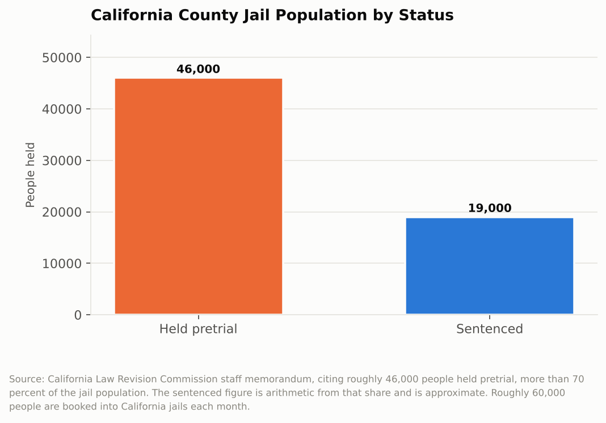
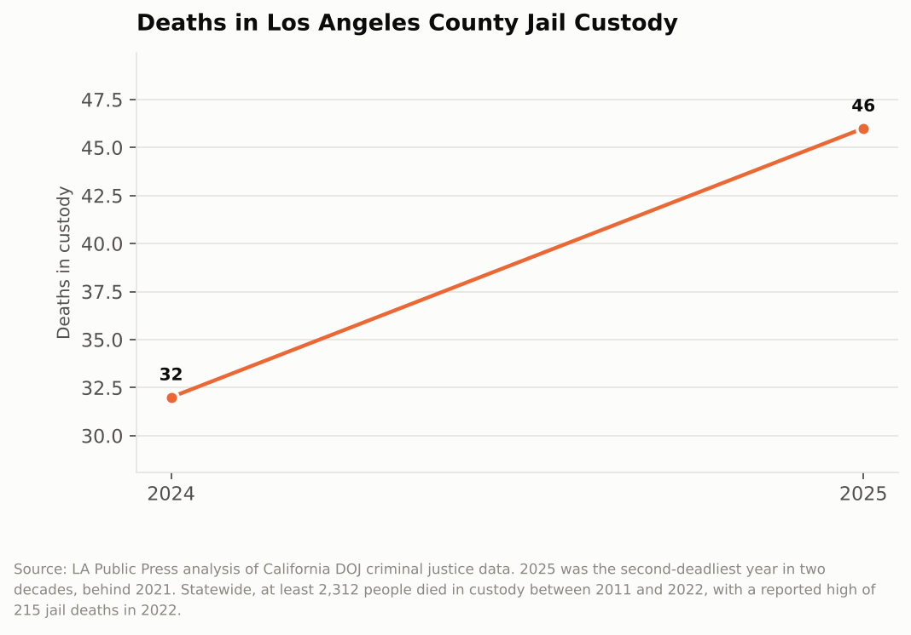

# California Counts: The County Cell
## More than seven in ten people in California jails have not been convicted of the thing holding them there

California's prisons hold people who have been convicted and sentenced, and this series has examined their population drawdown. California's jails are different institutions, run by 58 county sheriffs rather than by the state, and they hold a population that is mostly awaiting resolution of a case. Roughly 46,000 people are held pretrial in California jails, more than 70 percent of the jail population. Around 60,000 people are booked into those jails each month.

---

## The Topline: 46,000 Not Yet Convicted

The composition of the jail population is the structural fact that everything else follows from.

Roughly 46,000 people held pretrial, against a sentenced population in the high teens of thousands. More than 70 percent of everyone in a California jail cell on a given day is legally innocent and is there because a case has not been resolved and release was not granted.

The flow number is the one that conveys the scale of the institution. Sixty thousand bookings a month is 720,000 a year, in a state of 39 million. Most of those people are released within days. The 46,000 are the residue: the people whose cases did not resolve quickly and who did not get out.

Pretrial detention is not punishment, in law. It exists to secure appearance at trial and to protect public safety, and the legal standard is supposed to be individualized. In practice the determinant has historically been money, and California's attempt to change that is one of the more instructive policy episodes in recent state history. The Legislature passed a bill eliminating money bail in 2018; the bail industry qualified a referendum; voters rejected the law in 2020. The California Supreme Court then held separately that a court may not detain someone solely because they cannot afford bail. The result is a system operating under judicial constraint rather than statutory design, applied county by county.

---

## Fifty-Eight Different Systems

The word "jail" describes 58 separately governed institutions, and that fragmentation is why statewide analysis of this population is so difficult.

Each county sheriff runs the jail, sets the booking and release practices, contracts the medical care, and reports data to the Board of State and Community Corrections through the Jail Profile Survey. The BSCC aggregates it. But the reporting is self-submitted, the survey has gaps, and the publicly posted statewide trend documents run well behind: the version surfacing in searches for current figures covers through 2022 and carries a note that some data has not been reported.

That lag is not a minor inconvenience. California's jails are where its criminal justice reforms land. Realignment moved populations from state prisons to county jails. Proposition 47 and Proposition 36 both changed what offenses carry jail exposure. Every one of those policy changes was evaluated, or should have been, against jail population data that is submitted voluntarily by 58 elected officials and published on a multi-year delay.

Los Angeles County illustrates the scale of a single county within this. Its average daily jail population was 13,054 in 2025, up about 4 percent from 12,561 in 2024, and the sheriff's own quarterly reporting puts the pretrial share of that population between 52 and 54 percent. One county holds roughly a fifth of the state's jail population.

---

## Deaths in Custody

The outcome measure that the fragmented system produces most consistently is a death count.

Los Angeles County recorded 46 deaths in jail custody in 2025, up from 32 in 2024, a 44 percent increase. An analysis of California DOJ criminal justice data found 2025 to be the second-deadliest year in two decades for the LA jail system, surpassed only by 2021.

Statewide, at least 2,312 people died in custody in California between 2011 and 2022, with a reported high of 215 jail deaths in 2022. That is an average above 190 deaths per year across the period, in facilities holding people who are mostly awaiting trial.

California collects this data because Government Code section 12525 requires every law enforcement agency to report deaths in custody to the Department of Justice. The DOJ's Criminal Justice Statistics Center compiles it and publishes it through OpenJustice. The reporting requirement is one of the stronger custodial transparency statutes in the country, and the resulting dataset is the reason any of these figures exist.

The share attributable to county jails has been rising within that dataset. OpenJustice's own analysis found county sheriff's departments accounted for 17.1 percent of reported deaths in custody in 2010, 22.2 percent in 2014, and 20.6 percent in 2019.

| Measure | Figure |
|---|---|
| People held pretrial in California jails | ~46,000 |
| Pretrial share of jail population | more than 70% |
| Bookings into California jails per month | ~60,000 |
| Los Angeles County average daily population, 2025 | 13,054 |
| Los Angeles County average daily population, 2024 | 12,561 |
| Deaths in LA County jail custody, 2024 | 32 |
| Deaths in LA County jail custody, 2025 | 46 |
| Deaths in custody statewide, 2011 through 2022 | at least 2,312 |

---

## The Cost of Holding

The pretrial population is expensive in a way that does not appear in any single budget line, because the cost is distributed across county general funds, court budgets, and the households of the people detained.

A county pays to house, feed, and provide medical care to someone awaiting trial, at a daily cost that in California's larger counties runs into the hundreds of dollars. The detained person loses income, frequently loses the job, and in many cases loses housing, which is one of the documented pathways into the homelessness this series has examined. Dependent children enter the child welfare system. None of those downstream costs are charged against the detention decision that produced them.

The research literature finds that pretrial detention itself worsens case outcomes: detained defendants plead guilty more often and receive longer sentences than similarly situated released defendants, because detention removes the ability to wait. That is the part of the system where the legal fiction of innocence and the practical reality diverge most sharply, and it is not visible in any administrative dataset California publishes.

---

## The Interpretive Tension

The critical read is that California incarcerates roughly 46,000 legally innocent people on an average day, in 58 county systems whose population data is self-reported and published years late, and at least 2,312 people died in those systems over a twelve-year period. The state eliminated money bail by statute, saw it overturned at the ballot, and has since operated without a coherent pretrial framework, leaving the detention decision to vary by county. Los Angeles County's death count rose 44 percent in a year while its population rose 4 percent, which is a rate increase, not a volume effect. The state has the strongest custodial death reporting statute in the country and uses it primarily to document rather than to intervene.

The generous read is that a sheriff running a jail does not choose its population: courts set bail, prosecutors file charges, and the Legislature defines offenses. Pretrial populations are high because case processing is slow, which is a court capacity problem this series has examined under a different heading. California is one of very few states that requires every in-custody death to be reported to a central authority and published, which is why LA County's increase is knowable at all; most states cannot produce the equivalent number. The jail population is also substantially a product of realignment, a reform that reduced state prison crowding under federal court order and moved the pressure to counties that were given funding to absorb it. And the trend in reported crime, examined earlier in this series, has been sharply downward, which over time reduces the inflow.

---

## What the Data Doesn't Show

The BSCC Jail Profile Survey is self-reported by county sheriffs and has known gaps, including years where individual counties did not report. The statewide totals are therefore assembled from submissions of varying completeness, and the publicly posted trend documents lag the current year substantially.

Deaths in custody are reported under a statute, but researchers working with the data have documented significant limitations in how it is collected, including inconsistent classification of cause and manner of death across agencies. A death is reported; whether it was preventable is not a field.

The pretrial share is a point-in-time measure and understates how many people experience pretrial detention, because the sentenced population turns over slowly while the pretrial population churns. The 46,000 on a given day represent far more than 46,000 people over a year.

Most importantly, nothing published links the detention decision to the outcome. California does not publish a dataset connecting who was detained pretrial, for how long, and what happened to their case. The research on detention's effect on plea rates and sentence length comes from academic work in other jurisdictions. For California's own 46,000, the question of what detention did to their cases is not answerable from the state's data.

---

Forty-six thousand people will sleep tonight in a California jail without having been convicted of the offense that put them there, in facilities run by 58 separately elected officials, reporting population figures on a lag of several years and death figures under a statute the state passed because it did not trust the reporting otherwise. The jails are where every criminal justice reform California has passed actually lands. They are also the part of the system the state measures last.

---

*Data sources: [California Board of State and Community Corrections, Jail Profile Survey](https://www.bscc.ca.gov/wp-content/uploads/Jail-Pop-Trends-Through-Q3-2022.pdf); [California Law Revision Commission, Bail and Pretrial Release staff memorandum](https://clrc.ca.gov/CRPC/Pub/Memos/CRPC26-09.pdf); [California DOJ OpenJustice, Deaths in Custody 2010-2019](https://openjustice.doj.ca.gov/data-stories/2019/death-custody-2010-2019); [DOJ Death in Custody context document](https://data-openjustice.doj.ca.gov/sites/default/files/dataset/2022-08/Death%20in%20Custody%20Context_081122.pdf); [LA Public Press, Nearly one person died every week in LA County jail custody last year](https://lapublicpress.org/2026/01/one-person-died-every-week-la-county-jail/); [Los Angeles County Sheriff's Department, Custody Division Population Year End Review 2025](https://lasd.org/wp-content/uploads/2026/04/Transparency_Custody_Division_Population_2025_Year_End_Report.pdf); [Care First California, Lives Lost: A Decade of In-Custody Deaths](https://carefirstca.org/wp-content/uploads/2024/02/InCustodyDeaths.pdf). The sentenced population figure in the chart is arithmetic from the published pretrial share and is approximate.*

*This is installment #179 of California Counts, a data journalism series examining California state programs, spending, and policy through publicly available data. All data and analysis available on request.*

*Disclosure: This post was drafted with the assistance of an AI agent (Claude) and has not been independently verified by a human editor.*
