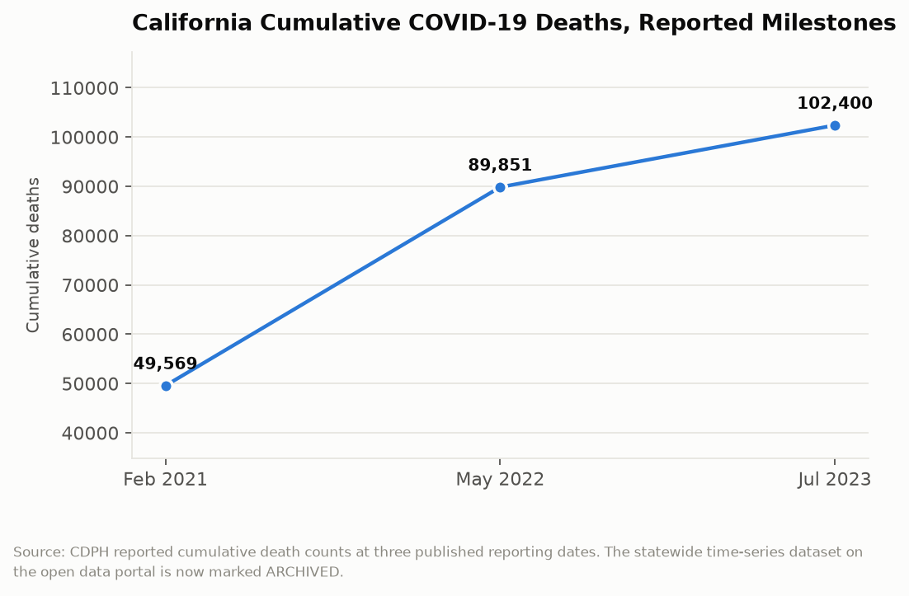

# California Counts: The Dataset That Stopped Counting
## What happens to a public health emergency when the open data file that measured it gets a banner reading ARCHIVED

For about three years, the most downloaded file on California's open data portal was a spreadsheet of COVID-19 cases and deaths by county. Reporters built dashboards on it. County supervisors quoted it in board meetings. Parents checked it before deciding whether to send a kid to school. Go looking for it today and the dataset page still loads, but the title now carries a parenthetical that changes what the file is: COVID-19 Time-Series Metrics by County and State (ARCHIVED). The numbers are still there. The counting stopped.

---

## The Topline: 102,400 Deaths, Three Reporting Dates

California's cumulative COVID-19 death toll, as reported by the Department of Public Health at three widely cited moments, traces the shape of the emergency better than any single figure can.

By late February 2021, the state had recorded 49,569 deaths. By May 2022, 89,851. Through July 2023, 102,400. The gap between the first two points is 40,282 deaths in fifteen months. The gap between the last two is 12,549 deaths in fourteen months. The curve bends because vaccines arrived, because the population had accumulated immunity, and because the virus itself changed. The deadliest single stretch was January 2021, when California was recording 688 COVID-19 deaths per day, roughly the equivalent of two fully loaded regional jets falling out of the sky every day for a month.

One hundred two thousand is a number that resists being felt. It is larger than the population of San Luis Obispo. It is roughly twice the number of Californians who died in traffic crashes across the entire decade of the 2010s. It happened in three and a half years, and the state produced a machine-readable file that let anyone watch it happen in near real time.

That machine is the part worth examining now. The deaths are a matter of historical record. The data infrastructure that recorded them is a live question about what California does next.

---

## What the Portal Actually Built

California's open data program launched in 2016 and spent its first four years as a mostly unremarkable civic-technology project: budget files, boundary shapefiles, inspection records, the usual furniture of an open data portal. Then March 2020 arrived and the portal became, briefly, one of the most consequential pieces of public infrastructure in the state.

The COVID-19 datasets did something the portal had never been asked to do. They updated daily rather than annually. They were consumed by automated pipelines rather than by humans downloading a CSV once. They carried a definitional burden that no budget file carries, because the question of what counts as a COVID-19 death required a coding decision that changed over time and that thousands of local officials had to apply consistently. And they were load-bearing: the state's own reopening framework, the color-coded tier system that determined whether a restaurant could seat people indoors, was keyed to metrics published in those files.

That last point is the one worth sitting with. For a period in 2020 and 2021, a row in a public spreadsheet determined whether a business in Fresno County could open its doors. California had built a governance mechanism in which the open dataset was not a report about policy but the trigger for it. Very few state data products have ever operated that way.

The portal has since migrated to a CKAN platform shared with the Natural Resources Agency and the Health and Human Services Agency, a consolidation that makes the state's data holdings easier to search across. The COVID files came along for the migration. They arrived with the archived label attached.

---

## What Archiving Means and Doesn't Mean

An archived dataset is not a deleted dataset, and the distinction matters. The files remain downloadable. The historical series is intact. Researchers studying excess mortality, vaccine effectiveness, or the distributional pattern of a respiratory pandemic can still get the county-by-county daily record for the period it covers.

What archiving means is that nobody is adding rows. CDPH moved its ongoing respiratory virus surveillance to a different reporting cadence, folded COVID-19 in alongside influenza and RSV, and reports on a weekly rather than daily basis through a dashboard rather than a bulk file. That is a defensible public health decision. Daily county-level case counts were a meaningful signal when testing was near-universal and free; they became close to meaningless once most testing moved to at-home kits that nobody reports.

The cost is subtler. A dataset that updates is a commitment. It implies a pipeline, a data steward, a definitional standard, and a budget line. When the commitment ends, the capability usually ends with it. The staff who built the daily extract move to other work. The validation scripts stop being maintained. The county-level reporting relationships, which were genuinely hard to establish, atrophy. If California needs daily county-level infectious disease data again, and at some point it will, the question is whether the state restarts from the position it reached in 2022 or from the position it held in February 2020.

---

## The Thing the Archive Can Still Tell Us

The archived files support an analysis that was hard to run while the emergency was live, because during the emergency everyone was looking at the most recent row. Now that the series is closed, it can be read as a whole.

Read that way, the California COVID record shows a pattern that the daily numbers obscured: the burden was not distributed anything like the population. Counties in the San Joaquin Valley recorded death rates substantially above coastal metropolitan counties despite having younger populations, which is the opposite of what an age-driven mortality pattern predicts. Imperial County, which appears elsewhere in this series for having the state's highest unemployment rate, recorded among the highest per-capita death rates in California during the first year. The pattern tracks occupational exposure, household crowding, and access to care far more closely than it tracks anything about the virus.

| Reporting date | Cumulative deaths | Change from prior point |
|---|---|---|
| Late February 2021 | 49,569 | baseline |
| May 2022 | 89,851 | +40,282 |
| July 2023 | 102,400 | +12,549 |

That is the analysis the archive enables, and it is the kind of analysis that only becomes possible once a series stops moving. There is a version of open data practice in which the closing of a dataset is the beginning of its usefulness rather than the end.

---

## The Interpretive Tension

The critical read is that California built an extraordinary public data capability under emergency conditions and then let it lapse without deciding to. No legislature voted to stop publishing daily county-level infectious disease data. No public process weighed the surveillance value against the cost. The capability was funded by emergency appropriations, and when the emergency funding ended the capability ended, which means the most consequential data infrastructure decision the state made in the last five years was made by the expiration of a budget line rather than by anyone choosing it. The archived banner is what a policy decision looks like when nobody makes it.

The generous read is that maintaining a daily data pipeline for a disease that is now endemic and largely tested at home would be theater. The signal quality collapsed. Case counts became a measure of who bothered to report a home test, which correlates with education and insurance status more than with infection. A state that kept publishing those numbers would be publishing a number that no longer measures what its name says it measures, and there is a real public cost to authoritative-looking data that has quietly stopped being accurate. CDPH folded COVID into a respiratory surveillance system that covers influenza and RSV too, which is arguably a more honest architecture than a disease-specific emergency apparatus running in perpetuity. Archiving a series that has lost its meaning is good data stewardship, not neglect.

Both readings accept the same fact: the state has less granular infectious disease data today than it had in 2021, and no plan on the public record for how quickly it could get that granularity back.

---

## What the Data Doesn't Show

The archived files record deaths attributed to COVID-19 under the case definition in force at the time, and that definition changed more than once. Deaths with COVID and deaths from COVID are not separated in the series. Deaths that never entered the surveillance system, particularly early deaths in spring 2020 before testing was widely available, are not in the file at all; the excess mortality literature suggests California's true toll is somewhat higher than 102,400.

The files show what was reported, not what happened. They show the state's counting capacity as much as the epidemic. And they contain nothing at all about the thing most readers actually want to know, which is whether any given intervention worked. Cases and deaths by county cannot answer a causal question about mask mandates or school closures without a research design that the dataset does not supply.

Most importantly for the argument here, the portal itself publishes no metadata about why a dataset was archived, who decided, or what would trigger its resumption. The archive label is the entire explanation on offer.

---

Somewhere in the state's file system is a spreadsheet that once determined whether restaurants in fifty-eight counties could serve people indoors, and it now sits behind a label that means nobody is watching it. That is probably correct. It is also the only record we have of how California learned to count something in real time, and the state has not written down what it learned. The next emergency will not announce which dataset it needs.

---

*Data sources: [California COVID-19 Time-Series Metrics by County and State, ARCHIVED (CHHS Open Data Portal)](https://data.chhs.ca.gov/dataset/covid-19-time-series-metrics-by-county-and-state); [COVID-19 Dashboard, ARCHIVED (CHHS Open Data Portal)](https://data.chhs.ca.gov/dataset/covid-19-dashboard); [California Department of Public Health COVID-19 updates](https://www.cdph.ca.gov/); [California Open Data Portal](https://data.ca.gov/); [USAFacts California COVID-19 summary](https://usafacts.org/visualizations/coronavirus-covid-19-spread-map/state/california/). Cumulative death figures are as reported by CDPH at the dates noted.*

*This is installment #159 of California Counts, a data journalism series examining California state programs, spending, and policy through publicly available data. All data and analysis available on request.*

*Disclosure: This post was drafted with the assistance of an AI agent (Claude) and has not been independently verified by a human editor.*
