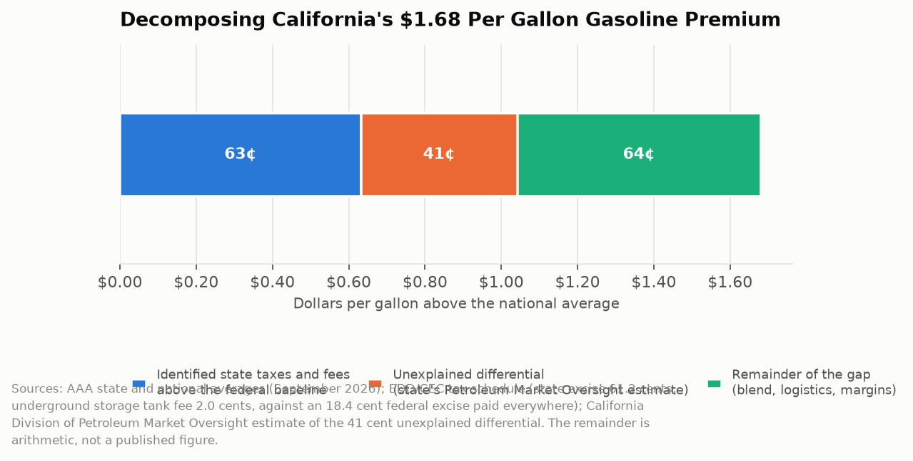

# California Counts: The Mystery Surcharge
## Californians pay $1.68 more per gallon than the national average, taxes explain about 63 cents of it, and the state's own oversight division cannot account for 41 cents

In September 2026 the AAA average price of a gallon of regular gasoline in California was $6.04. The national average was $4.37. The gap is $1.68 per gallon, which works out to roughly $25 extra on a fifteen gallon fill-up and, across a state that consumes on the order of thirteen billion gallons a year, tens of billions of dollars annually. California's taxes and fees account for part of it. The state created an agency in 2023 specifically to find out what accounts for the rest, and that agency's answer is that 41 cents of the gap is unexplained.

---

## The Topline: Decomposing $1.68

The premium can be broken into the part California imposes on purpose, the part its own oversight division cannot explain, and the remainder.

California's state gasoline excise tax is 61.2 cents per gallon. The underground storage tank fee is 2.0 cents. Those are on top of the 18.4 cent federal excise tax that every state pays, so the California-specific tax and fee differential above the national baseline is roughly 63 cents per gallon before accounting for state sales tax treatment and program costs.

The California Division of Petroleum Market Oversight, an independent unit inside the Energy Commission created by statute in 2023, has estimated that after adjusting for differences in taxes, fees, and other state-specific costs, Californians pay an extra 41 cents per gallon that it cannot account for. That figure is the division's own language: a mystery surcharge.

The remaining roughly 64 cents is the arithmetic residual, and it is where the legitimate cost differences live: California's unique reformulated gasoline blend, the cap-and-trade and low carbon fuel standard program costs embedded in wholesale prices, the state's isolation from national pipeline networks, and refinery margins. That residual is not a published figure. It is what is left when the two documented components are subtracted from the observed gap.

---

## Why California Is an Island

The structural explanation for most of the non-tax premium is that California's gasoline market is physically separate from the rest of the country.

The state mandates a unique cleaner-burning blend, California Reformulated Gasoline, which almost no refinery outside the state produces. There is no pipeline connecting California to Gulf Coast refining capacity. When a California refinery goes offline for maintenance or after an incident, replacement fuel has to arrive by ship, typically from Asia, on a timeline of weeks rather than days. The market has few participants, high barriers to entry, and no ability to import quickly.

The consequence is predictable and is documented in the price data: California gasoline prices spike harder and recover more slowly after supply disruptions than prices anywhere else in the country. A single unplanned refinery outage can move the statewide average thirty or forty cents within days. That is not price gouging in any legal sense. It is what a market with inelastic short-run supply does.

The complication is that this structure is now shrinking. California refineries have announced closures, which reduces in-state capacity further and increases dependence on imports, and the resulting uncertainty about the state's fuel supply has become a live policy fight. A state pursuing a transition away from gasoline has a genuine problem in that the transition's midpoint involves less refining capacity, higher prices, and a population that still overwhelmingly drives gasoline vehicles.

---

## What an Oversight Division Can and Cannot Find

The creation of the Division of Petroleum Market Oversight was California's institutional response to the 2022 price spike, when the in-state premium reached extraordinary levels and refinery margins in public filings reached record highs in the same quarter. The division has subpoena authority, receives mandatory refiner cost and margin reporting, and is staffed with economists.

Its central finding, the 41 cent unexplained differential, is a carefully constructed statement and worth reading precisely. It is not a finding of collusion. It is not a finding of illegality. It is a finding that after subtracting every cost difference the division can identify and document, a gap remains. That is the honest output of a rigorous exercise, and it is also, deliberately, an invitation.

The interpretive disagreement is entirely about what an unexplained residual means. Consumer Watchdog and allied groups read it as evidence of market power being exercised: a small number of refiners in a captive market extracting rent because nothing stops them. The Pacific Research Institute and industry-aligned analysts read it as evidence that the division's cost model is incomplete, and that the residual consists of real costs the division has not yet measured, including regulatory compliance costs, the capital cost of California-specific equipment, and the risk premium of operating in a jurisdiction actively planning to eliminate the product.

Both readings are consistent with a 41 cent residual. That is precisely the problem with a residual as a policy finding: it is defined by what is absent from the model rather than by anything observed.

| Component | Cents per gallon |
|---|---|
| California excise tax above federal baseline | 61.2 |
| Underground storage tank fee | 2.0 |
| Unexplained differential (DPMO estimate) | 41 |
| Remainder (blend, logistics, program costs, margins) | ~64 |
| Total premium over national average | ~168 |

---

## The Tax Part Is the Least Mysterious

It is worth stating plainly that the taxes are not the mystery, because the taxes are the part of the gap most often blamed for all of it.

Combined state and federal taxes, fees, and surcharges on California gasoline run roughly 80 to 90 cents per gallon in 2026. Subtract the 18.4 cent federal excise that every state pays, and California's own tax differential is roughly 63 cents. That is 37 percent of the $1.68 premium. The other 63 percent is not tax.

The excise tax is also the most transparent dollar in the price. Its rate is published, its annual inflation adjustment is statutory, and its destination is a constitutionally restricted transportation fund that pays for road maintenance and transit. A driver who objects to 61.2 cents per gallon can identify exactly who set it and what it buys. The same driver cannot identify who set the 41 cents or what it buys, which is the entire reason the phrase mystery surcharge has political traction that the gas tax debate lacks.

---

## The Interpretive Tension

The critical read is that California's gasoline market has the structure economic theory predicts will produce excess margins, a handful of refiners supplying a blend nobody else makes into a market that cannot import quickly, and the state's own independent oversight division has measured 41 cents per gallon it cannot explain by costs. Thirteen billion gallons at 41 cents is over five billion dollars a year. The state created an agency, gave it subpoena power, received a finding of an unexplained multi-billion dollar differential, and has taken no action that has changed the price. The burden falls hardest on the exact population identified elsewhere in this series: workers in Imperial, Kern, and San Joaquin counties with long commutes, older vehicles, and no transit alternative, who pay the premium on every mile they drive to a job.

The generous read is that a residual in an economic model is not evidence of wrongdoing, and treating it as such would be bad analysis. California has the strictest fuel specification in the country, the most expensive carbon compliance regime, a geographically isolated supply chain, refinery labor and permitting costs well above the national average, and a declared policy of ending gasoline vehicle sales, all of which impose real costs that a residual-based method may capture incompletely. The premium is in substantial part the price of environmental policies the state chose deliberately and that have delivered measurable air quality improvements. California also did something almost no other state has done: it created an independent body with subpoena authority to investigate its own fuel market and publish findings unflattering to a politically powerful industry. Publishing an unexplained 41 cents is what a functioning oversight institution looks like, not what a captured one looks like.

---

## What the Data Doesn't Show

The 41 cent figure is a model output, not a measurement. It is the difference between observed prices and modeled costs, which means its magnitude depends entirely on the completeness of the cost model. The division publishes its methodology, but there is no way for an outside analyst to determine whether an omitted cost category would close the gap.

Refiner-specific cost and margin data submitted under the mandatory reporting requirement is largely confidential, which means the public sees aggregates. Whether the unexplained differential is spread evenly across refiners or concentrated in one or two is not publicly determinable, and that distinction matters enormously for whether the explanation is market structure or firm conduct.

Retail price data from AAA and similar sources is a survey average. It does not capture the substantial geographic variation within California, where stations in remote counties routinely charge fifty cents or more above the state average, nor the variation by brand and by station ownership structure.

Finally, the price series says nothing about incidence. A per-gallon premium is regressive in its effect because low-income households spend a larger share of income on fuel and drive less fuel-efficient vehicles, but the state publishes no distributional analysis of who actually bears the $1.68.

---

California created an agency to find out why gasoline costs more here, gave it subpoena power, and got back an answer that 41 cents per gallon is unaccounted for. That is a genuine finding and it is also a confession: the state can measure the gap precisely and cannot explain it. Every Californian pays the unexplained part weekly, in increments of six or seven dollars, at a pump that prints a receipt itemizing the taxes and nothing else.

---

*Data sources: [California Energy Commission, Estimated Gasoline Price Breakdown and Margins](https://www.energy.ca.gov/estimated-gasoline-price-breakdown-and-margins); [California Division of Petroleum Market Oversight reports (CEC)](https://www.energy.ca.gov/); [EDD/CDTFA California fuel tax rates](https://edd.ca.gov/); [AAA California average gas prices](https://gasprices.aaa.com/?state=CA); [Consumer Watchdog analysis of the mystery surcharge](https://consumerwatchdog.org/news-story/whats-behind-mystery-surcharge-some-california-gas-stations); [Pacific Research Institute, There Is No Mystery Surcharge](https://www.pacificresearch.org/there-is-no-mystery-surcharge-driving-up-californias-gasoline-costs/); [Union of Concerned Scientists on California fuel supply](https://blog.ucs.org/jeremy-martin/whats-happening-with-californias-gasoline-supply/). The remainder component in the decomposition is arithmetic, not a published figure.*

*This is installment #168 of California Counts, a data journalism series examining California state programs, spending, and policy through publicly available data. All data and analysis available on request.*

*Disclosure: This post was drafted with the assistance of an AI agent (Claude) and has not been independently verified by a human editor.*
