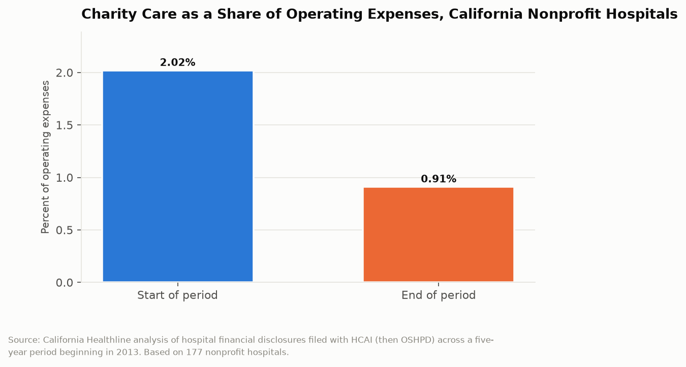

# California Counts: The Vanishing Charity Care
## Nonprofit hospitals cut charity care from 2.02 percent of operating expenses to 0.91 percent, and California sets no minimum

A nonprofit hospital in California pays no federal income tax, no state income tax, and no local property tax on its facilities. The justification for that exemption, in both state and federal law, is that the hospital provides community benefits, of which the most legible is charity care: treating patients who cannot pay and writing off the bill. California hospitals report those figures to the Department of Health Care Access and Information. Over a five-year period beginning in 2013, charity care at California nonprofit hospitals fell from 2.02 percent of operating expenses to 0.91 percent. Neither the state nor the federal government sets a minimum.

---

## The Topline: 2.02 Percent to 0.91 Percent

The decline is measured across 177 California nonprofit hospitals reporting to the state's hospital financial disclosure system.

Two point zero two percent of operating expenses at the start of the period. Zero point nine one percent at the end. A decline of 55 percent in the share, in five years.

The pattern was not confined to nonprofits. For-profit hospitals and public hospitals, including city, county, district, and state facilities, showed the same directional decline over the same period. That uniformity is the strongest evidence for the benign explanation, which is discussed below, because it suggests a common external cause rather than institution-specific behavior.

The analysis covered 177 nonprofit hospitals, 80 for-profit hospitals, and 54 city, county, district, or state hospitals, using data hospitals are required to file with the state. California has mandated hospital financial disclosure for decades, which is why this measurement is possible here and is difficult in most states.

---

## The Affordable Care Act Explanation

The dominant explanation for the decline is the Affordable Care Act, and it is largely correct.

Charity care is care delivered to uninsured patients who cannot pay. California expanded Medi-Cal under the ACA beginning in 2014, and the state's uninsured rate fell dramatically over exactly the period the charity care decline covers. Millions of Californians who would previously have arrived at an emergency room uninsured arrived instead with Medi-Cal coverage. The hospital that formerly wrote off that visit as charity care now bills Medi-Cal and receives payment.

That is not a hospital reducing its community commitment. It is the same patient receiving the same care with a different payer, and the accounting moves the expense from the charity care line to the patient revenue line. If charity care had not fallen after a coverage expansion of that magnitude, something would be wrong with the data.

The complication is what happened to the value of the tax exemption during the same period. The exemption did not shrink. A hospital whose charity care obligation was effectively reduced by a public program retained a tax benefit calibrated to the prior level of uncompensated care, and the difference accrued to the hospital's operating margin. Nonprofit hospital systems in California have accumulated substantial reserves over this period, and several operate investment portfolios and real estate holdings of a scale that has drawn attention from local assessors and from the Legislature.

---

## What Community Benefit Includes

Charity care is one component of community benefit, and the broader category is where the accountability question becomes genuinely hard to resolve.

Nonprofit hospitals in California file community benefit plans describing their contributions, and the reportable categories extend well beyond free care. They include the unreimbursed cost of Medi-Cal, meaning the gap between what Medi-Cal pays and what the hospital says the care cost. They include health professions education, research, community health improvement programs, and in-kind donations. A hospital can substantially increase its reported community benefit without treating a single additional uninsured patient.

The Medi-Cal shortfall category is the largest for most California hospitals and the most methodologically contestable, because it depends on the hospital's own cost accounting. A hospital that assigns high costs to Medi-Cal patients reports a larger shortfall and therefore a larger community benefit. The cost allocation methodologies are not standardized across hospitals in a way that permits comparison, and they are not audited for this purpose.

The result is that California has good data on the narrow, verifiable component of community benefit, charity care, and looser data on the large, self-reported components. The narrow component fell 55 percent. The broad component is reported as robust.

| Measure | Figure |
|---|---|
| Charity care, share of operating expenses, start of period | 2.02% |
| Charity care, share of operating expenses, end of period | 0.91% |
| Decline in share | 55% |
| Nonprofit hospitals in the analysis | 177 |
| For-profit hospitals | 80 |
| Public hospitals | 54 |
| State or federal minimum charity care requirement | none |

---

## The Absence of a Floor

The single most consequential fact in this analysis is the one that requires no data at all: neither California nor the federal government sets a minimum charity care level for a hospital to retain its tax exemption.

The federal requirement, established under the ACA, is procedural. A nonprofit hospital must conduct a community health needs assessment every three years, adopt a written financial assistance policy, publicize it, limit charges to financial-assistance-eligible patients, and follow reasonable collection procedures. It must do all of that. It need not spend any particular amount.

California added meaningful requirements of its own through the Hospital Fair Pricing Act, which sets eligibility thresholds for discounted care based on income and limits what hospitals may charge qualifying patients. That is a genuine consumer protection and it constrains pricing rather than mandating volume. A hospital can comply fully and provide very little charity care if few eligible patients apply.

Several states have moved toward minimum spending requirements or have conditioned property tax exemption on demonstrated community benefit. California has not. The exemption remains categorical: a hospital that is organized as a nonprofit and meets the procedural requirements keeps it, at whatever level of charity care it chooses.

---

## The Interpretive Tension

The critical read is that California grants nonprofit hospitals an exemption from income and property tax worth a great deal of money, justified by charity care, and then sets no minimum, publishes the resulting 55 percent decline, and does nothing. The largest reported component of community benefit is a self-calculated Medi-Cal shortfall using unstandardized cost accounting, which means the number the exemption rests on is substantially a hospital's own estimate of its own generosity. Nonprofit systems accumulated reserves and investment portfolios over the same period their charity care share fell by more than half. The state has the disclosure infrastructure to condition the exemption on performance and has chosen a categorical exemption instead.

The generous read is that a falling charity care share after the largest health coverage expansion in American history is exactly what success looks like. The purpose of charity care was never to be large; it was to catch people the insurance system missed, and California cut its uninsured rate more than almost any state. Charity care declining while coverage rose means fewer Californians needed free care, which is the outcome the state spent billions to produce. The decline appeared across nonprofit, for-profit, and public hospitals alike, which is consistent with an external cause and inconsistent with nonprofit hospitals retreating from a commitment. California's Hospital Fair Pricing Act protects patients from ruinous billing more aggressively than most states, and the state's mandatory financial disclosure system is the reason anyone can measure any of this. The data that makes the critique possible exists because California required it.

---

## What the Data Doesn't Show

The central figures in this post cover a five-year period beginning in 2013 and are therefore dated. HCAI continues to collect hospital financial disclosures, and Los Angeles County has published a 2014 through 2023 analysis of hospital financial assistance, but there is no current published statewide series of charity care as a share of operating expenses. The trend after 2017 is not established here, and the absence of a maintained public series for a decade-long question is itself a finding.

Charity care is measured at cost, not charges, which is the correct methodology and which depends on each hospital's cost-to-charge ratio. Those ratios vary and are not independently verified for this purpose.

The data records care written off. It does not record care not delivered. A hospital that discourages uninsured patients at the point of registration, closes a service line in a poor neighborhood, or maintains a financial assistance application process onerous enough to deter applicants reports low charity care and looks efficient. The mechanism producing a low number is invisible in the number.

Finally, nothing in the disclosure data quantifies the value of the tax exemption itself. Comparing what a hospital forgoes in tax against what it provides in charity care would require property tax assessments, income tax liability estimates, and a standardized community benefit measure. California publishes the hospital side of that comparison and not the public side.

---

Two cents on the dollar, then one cent, in exchange for an exemption from income tax and property tax that nobody has priced. California collects the data that shows the decline, publishes the rules that require the reporting, and has never written down what level of charity care a tax-exempt hospital owes the community whose taxes it does not pay.

---

*Data sources: [California Department of Health Care Access and Information hospital financial disclosure](https://hcai.ca.gov/); [California Healthline, Charity Care Spending By Hospitals Plunges](https://californiahealthline.org/multimedia/charity-care-spending-by-hospitals-plunges/); [KFF Health News, Charity Care Spending By Hospitals Plunges](https://kffhealthnews.org/news/charity-care-spending-by-hospitals-plunges/); [Los Angeles County Department of Public Health, 2014-2023 Landscape of Hospital Financial Assistance in Los Angeles County](http://ph.lacounty.gov/hccp/docs/FALandscapeReport2025.pdf); [Health Affairs, In California, Not-For-Profit Hospitals Spent More Operating Expenses On Charity Care Than For-Profit Hospitals](https://www.healthaffairs.org/doi/10.1377/hlthaff.2014.1208); [Legislative Analyst's Office, The 2024-25 Budget: Department of Health Care Access and Information](https://lao.ca.gov/Publications/Report/4860). Charity care figures cover a five-year period beginning in 2013 as reported by California Healthline from HCAI filings.*

*This is installment #174 of California Counts, a data journalism series examining California state programs, spending, and policy through publicly available data. All data and analysis available on request.*

*Disclosure: This post was drafted with the assistance of an AI agent (Claude) and has not been independently verified by a human editor.*
