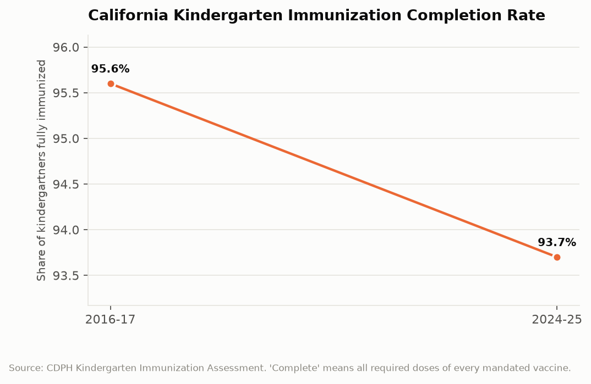
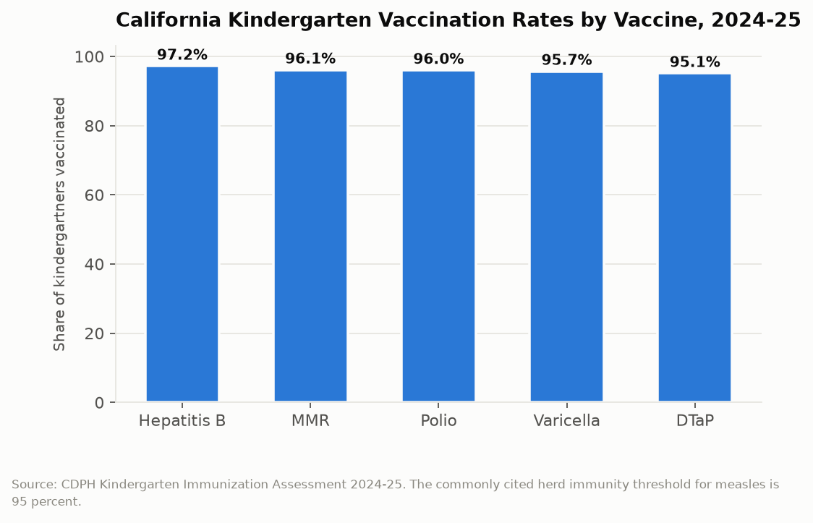

# California Counts: The Herd Threshold
## California's kindergarten measles vaccination rate is 96.1 percent statewide, and fifteen counties are below the line where measles stops spreading

Measles requires roughly 95 percent of a population to be immune before transmission chains reliably break. It is the most contagious pathogen in routine circulation, with a basic reproduction number high enough that it will find the unvaccinated child in a room of a hundred. California's statewide kindergarten MMR vaccination rate is 96.1 percent, comfortably above the line and well above the national average of 92.5 percent. Fifteen of California's 58 counties are below 95 percent, and twelve counties have overall immunization completion rates below 90 percent. A statewide average above threshold is not the same thing as a state above threshold.

---

## The Topline: 95.6 Percent to 93.7 Percent

The state's overall immunization completion rate, meaning a kindergartner who has received every required dose of every mandated vaccine, has been drifting downward for nearly a decade.

Ninety-five point six percent in 2016-17. Ninety-three point seven percent in 2024-25. A 1.9 point decline over eight years.

That is a small number that took a specific kind of effort to produce. The 2016-17 figure was the first full year under Senate Bill 277, which eliminated the personal belief exemption from California's school immunization requirements. California is one of only five states, alongside Connecticut, New York, Maine, and West Virginia, that permits no non-medical exemption. Medical exemptions now account for about 0.1 percent of kindergartners, which is roughly the rate that genuine medical contraindication would predict.

So the decline is not an exemption story. California closed the exemption channel and the completion rate still fell nearly two points. Whatever is driving it operates through a different mechanism.

---

## What 93.7 Percent Is Made Of

The individual vaccine rates explain why the composite number is lower than any of its components.

Hepatitis B at 97.2 percent. MMR at 96.1 percent. Polio at 96.0 percent. Varicella at 95.7 percent. DTaP at 95.1 percent.

Every individual vaccine clears 95 percent. The composite completion rate is 93.7 percent, which is below all of them, and the arithmetic reason is that a child missing any single required dose of any single vaccine is counted as incomplete. A child fully vaccinated against measles, polio, hepatitis B, and chickenpox who is one DTaP dose short is not complete.

That distinction matters for interpreting the trend. A falling composite rate in a system where every component rate exceeds 95 percent is consistent with a series of small, scattered gaps rather than a coherent refusal. A child whose family moved twice, whose records did not follow, and who is missing the fifth DTaP dose produces the same data point as a child whose parents object to vaccination. The composite measures both and distinguishes neither.

DTaP being the lowest at 95.1 percent is consistent with the record-keeping explanation, because DTaP requires five doses on a schedule extending to age four to six, which is the most complex series and the most vulnerable to a missed appointment or a lost record.

---

## The Geography Is the Risk

The statewide average is reassuring and close to irrelevant to how an outbreak actually works, because measles does not spread through a state. It spreads through a classroom, a church, a grocery store, and a pediatric waiting room.

Twelve of California's 58 counties reported overall immunization rates below 90 percent in 2024-25. Fifteen counties reported MMR rates below 95 percent. That means roughly a quarter of California counties are below the measles threshold for the specific vaccine that matters most for the specific disease most likely to arrive.

And county rates are themselves averages over schools. A county at 94 percent MMR contains individual schools well below that, and the school is the epidemiologically relevant unit. California publishes school-level immunization data, which means anyone can identify the specific schools where an introduced measles case would find a susceptible population. Those schools cluster, for reasons that have been studied and that include both vaccine hesitancy concentrated in particular communities and access problems concentrated in others. Those two causes look identical in the data and require opposite interventions.

| Vaccine or measure | Rate, 2024-25 |
|---|---|
| Hepatitis B | 97.2% |
| MMR | 96.1% |
| Polio | 96.0% |
| Varicella | 95.7% |
| DTaP | 95.1% |
| All required doses complete | 93.7% |
| National MMR average | 92.5% |
| Counties below 90% overall | 12 of 58 |
| Counties below 95% MMR | 15 of 58 |

---

## Why California Looks Good by Comparison

The national kindergarten MMR rate fell to 92.5 percent in 2024-25, and the gap between that figure and California's 96.1 percent is the clearest available evidence about whether eliminating non-medical exemptions works.

California's rate is 3.6 points above the national average, at a moment when national rates are declining faster than California's. The four other states without non-medical exemptions show a similar pattern. That is not a controlled experiment, and states that pass such laws differ from states that do not in ways that affect vaccination independently. But the direction is consistent, the effect size is meaningful, and California's experience is the largest natural test available: a state of 39 million people closed the exemption channel in 2016 and now sits well above the national trend line.

The counterargument that was made at the time, that eliminating exemptions would drive families into homeschooling and independent study rather than into compliance, is partially testable in the data and partially not. Independent study enrollment did rise, and some portion of that rise involves families avoiding requirements. Those children do not appear in kindergarten immunization statistics, which means California's reported rate is measured over a school population that the policy itself may have altered.

---

## The Interpretive Tension

The critical read is that California's completion rate has declined every year since the exemption law took effect, which means the strongest available policy tool has not arrested the drift. Twelve counties below 90 percent and fifteen below the measles threshold is not a statewide average problem, it is a set of identified geographic vulnerabilities that the state has mapped and not closed. The school-level data has been public for years, the specific schools are known, and the state's response has been reporting rather than targeted intervention. A measles introduction into one of those schools is not an unforeseeable event; it is a scheduled one whose date is unknown.

The generous read is that California has among the highest kindergarten vaccination rates in the country, 3.6 points above a national average that is falling faster, achieved by passing and defending the most restrictive school immunization law in the nation against sustained organized opposition. Every individual vaccine rate exceeds the 95 percent threshold. Medical exemptions are at 0.1 percent, meaning the exemption channel is genuinely closed rather than nominally closed. A 1.9 point decline over eight years, during a period that included a pandemic that disrupted every pediatric primary care relationship in the state and a global collapse in vaccine confidence, is a remarkably shallow slope. Much of the residual gap is missing paperwork and missed appointments rather than refusal, which is an administrative problem with administrative solutions.

---

## What the Data Doesn't Show

The assessment counts kindergartners enrolled in reporting schools. It does not count children in independent study, in home schooling, or not enrolled, which is precisely the population most likely to be unvaccinated and the population that a mandatory vaccination law might have pushed out of the count. The reported rate is calculated over a denominator the policy influenced.

The data records dose completion, not immunity. A child recorded as having received MMR is presumed immune, which is correct for roughly 97 percent of recipients after two doses, and the remaining primary vaccine failures are invisible in an administrative dataset.

Most importantly, the file cannot distinguish hesitancy from access. A school at 85 percent might serve a community with organized vaccine refusal or a community where the nearest pediatrician is forty minutes away and takes no new Medi-Cal patients. The intervention for the first is trust-building and clinician communication; for the second it is a mobile clinic. CDPH's published data supports neither diagnosis, which means the state can identify where the risk is and not why.

---

Ninety-six point one percent statewide, which clears the threshold, and fifteen counties that do not. Measles has no interest in the state average. It looks for a room with a susceptible child in it, and California publishes a list of exactly which rooms those are, updated annually, school by school, for anyone who cares to read it.

---

*Data sources: [CDPH Kindergarten Immunization Assessment, 2024-25](https://www.cdph.ca.gov/Programs/CID/DCDC/CDPH%20Document%20Library/Immunization/2024-25KindergartenSummaryReport.pdf); [CDPH 2023-24 Kindergarten Report](https://cdph.ca.gov/Programs/CID/DCDC/CDPH%20Document%20Library/Immunization/2023-2024KindergartenReport.pdf); [CDPH news release on kindergarten immunization rates](https://www.cdph.ca.gov/Programs/OPA/Pages/NR25-006.aspx); [Public Policy Institute of California, School Vaccination Rates Vary across California](https://www.ppic.org/blog/school-vaccination-rates-vary-across-california/); [KFF, Kindergarten Routine Vaccination Rates Continue to Decline](https://www.kff.org/medicaid/kindergarten-routine-vaccination-rates-continue-to-decline/); [EdSource on California school vaccine rules](https://edsource.org/2026/california-maintains-school-vaccine-rules-despite-trump-order/764500). Rates are as published by CDPH.*

*This is installment #171 of California Counts, a data journalism series examining California state programs, spending, and policy through publicly available data. All data and analysis available on request.*

*Disclosure: This post was drafted with the assistance of an AI agent (Claude) and has not been independently verified by a human editor.*
