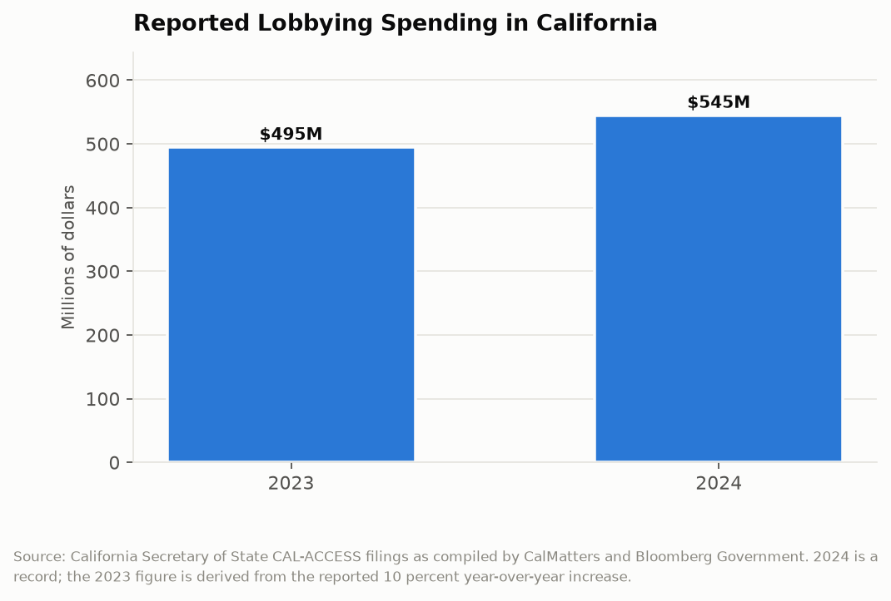
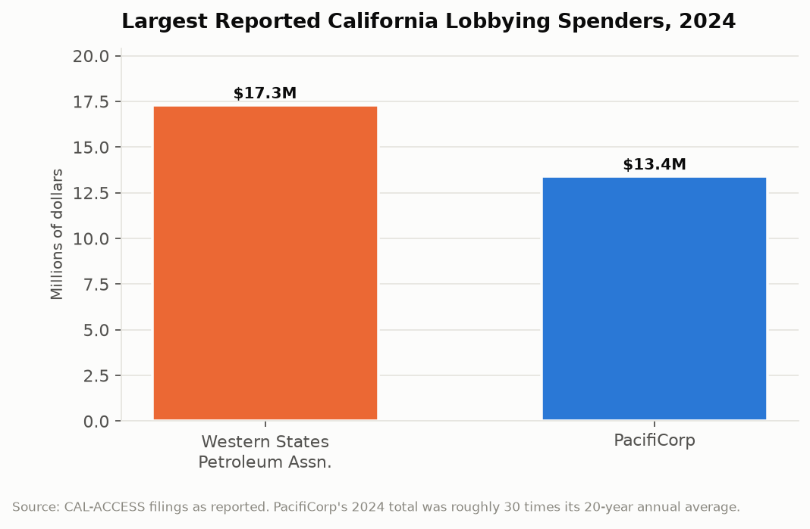

# California Counts: The Half-Billion Dollar Ask
## Interests spent $545 million lobbying California government in one year, which is roughly $4.5 million per legislator

California has 120 legislators, one governor, and a few dozen agency heads with meaningful regulatory authority. In 2024, companies, trade associations, unions, and advocacy groups reported spending $545 million trying to influence them. That is a record, roughly ten percent above the prior year, and it works out to about $4.5 million per legislative seat. Every dollar of it is disclosed, itemized quarterly, and published in a public database that almost nobody reads.

---

## The Topline: $545 Million, Up 10 Percent

Reported lobbying spending under California's Political Reform Act has been setting records for several consecutive years.

Five hundred forty-five million dollars in 2024, roughly ten percent above 2023. The single busiest quarter on record was the summer of 2024, when $168 million was reported in the three months when the Legislature takes up its most consequential bills before the end-of-session deadline.

That quarterly concentration is the structural insight. Lobbying spending in California is not evenly distributed across the year, because the Legislature's calendar creates a compressed window in which hundreds of bills move in days. The last two weeks of session produce a volume of amendments, gut-and-amends, and floor votes that no member can individually evaluate, and that is precisely when the spending peaks. The money follows the moment when information asymmetry is greatest.

For comparison, the Legislature's own operating budget is a few hundred million dollars. California's interests spend more money explaining bills to the Legislature than the Legislature spends analyzing them.

---

## Who Spends the Most

The identity of the top spenders maps onto the state's most contested regulatory fights with almost no ambiguity.

The Western States Petroleum Association reported more than $17.3 million in 2024, including more than $10 million in the summer quarter alone. The largest non-oil spender was PacifiCorp at more than $13.4 million, which was approximately thirty times its own annual average over the preceding two decades.

That PacifiCorp multiple is the more revealing figure. A utility that spent roughly $450,000 a year lobbying California for twenty years spent $13.4 million in one year. Nothing about the company's underlying interest in California changed by a factor of thirty. What changed was that something specific was on the table, and the spending pattern is the clearest available public indicator of when a company believes a single legislative outcome is worth more than its entire prior two decades of advocacy.

Energy interests led overall, followed by technology and health care. Those three sectors are where California's regulatory authority bites hardest and where the state's rules function as de facto national standards, which raises the stakes for any company whose product is sold nationally. A California vehicle emissions rule, privacy statute, or drug pricing provision becomes the operating constraint for the whole country. That makes California lobbying a national expenditure booked to a state disclosure system.

---

## What the Disclosure Actually Captures

California's lobbying disclosure regime is among the most detailed in the country, and understanding its boundaries is necessary to read the $545 million correctly.

Registered lobbyists and their employers must file quarterly reports itemizing payments, identifying the legislative and administrative actions they sought to influence, and naming the agencies contacted. The filings go into CAL-ACCESS, the Secretary of State's public database, and are available for download. The Fair Political Practices Commission enforces the requirements.

What that captures is direct lobbying: paid advocates communicating with officials about identified governmental decisions. What it does not capture is most of the influence apparatus. Issue advertising aimed at the public does not appear. Funding for research institutes and academic centers that produce favorable analysis does not appear. Trade association dues that fund advocacy are reported by the association, not by the member companies, which means a coalition's spending shows up once under the coalition's name rather than attributed to the firms behind it. Grassroots mobilization campaigns fall largely outside the definition. Campaign contributions are disclosed separately and are not in this total.

So $545 million is a floor on the money spent influencing California policy, and the ratio between the reported floor and the actual total is unknown. The reported figure is also, by construction, the most visible and therefore the most constrained part of the spend, since it is the part subject to itemization and audit.

| Measure | Figure |
|---|---|
| Total reported lobbying spending, 2024 | $545 million |
| Change from 2023 | ~+10% |
| Record quarter, summer 2024 | $168 million |
| Largest single spender (WSPA) | $17.3 million |
| Largest non-oil spender (PacifiCorp) | $13.4 million |
| Per legislative seat | ~$4.5 million |
| Legislators | 120 |

---

## The Asymmetry Nobody Reports

The number that would make this analysis complete is not published anywhere, and its absence is the most important thing about the lobbying data.

California discloses what interests spend to influence legislation. It does not disclose, in any comparable form, what is spent on the other side of the information exchange. Legislative committees have staff. The Legislative Analyst's Office produces independent fiscal analysis. Individual members have consultants. But there is no published figure for total analytic capacity available to the Legislature, and therefore no way to compute the ratio that actually matters: dollars spent persuading legislators versus dollars spent helping them evaluate the persuasion.

The available proxies are not reassuring. Committee consultant positions have not grown proportionally with the volume or technical complexity of legislation. Bills on artificial intelligence, battery chemistry, water rights adjudication, and health plan actuarial practice arrive in committees whose staff cover dozens of subject areas each. In that environment, a lobbyist's briefing memo is not merely advocacy. It is frequently the most detailed document in the room.

That is not a claim about corruption. It is a claim about capacity, and it describes a state where the most technically informed party to a policy decision is routinely the party with a financial stake in the outcome.

---

## The Interpretive Tension

The critical read is that $545 million a year buys something, and the timing data shows what: influence concentrated in the exact weeks when legislative scrutiny is thinnest. A single utility increasing its advocacy spending thirtyfold in one year is a company that has calculated the return on a specific outcome, and the return calculation implies the outcome was purchasable in some sense. Energy interests leading the field in a state whose signature policy commitment is decarbonization is not a coincidence. And the disclosure regime, for all its detail, itemizes only the most visible channel while leaving issue advertising, funded research, and coalition structures largely outside the count, which means the public sees the part of the influence economy that its participants were willing to have seen.

The generous read is that lobbying is constitutionally protected petitioning, that a state regulating a $4 trillion economy across energy, technology, health care, housing, water, and labor generates thousands of technical decisions a year, and that the parties affected by those decisions have both a right and an obligation to explain the consequences to decision-makers who cannot possibly be expert in all of it. Half a billion dollars against a $322 billion state budget is roughly one sixth of one percent, which is a modest information cost for an enterprise that size. California requires quarterly itemized disclosure, names the specific bills and agencies targeted, publishes it in a searchable public database, and enforces it through an independent commission, which is more transparency than the federal government provides and vastly more than most states. The record totals are knowable precisely because the system works.

---

## What the Data Doesn't Show

CAL-ACCESS records payments and identified subjects of advocacy. It does not record outcomes. There is no field connecting a lobbying expenditure to a vote, an amendment, or a regulatory decision, which means the database cannot support any claim about effectiveness. The correlation between spending and results, in either direction, is unmeasurable from the public files.

The database's technical condition is itself a transparency problem. CAL-ACCESS is a legacy system, and researchers have documented persistent difficulties in extracting reliable bulk data from it. The compiled totals in this post come from journalists and analysts who did that extraction work, not from a state-published summary. California does not produce an annual official report of total lobbying expenditures in accessible form; the headline number exists because CalMatters and Bloomberg Government built it.

Coalition structures obscure attribution by design. A company can fund a trade association, which funds a coalition, which registers a lobbyist, and the money appears once, under a name that reveals nothing about its origin. The filings are accurate and the attribution chain is legally complete and practically opaque.

---

Five hundred forty-five million dollars, itemized quarterly, filed on time, published free, and spent most heavily in the two weeks of the year when the fewest people are watching. The disclosure system does exactly what it was designed to do. What California has never built is the other half of the system, the one that would tell a legislator, at the moment a bill is amended at midnight, who is not in the room.

---

*Data sources: [California Secretary of State Campaign and Lobbying disclosure (CAL-ACCESS)](https://www.sos.ca.gov/campaign-lobbying); [CalMatters, Lobbying California officials topped half a billion dollars in 2024](https://calmatters.org/data/2025/04/california-lobbying-spending-2024/); [CalMatters, Lobbying activity this past summer cost a record-breaking $168 million](https://calmatters.org/politics/2024/11/california-lobbying-google-big-oil/); [Bloomberg Government, Energy and Tech Led Lobbying Spending of $545 Million in California](https://news.bgov.com/bloomberg-government-news/energy-tech-led-lobbying-spending-of-545-million-in-california); [California Fair Political Practices Commission](https://www.fppc.ca.gov/). The 2023 comparison figure is derived from the reported year-over-year increase; per-seat figures are arithmetic.*

*This is installment #169 of California Counts, a data journalism series examining California state programs, spending, and policy through publicly available data. All data and analysis available on request.*

*Disclosure: This post was drafted with the assistance of an AI agent (Claude) and has not been independently verified by a human editor.*
