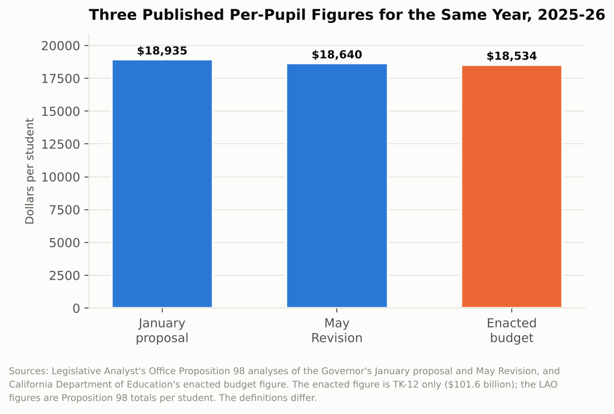
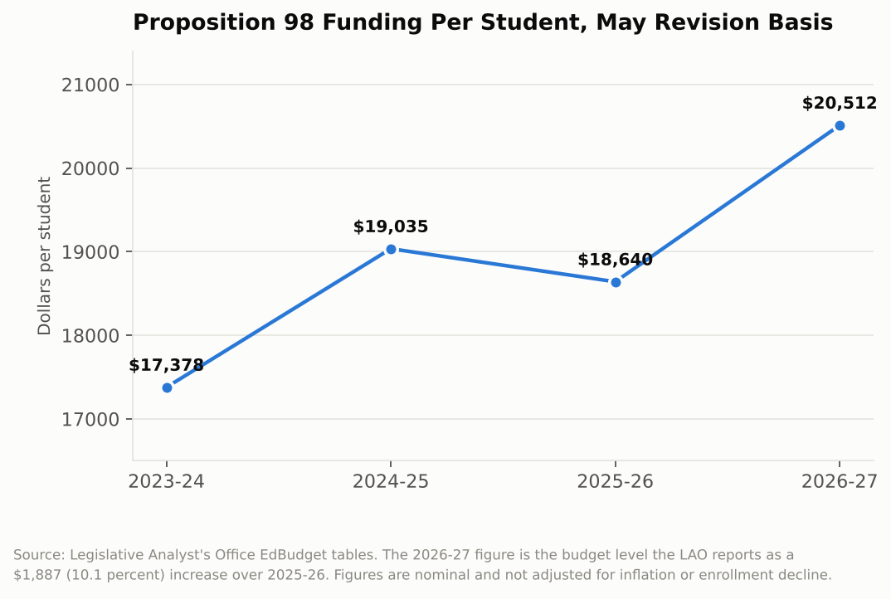

# California Counts: The Per-Pupil Dollar
## California published three different per-pupil funding figures for the same school year, and all three are correct

Proposition 98, passed by voters in 1988, sets a constitutional minimum for what California must spend on K-14 education each year. It is the largest single commitment in the state budget and the formula that determines it is understood in detail by perhaps a few dozen people. The most common way the public encounters it is a per-pupil dollar figure. For the 2025-26 year, the Legislative Analyst's Office put that figure at $18,935 in January, $18,640 in May, and the Department of Education reported $18,534 when the budget was enacted.

---

## The Topline: One Year, Three Numbers

The three figures come from three official sources at three moments in a single budget cycle.

Eighteen thousand nine hundred thirty-five dollars per student in the Governor's January proposal, as analyzed by the LAO. Eighteen thousand six hundred forty at the May Revision. Eighteen thousand five hundred thirty-four in the enacted budget, as reported by the California Department of Education.

The spread is $401, about 2.1 percent. By the standards of government budget revision that is small, and the chart above deliberately uses a zero baseline so the proportions are honest: these numbers are close together.

They are also not the same measure. The LAO figures are total Proposition 98 funding per student, which covers community colleges as well as K-12. The CDE figure is TK-12 only, $101.6 billion, against a total Proposition 98 TK-14 figure of $114.6 billion. So a reader comparing the January number to the enacted number is comparing a broader measure to a narrower one and attributing the difference to a budget cut that did not happen.

That is the finding. The per-pupil dollar is the most quoted statistic in California education finance and there is no single authoritative version of it, because the denominators and the scope differ by publisher and nobody is obliged to reconcile them.

---

## Why the Guarantee Moves

Proposition 98 is not an appropriation. It is a formula with three alternative tests, and which test applies in a given year depends on how the economy performed.

The guarantee is driven primarily by General Fund revenue and by per-capita personal income growth. When revenue rises, the guarantee rises with it, automatically. When revenue forecasts are revised between January and May, which they always are because April tax receipts arrive in between, the guarantee is recalculated. The January figure is built on a November revenue forecast. The May figure is built on actual April receipts. They differ because the forecast was wrong, which forecasts are.

California's revenue is unusually volatile, a fact this series has examined under the concentration of income tax receipts among high earners. That volatility passes directly into the education guarantee. A year in which capital gains realizations come in below forecast produces a smaller guarantee, and districts that budgeted against the January figure have to close a gap they did not create.

The state manages this with a Proposition 98 reserve and with deferrals, which move a payment from one fiscal year into the next without reducing the nominal amount. Deferrals are a cash management device that leaves the guarantee intact and leaves districts borrowing to make payroll.

---

## The Trend Underneath

Pulling back from a single year, the per-pupil series on a consistent basis shows growth that is substantial in nominal terms.

Seventeen thousand three hundred seventy-eight dollars in 2023-24. Nineteen thousand thirty-five in 2024-25. Eighteen thousand six hundred forty in 2025-26. And a 2026-27 level the LAO reports as $20,512, an increase of $1,887 or 10.1 percent over the prior year.

Two observations follow. The first is that the series is not monotonic: 2025-26 is below 2024-25 on this basis, which is the revenue volatility arriving as a year-over-year decline in the middle of a growth trend.

The second is that these are nominal dollars, unadjusted for inflation and unadjusted for enrollment. Both adjustments matter and they pull in opposite directions. Inflation over this period was substantial, so real per-pupil growth is considerably smaller than the nominal figures suggest. Enrollment, meanwhile, is falling, for reasons examined in this series under the state's fertility decline, and a falling denominator raises per-pupil funding mechanically without a single additional dollar reaching a classroom.

That second point deserves emphasis because it will dominate the next decade of California school finance. A district losing students gains per-pupil funding and loses total funding, since the money follows attendance. The per-pupil figure will look increasingly healthy while district budgets get harder.

| Figure | Amount | Basis |
|---|---|---|
| 2025-26, Governor's January proposal | $18,935 | Prop 98 total per student |
| 2025-26, May Revision | $18,640 | Prop 98 total per student |
| 2025-26, enacted | $18,534 | TK-12 only |
| 2026-27 budget level | $20,512 | Prop 98 total per student |
| TK-12 funding, 2025-26 enacted | $101.6 billion | |
| TK-14 Proposition 98 total, 2025-26 | $114.6 billion | |

---

## What the Average Conceals

A statewide per-pupil average describes no actual district, because California stopped funding districts uniformly in 2013.

The Local Control Funding Formula replaced a tangle of categorical programs with a base grant per student, a supplemental grant for English learners, low-income students, and foster youth, and a concentration grant for districts where those students exceed 55 percent of enrollment. The design is explicitly redistributive: a high-need district receives materially more per student than a low-need one, and that is the policy working as intended.

So the $18,534 is an average across districts receiving quite different amounts, and the variation is the point of the formula rather than a defect in it. A reader who takes the statewide figure as what their district receives will be wrong in a direction that depends on their district's demographics.

LCFF also pairs the funding flexibility with an accountability mechanism, the Local Control and Accountability Plan, through which districts are supposed to show how supplemental and concentration dollars improved outcomes for the students who generated them. Whether that mechanism works has been contested since the formula was adopted, and it is the open question that the per-pupil figure cannot address at all.

---

## The Interpretive Tension

The critical read is that California's largest budget commitment is reported through a statistic with no agreed definition, published in at least three versions per year by three official sources using different scopes, in nominal dollars, against a falling enrollment denominator that inflates it. The result is a number that rises reliably in press releases while district budgets tighten, and a public that cannot easily tell whether school funding went up or down in any given year. The guarantee's volatility is imported directly from a revenue system the state has chosen not to stabilize, and the adjustment lands on districts through deferrals that make them borrow.

The generous read is that Proposition 98 has done what it was built to do, which is prevent the Legislature from balancing budgets on schools. The guarantee is a constitutional floor that has held through multiple recessions, and per-pupil funding has grown substantially in nominal terms over the past decade, from a position where California ranked near the bottom of states on this measure. The three figures differ because the state publishes its budget at three stages and revises against real revenue data rather than sticking to a forecast everyone knows is stale, which is honest forecasting rather than confusion. The LAO publishes the EdBudget tables that make every one of these numbers traceable to its basis, which is why this analysis is possible at all, and LCFF directs more money to higher-need students than almost any other state formula.

---

## What the Data Doesn't Show

The per-pupil figures in this post are nominal. The state does not publish a standard inflation-adjusted per-pupil series, which means the most important question about school funding trends, whether purchasing power rose, requires every analyst to pick a deflator and produce a different answer.

The denominator is average daily attendance, not enrollment, which means chronic absence mechanically reduces a district's funding. This series examined a statewide chronic absence rate of 20.4 percent. The interaction between that rate and the funding formula is direct, substantial, and not reported alongside either figure.

None of these numbers describe what reaches a classroom. Proposition 98 funding covers pensions, facilities debt service in some configurations, special education, transportation, and district administration. The share arriving as instruction is a separate calculation the state does not publish in a comparable per-pupil form, and rising pension contribution rates have absorbed a meaningful part of the nominal growth shown in the chart above.

And the figures say nothing about results. California publishes funding and publishes outcomes and does not publish anything linking the two at a level that would let anyone evaluate whether the additional $1,887 per student in 2026-27 is expected to do anything in particular.

---

Three official figures for one school year, each correct on its own basis, none of them reconciled to the others, describing the largest commitment in California's budget. The state publishes enough detail to work out why they differ, which is more than most states offer. What it does not publish is a single number a parent could use to answer whether their child's school got more money this year than last.

---

*Data sources: [Legislative Analyst's Office, The 2025-26 Budget: Proposition 98 Guarantee and K-12 Spending Plan](https://lao.ca.gov/Publications/Report/4963); [LAO, The 2025-26 California Spending Plan: Proposition 98 and K-12 Education](https://lao.ca.gov/Publications/Report/5087); [LAO, The 2026-27 Budget: Proposition 98 Guarantee and K-12 Spending Plan](https://lao.ca.gov/Publications/Report/5110); [LAO EdBudget, Proposition 98 Funding Per Student Under May Revision](https://www.lao.ca.gov/Education/EdBudget/Details/963); [California Department of Education, Budget Act for 2025-26](https://www.cde.ca.gov/fg/fr/eb/ba2025-26.asp); [LAO 2025-26 Changes in Proposition 98 Spending](https://lao.ca.gov/Education/EdBudget/Details/1007). Figures are nominal and are reported on the bases noted; the LAO and CDE figures are not directly comparable.*

*This is installment #181 of California Counts, a data journalism series examining California state programs, spending, and policy through publicly available data. All data and analysis available on request.*

*Disclosure: This post was drafted with the assistance of an AI agent (Claude) and has not been independently verified by a human editor.*
