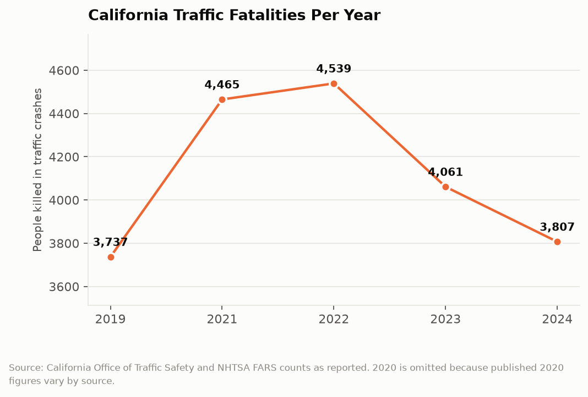
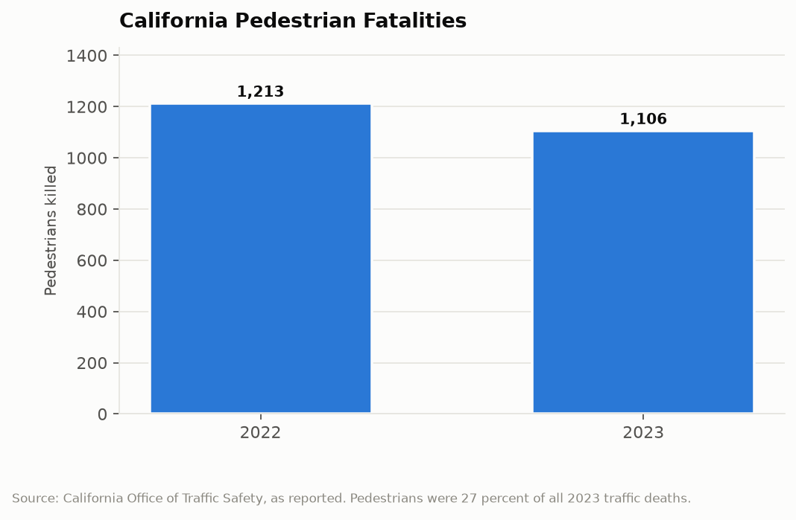

# California Counts: The Road Toll
## Traffic deaths rose 21 percent between 2019 and 2022, have fallen for two straight years, and are still killing more Californians than homicide

In 2019, 3,737 people died in traffic crashes on California roads. In 2022, 4,539 did. The increase happened during a period when Californians drove less, not more, which is the detail that makes the number a policy problem rather than a consequence of traffic volume. Deaths have declined since, to 4,061 in 2023 and 3,807 in 2024, the lowest total since 2019. California spent five years getting back to where it started.

---

## The Topline: 3,737 to 4,539 and Back

The annual fatality series is the state's most reliable and least discussed safety indicator.

Three thousand seven hundred thirty-seven deaths in 2019. Four thousand four hundred sixty-five in 2021. Four thousand five hundred thirty-nine in 2022, the highest total since 2007. Four thousand sixty-one in 2023, an 11 percent decline. Three thousand eight hundred seven in 2024, down another 6.3 percent.

Read as a whole, that is a 21 percent increase over three years followed by a 16 percent decrease over two, landing roughly two percent above the 2019 baseline. Five years of movement for a net change of about 70 deaths.

For scale, 3,807 traffic deaths in 2024 exceeded California's homicide total for the year. It is more than the number of Californians who die annually from breast cancer. It is roughly ten people per day, every day, in a state that funds a Vision Zero policy framework whose stated target is zero.

The 2020 figure is omitted from the chart because published 2020 counts vary meaningfully by source and reporting vintage, and the year is genuinely anomalous: vehicle miles traveled collapsed while the fatality rate per mile spiked. Including a contested figure in a five-point series would obscure rather than clarify the trend.

---

## The Rate Is the Real Finding

The headline count is deaths. The number that identifies what changed is deaths per mile driven, and it moved in the opposite direction from what the count alone suggests.

Californians drove dramatically less in 2020 and 2021. Commute traffic disappeared, then returned partially. Total vehicle miles traveled fell well below 2019 levels. Over that same period traffic deaths rose. That combination means the fatality rate per mile driven rose sharply, by more than the death count did.

The mechanism, as identified in the national traffic safety literature, is that emptier roads are faster roads. Congestion is an inadvertent speed governor. When it lifted, average speeds rose, and the relationship between impact speed and survival is not linear. A pedestrian struck at 20 miles per hour usually survives. At 40 miles per hour, usually does not. A modest increase in average speed across a road network produces a disproportionate increase in deaths, and that is essentially what California's 2020 through 2022 data records.

The behavioral changes reinforced it. Seat belt use declined. Impaired driving citations and post-crash toxicology both indicated increased alcohol and drug involvement. Speeding citations for extreme velocities, over 100 miles per hour, rose sharply enough that the California Highway Patrol reported on it specifically. None of those are infrastructure problems. They are the aggregate of several million individual decisions made under conditions where the usual social and physical constraints had loosened.

The decline in 2023 and 2024 is correspondingly hard to attribute. Traffic congestion returned, which restored the speed governor. Enforcement activity recovered from pandemic staffing reductions. Some new vehicle safety technology penetrated the fleet. All three plausibly contributed and the fatality file cannot apportion credit among them.

---

## Who Is Dying

The composition of the deaths is where California's numbers diverge most sharply from a story about car crashes.

In 2022, 1,213 pedestrians were killed. In 2023, 1,106, an 8.8 percent decline that tracked the overall improvement. Pedestrian deaths were roughly 27 percent of all California traffic deaths in 2023.

That share is the finding. Pedestrians are a small fraction of road users and more than a quarter of road deaths. Pedestrian fatalities rose about 10 percent between 2019 and 2022, and they are concentrated in specific conditions that the crash data identifies clearly: arterial roads with high speed limits and no median refuge, nighttime, and locations without adequate lighting. They are concentrated in lower-income neighborhoods, which is where California built its widest and fastest surface streets through residential areas.

This is the part of the problem that is genuinely an infrastructure question rather than a behavior question. A four-lane arterial with a 45 mile per hour limit, unsignalized crossings spaced a quarter mile apart, and a bus stop on the far side is a design that produces pedestrian deaths at a predictable rate. The design is the product of engineering standards written to move vehicles, applied to streets where people walk. Changing it requires capital projects on thousands of miles of local streets, funded by cities, and the state's role is limited to standards, grants, and the highways it owns directly.

| Year | Total traffic deaths | Change | Pedestrian deaths |
|---|---|---|---|
| 2019 | 3,737 | baseline | |
| 2021 | 4,465 | +19.5% vs 2019 | |
| 2022 | 4,539 | +21.5% vs 2019 | 1,213 |
| 2023 | 4,061 | -10.5% vs 2022 | 1,106 |
| 2024 | 3,807 | -16.1% vs 2022 | |

---

## The Data Infrastructure Is Unusually Good

Traffic fatality data is the best-instrumented harm California measures, and it is worth noting why, because it is a model the state has not replicated elsewhere.

Every reportable crash in California generates a Statewide Integrated Traffic Records System entry, filed by the responding law enforcement agency, containing location, time, vehicle types, party roles, violations, injury severity, and collision factors. The records are geocoded. Fatalities are cross-validated against the federal Fatality Analysis Reporting System, which independently codes every fatal crash in the country from police reports, death certificates, and toxicology. Researchers, cities, and advocacy groups use SWITRS routinely to identify high-injury corridors.

That means California has, for this one category of preventable death, a near-complete, geocoded, incident-level public record with a consistent national comparison series. Nothing in the state's public health data, homelessness data, or drinking water data approaches it. When a city wants to know which intersection to redesign, the data answers the question.

The gap is between the data and the redesign.

---

## The Interpretive Tension

The critical read is that California has the best crash data in the country, knows exactly which corridors and intersections kill people, has a stated Vision Zero goal of eliminating traffic deaths, and killed 3,807 people in 2024 while calling it an improvement. The 2019 to 2022 increase happened on the same road network with fewer cars on it, which means the network was already designed to kill at a higher rate whenever speeds rose, and nothing structural was done in the interim. Pedestrians are 27 percent of deaths and concentrated in poor neighborhoods with the widest streets, which is a distributional fact the state has documented for years without changing the engineering standards that produce it. Two years of decline that coincide with the return of traffic congestion is not evidence of a policy working.

The generous read is that California cut traffic fatalities 16 percent in two years, reaching the lowest total since 2019, during a period when the national trend was also improving but California's improvement outpaced many states. The state has funded Active Transportation Program grants for pedestrian and bicycle infrastructure, authorized speed safety camera pilots in six cities over substantial political resistance, lowered speed limits on qualifying corridors, and required safety analysis in local transportation plans. Those interventions have multi-year lags and the 2024 number is consistent with them beginning to appear. California's fatality rate per mile driven remains below the national average despite having the most vehicle miles traveled of any state, which is the fair comparison. And the state publishes the incident-level data that lets anyone, including critics, do this analysis.

---

## What the Data Doesn't Show

SWITRS records what the responding officer coded. Collision factor and party fault are officer determinations made at the scene, and studies have found systematic patterns in how pedestrian-involved crashes are coded. The data reports the officer's judgment, not an adjudicated finding.

Exposure is the missing denominator. The system counts crashes but has no reliable measure of how many people walked, biked, or drove on a given corridor, which means a road with few pedestrian deaths may be safe or may simply be a road nobody dares walk on. Without exposure data, the safest-looking streets and the most hostile streets can produce identical statistics.

Near-misses are invisible. A corridor generating daily close calls and one fatality every five years looks statistically quiet, which means the data systematically under-identifies dangerous designs until they have killed enough people to register. Every high-injury network map in California is built on a body count.

And the fatality file says nothing about cost. California does not publish a consolidated figure for what these deaths cost in emergency response, medical care, lost earnings, and litigation, which is the number that would make the infrastructure investment case in terms a city finance director could act on.

---

Three thousand eight hundred seven people died on California roads in 2024, and the state can tell you which intersection each one died at. The measurement is excellent. The corridors are identified, mapped, and published. Ten people will die today on roads whose danger is already documented in a public database, and the database will record them accurately.

---

*Data sources: [California Office of Traffic Safety, Traffic Safety Quick Stats](https://www.ots.ca.gov/ots-and-traffic-safety/score-card/); [Statewide Integrated Traffic Records System (SWITRS), California Highway Patrol](https://www.chp.ca.gov/); [Federal Highway Administration State Highway Safety Report, California](https://www.fhwa.dot.gov/tpm/reporting/state/safety.cfm?state=California); [TRIP, California traffic fatality analysis](https://tripnet.org/reports/traffic-safety-california-news-release-06-21-2023/); [California Local, California traffic deaths coverage](https://californialocal.com/localnews/statewide/ca/article/show/83433-california-traffic-deaths-2023-2022-crisis-pedestrians/). Annual counts are as reported by OTS and NHTSA FARS; 2020 is omitted because published figures vary by source.*

*This is installment #167 of California Counts, a data journalism series examining California state programs, spending, and policy through publicly available data. All data and analysis available on request.*

*Disclosure: This post was drafted with the assistance of an AI agent (Claude) and has not been independently verified by a human editor.*
